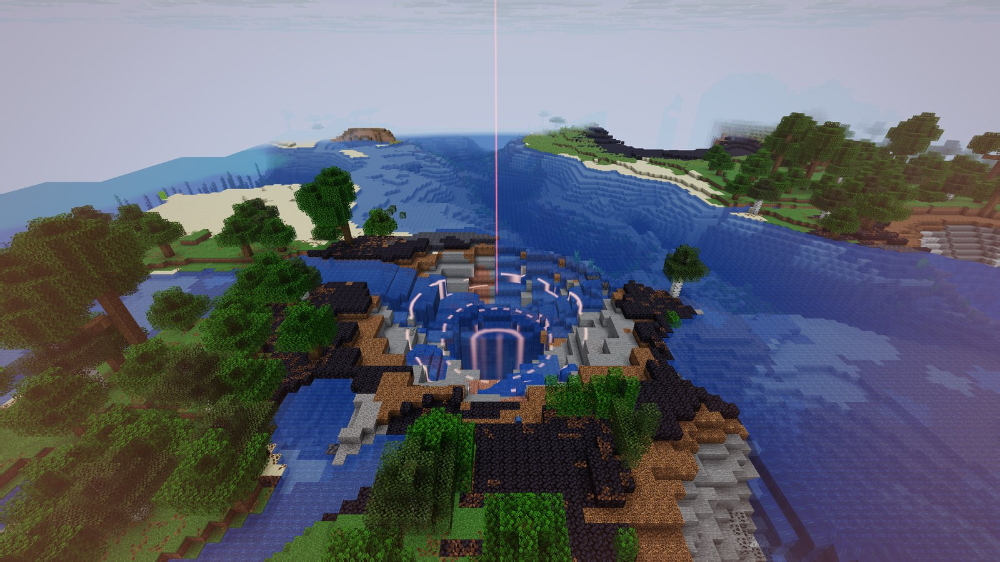
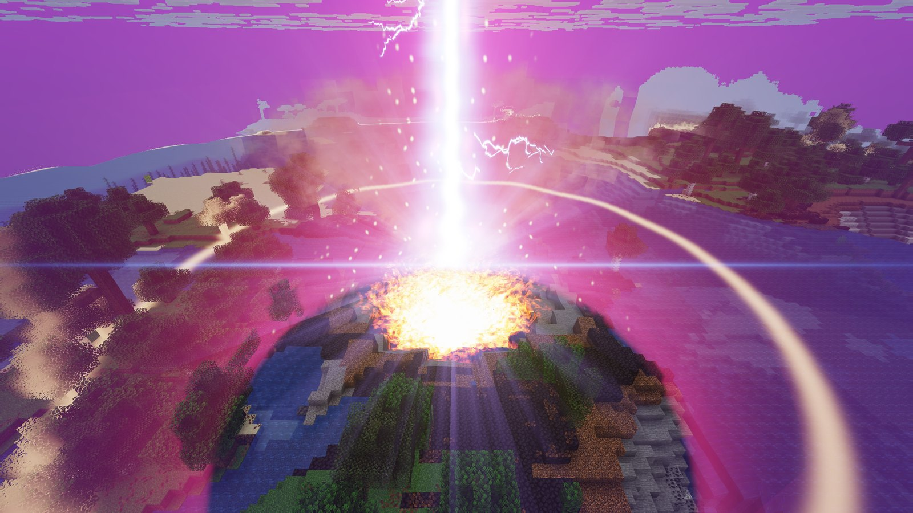
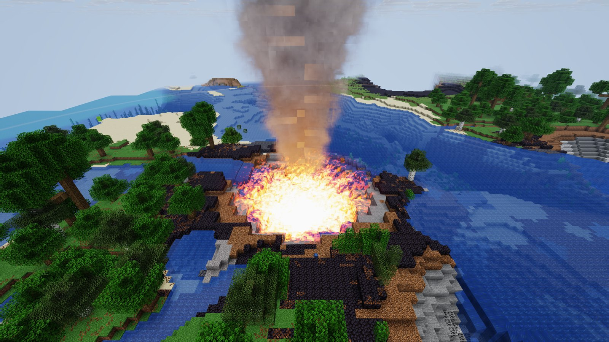

<p align="center">
  <picture>
    <source media="(prefers-color-scheme: dark)" srcset="docs/branding/orbital-laser-logo-dark.svg">
    
  </picture>
</p>

# Orbital Laser

**A terrestrial orbital laser strike for [Horizon](https://github.com/ludovic111/horizon), the Rust rewrite of
Minecraft Java.** Scope in with the Orbital Laser Designator, point at anything up to 200 blocks away, and a beam drops
from orbit: it digs a crater and a shaft down to bedrock, flattens the forest around it and kills everything standing
there. The beam, lightning, shockwaves, crater glow and smoke are one custom shader, and the sounds are synthesized from
scratch.

<p align="center">
  <a href="https://github.com/Stink-O/orbital-laser/releases/latest"><b>Download</b></a>
  &nbsp;·&nbsp;
  <a href="#getting-started"><b>Getting started</b></a>
  &nbsp;·&nbsp;
  <a href="#how-it-works"><b>How it works</b></a>
</p>

<p align="center">
  <a href="https://github.com/Stink-O/orbital-laser/releases/latest"></a>
  <a href="https://github.com/ludovic111/horizon"></a>
  
  
  <a href="LICENSE"></a>
</p>

<p align="center">
  
</p>

> [!WARNING]
> **A strike is destructive and permanent.** It carves a crater about 20 blocks across and a shaft down to bedrock,
> scorches the ground, and kills every mob and dropped item within 40 blocks (players are spared). **Back up your
> world**, and don't aim at anything you care about.

> [!IMPORTANT]
> **You need Horizon**, which needs your own copy of Minecraft Java Edition 26.3. Nothing from Minecraft is in this
> repository or the release download. Horizon's `horizon-ctl` tool (it ships in Horizon's own folder) is how the strike
> talks to the game.

> [!WARNING]
> **Early and experimental.** Developed and tested on one Linux PC (Fedora, NVIDIA), against the Horizon build released
> 2026-10-19. Windows and macOS are untested. The designator is a renamed spyglass, and the strike is run by a script
> outside the game, because Horizon's mod API can't change the world yet (see [How it works](#how-it-works)).

**Contents:** [Features](#features) ·
[New in 0.1.0](#new-in-010) ·
[Getting started](#getting-started) ·
[Set it up with an AI agent](#set-it-up-with-an-ai-agent) ·
[How to play](#how-to-play) ·
[Options](#options) ·
[How it works](#how-it-works) ·
[If something goes wrong](#if-something-goes-wrong) ·
[Known gaps](#known-gaps) ·
[Developing](#developing)

| Charge-up | Every strike rolls a new look | Aftermath |
|---|---|---|
|  |  |  |

## Features

- **A beam from orbit, drawn in the world.** One fragment shader rebuilds every pixel's position from the depth
  buffer, so the beam, reticle, shockwaves and glow are anchored to real blocks and hidden behind hills in front of
  them, not painted on the screen.
- **Forked lightning.** Jagged bolts with branches lash out from the column, re-rolling about ten times a second, with
  a camera shake, chromatic flash and light rays at impact.
- **Real terrain damage.** A rough bowl crater, a shaft that funnels down and then runs straight to bedrock, trees
  stripped from a 24-block radius, and grass turned to blackstone around the rim. Magma and lava sit at the bottom.
- **Everything in the blast dies.** Mobs and dropped items within 40 blocks, except players.
- **Custom sound design.** Eight sounds built from noise, sweeps and a convolution reverb: a turbine charge-up, a latch
  click on lock-on, a layered boom with thunder echoes, a plasma roar, rumble, crackle, rockfall and a spool-down.
- **No two strikes alike.** Each one picks a colour (blue, magenta or green), power surges, beam sway, lightning density
  and extra shockwaves at random.
- **Point and fire.** Look through the spyglass and it fires where your crosshair lands, up to 200 blocks away. It needs
  no block in reach.
- **Quiet.** Nothing it does shows up in chat.

## New in 0.1.0

The first release: the shader pack, the sound pack, the strike driver and the installer.

## Getting started

You need Horizon running and a world with **cheats on** (creative is easiest).

1. **Install.** Download the zip from the [latest release](https://github.com/Stink-O/orbital-laser/releases/latest),
   unzip it, and run (or clone this repo and run the same):

   ```sh
   python3 install.py
   ```

   It copies the shader pack and the sound pack into Horizon's game folder (`~/.local/share/horizon`, or
   `$HORIZON_HOME`). `python3 install.py --link` symlinks them instead, for development.

2. **Turn them on.** With the game **closed**, run `python3 install.py --enable`, which selects the shader pack and
   enables the sound pack. Or do it in the game: **Options → Video Settings → Shader Packs → `orbital-laser-shader` →
   Apply**, then **Options → Resource Packs →** enable `orbital-sounds`.

3. **Start Horizon through its control tool**, from Horizon's folder:

   ```sh
   ./horizon-ctl launch --world MyWorld --creative --wait
   ```

4. **Check everything, then start the designator**, from this folder:

   ```sh
   python3 strike.py --doctor     # says what's missing and how to fix it
   python3 strike.py --daemon
   ```

   If `horizon-ctl` isn't on your `PATH`, pass `--ctl /path/to/horizon-ctl` or set `HORIZON_CTL`. If the game folder isn't
   found, pass `--home PATH` or set `HORIZON_HOME`.

## Set it up with an AI agent

If you use a coding agent (Claude Code, Codex, Cursor and the like), you can paste the message below into it and let it
do the whole setup on your computer, whatever the system. [AGENTS.md](AGENTS.md) has the same guidance for agents that
read the repository themselves.

````text
Set up Orbital Laser on this computer and get a test strike working, end to end:
https://github.com/Stink-O/orbital-laser

It is a shader pack, a sound pack and a Python driver for Horizon, the Rust rewrite of Minecraft Java
(https://github.com/ludovic111/horizon). When it works I can hold a spyglass, look through the scope at
anything up to 200 blocks away, and an orbital laser strikes there.

Before doing anything, read these from the repository: README.md (especially "Getting started", "If
something goes wrong" and "Known gaps") and AGENTS.md.

Facts to rely on:
- Horizon and Minecraft are not included, and you must not download, fake or work around them. I need
  Horizon installed and working, which needs my own copy of Minecraft Java 26.3, and its horizon-ctl tool
  (it is in Horizon's folder). If Horizon isn't installed, stop and tell me how to get it from its
  repository. Don't try to build or patch it yourself.
- This was developed and tested on Linux only. On Windows or macOS expect rough edges. Keep any fix small,
  and tell me exactly what you changed and why.
- It needs Python 3.8 or newer. If it's missing, ask me before installing anything.
- A real strike is destructive and permanent: a crater, a shaft down to bedrock, and every mob and dropped
  item within 40 blocks killed. Use a throwaway creative world, never one of my real worlds, and ask me
  before the first strike that destroys terrain.
- `python3 strike.py --doctor` checks the whole setup, changes nothing and says how to fix each [FAIL]. Run
  it first, and again after every step.
- If the game folder isn't found, pass --home PATH or set HORIZON_HOME (the folder with options.txt and
  saves/; `horizon-ctl launch` prints it as "home"). If horizon-ctl isn't on PATH, pass --ctl PATH or set
  HORIZON_CTL.
- Option values in orbital-laser-shader/pack.toml must stay floats (13.0, not 13), or the pack fails to load.
- Don't edit Horizon's files, my saves or my settings beyond what install.py does.

Steps:
1. Clone the repository (or unzip the latest release) somewhere sensible and work from that folder.
2. Make sure Horizon is closed, then run `python3 install.py --enable`. It copies in the shader pack and the
   sound pack, selects the shader pack and switches the sound pack on.
3. Start a throwaway creative world: `horizon-ctl launch --world OrbitalTest --creative --wait`.
4. Run `python3 strike.py --doctor` until every line is [ok]. If the shader reports an error, run
   tools/check-shader.sh and read its message before changing anything.
5. Test safely first. Aim at the ground a few blocks away (`horizon-ctl look-at X Y Z`), run
   `python3 strike.py --no-terrain --no-sound`, and check it plays without errors or chat spam. Then run it
   once with sound (still --no-terrain). Ask me before running a full strike.
6. Start the designator with `python3 strike.py --daemon` and tell me how to use it: press 9, right-click
   and hold the Orbital Laser Designator spyglass, aim, and keep holding for about a second.

Report each step's result as you go. If a step fails, show me the exact command and message, say what you
think is wrong, and fix it. Don't guess past a failure. If it's silent, check the in-game master volume
and the operating system's volume for the game before touching the sound pack.
````

## How to play

`strike.py --daemon` puts the **Orbital Laser Designator**, a glowing, red-named spyglass, in your last hotbar slot.

1. Press **9** to hold it.
2. **Right-click and hold** to look through the scope, and aim at anything up to 200 blocks away.
3. Keep holding for about a second. The action bar shows `ACQUIRING TARGET…`, then it fires where your crosshair lands.

A strike takes about 25 seconds, so scope in again afterwards for the next one. Stop the daemon with Ctrl-C.

Other ways to fire:

```sh
python3 strike.py                   # once, at the block under the crosshair (normal reach)
python3 strike.py --at 120 64 -300  # once, at a surface block you name
python3 strike.py --no-terrain      # visuals and sound only: nothing gets destroyed
python3 strike.py --no-sound
python3 strike.py --radius 12       # wider shaft mouth
python3 strike.py --depth 30        # stop 30 blocks down instead of at bedrock
```

While the daemon runs it keeps command feedback switched off so nothing appears in chat (your own commands won't print
feedback either), and it switches it back on, as vanilla has it, when you stop it. The one-shot forms print a single
`Game rule … is now set to true` line at the end.

## Options

Under *Shader Pack Settings*, **Intensity** (0.2 to 2) scales every effect, and **Target X / Y / Z** place the strike if
you drive the shader by hand (set `freeze_time` to `-1` to start its clock). The other options (`freeze_time`, `swz`,
`seed`) are written by `strike.py`, which also picks a fresh random `seed` for every strike.

To tune the driver, see the constants at the top of [`strike.py`](strike.py): `RANGE` (200 blocks), `KILL_RADIUS` (40) and
`LOCK_TICKS` (how long you scope before it fires), plus the sound and terrain timeline inside `run_strike`.

## How it works

**The visuals are one shader.** Horizon's `composite` stage hands a shader pack the scene colour, the depth buffer and
the camera matrices. The beam is a vertical cylinder found by the closest approach between a pixel's view ray and the
target axis. The lightning is a set of noise-displaced polylines whose endpoints are 3D points on the beam, projected
through the camera, with forks and terrain occlusion. The crater glow is a cylinder around the axis, lit by depth below the
original surface. The smoke is a billowing plume with its own fixed axis.

| Time | What happens |
|---|---|
| 0 to 4 s | **Charge:** a thin red designator beam, converging reticle rings, the world dims and reddens |
| 4 s | **Impact:** flash, camera shake, the beam slams down from orbit, a shockwave |
| 4 to 13 s | **Burn:** plasma beam with strands and forked lightning, surges, secondary shocks, sparks |
| 13 to 26 s | **Aftermath:** the crater glows and fades, a smoke column rises and disperses |

The shader's clock restarts whenever `pack.toml` is rewritten (about 0.4 s of reload latency, measured), which is how
`strike.py` starts a strike and keeps everything else in sync.

**The strike is driven from outside the game.** A Horizon mod can't edit the world yet (the mod API is read-only plus a
HUD), so the terrain, sounds and kills are done with ordinary vanilla commands sent through `horizon-ctl`: `/fill` builds
the crater, the shaft and the scorched ring, `/kill` clears everything but players, and `/playsound` plays the sounds.

- Hundreds of `/fill` lines go down one long-lived `horizon-ctl script` pipe, and each circle is built from a few grouped
  rectangles (about 340 commands per strike) so the carving keeps pace with the beam. The driver waits for the queue to
  drain before it finishes.
- Commands that fail ("No blocks were filled", "No entity was found") would spam chat even with feedback off. Wrapping
  every command in `execute as @s at @s run …` makes them silent.
- Sounds are played with a minimum volume and a long attenuation distance, so you hear them wherever you stand.

**The designator is a spyglass.** The driver polls the game state, and when you hold the named spyglass and have used it
for about 14 ticks, it ray-marches your look direction through the world (coarse steps, then a fine refine) to find the
surface you're aiming at. Horizon's content-mod API (`registries`, API 0.2) is meant to add real items, but I couldn't get
one to load, so a renamed spyglass does the job.

**The sounds** ([`tools/synth_sounds.py`](tools/synth_sounds.py)) have no samples in them: they are generated from noise
and sweeps, with a reverb built from a synthetic impulse response. Vanilla thunder and explosion samples are layered
underneath the impact for texture.

## If something goes wrong

- **First, run `python3 strike.py --doctor`.** It checks the whole setup and says how to fix each problem.
- **Nothing happens when I scope in.** Is `strike.py --daemon` still running? Are you holding the red-named spyglass
  (spectator mode can't hold items)? If the action bar says `NO TARGET IN RANGE`, you're aiming at the sky, past 200
  blocks, or at unloaded chunks.
- **The shader shows an error in chat.** Run `tools/check-shader.sh` for the real message (see [Developing](#developing)).
- **I can't hear anything.** Check the in-game master volume (Music & Sounds), your OS volume for the game's own audio
  stream, and that the `orbital-sounds` resource pack is enabled. A game stream at 28% under a 28% master volume is about
  8% loudness.
- **The sounds aren't the new ones after I regenerate them.** Reload resources in game (F3 + T).
- **The terrain lags behind the beam.** Use a smaller `--radius`, or a smaller render distance. Each `/fill` costs
  block-update and lighting work.
- **The shaft fills with water, or ends in obsidian.** It hit groundwater, and the lava at the bottom met it.

## Known gaps

- **Linux only so far.** Windows and macOS are untested, and `strike.py` has no Windows path handling yet.
- **The designator is a spyglass** and the strike runs from a script. A real item and an in-game trigger need Horizon's
  content and server mod APIs.
- **Single player.** The shader draws only the local view, and the driver talks to one local game.
- **One strike at a time.** The shader holds a single target, so a second strike has to wait for the first.
- **Terrain damage can't be undone.** Back up the world.
- **Terrain timing is approximate.** The shader and the commands are in step to within about a quarter of a second.
- **Targets must be in loaded chunks** and within 200 blocks.

## Developing

```sh
tools/check-shader.sh                  # validate strike.wgsl against Horizon's prelude, offline, with real errors
python3 tools/synth_sounds.py          # regenerate orbital-sounds/*.ogg
python3 tools/capture.py 6.3 out.png   # a correct-colour screenshot of t = 6.3 s of the strike
python3 tools/make_branding.py         # regenerate the logo files in docs/branding
```

Edit `orbital-laser-shader/shaders/strike.wgsl` while the game runs (install with `--link`) and Horizon hot-reloads it.
See [CONTRIBUTING.md](CONTRIBUTING.md).

Gotchas worth knowing:

- **Building a vector from override constants inside the entry point breaks Horizon's pipeline-constant pass.**
  `let tgt = vec3<f32>(target_x, target_y, target_z);` makes naga fail with `ExpressionAlreadyInScope`, which Horizon
  reports only as "Pipeline constant error … Entry point fs_main is invalid". Assemble the vector in a helper function
  (`target_pos()`) instead. `tools/check-shader.sh` reproduces and names this kind of error.
- **`horizon-ctl screenshot` loses colour.** It writes the 10-bit surface as 8-bit and overwrites the top byte, which
  destroys the blue channel. `tools/capture.py` recovers it with the shader's debug options (`freeze_time` pins the clock,
  `swz` alternates normal and blue-channel frames). Stop `strike.py --daemon` first: both edit `pack.toml`.
- Option values written into `pack.toml` must be floats (`13.0`, not `13`), or the pack fails to load.

## Credits and licence

Orbital Laser is under the MIT License (`LICENSE`). Third-party notes are in `NOTICE`. It is built on
[Horizon](https://github.com/ludovic111/horizon) by Ludovic and contributors, and nothing from Horizon is included.

Minecraft is a trademark and work of Mojang Studios and Microsoft. Orbital Laser is an independent fan project, not made
by or affiliated with Mojang, Microsoft or Horizon's author, and it contains none of their code, textures or sounds. You
need your own copy of Minecraft.
