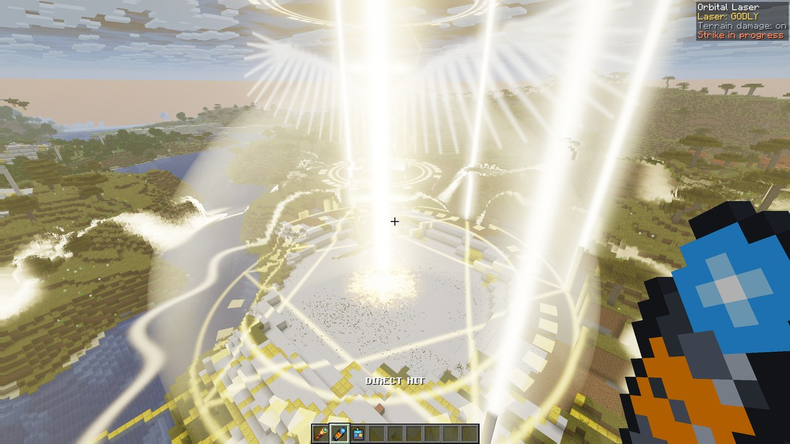

<p align="center">
  <picture>
    <source media="(prefers-color-scheme: dark)" srcset="docs/branding/orbital-laser-logo-dark.svg">
    
  </picture>
</p>

# Orbital Laser

**A terrestrial orbital laser strike, as a mod for [Horizon](https://github.com/ludovic111/horizon), the Rust rewrite of
Minecraft Java.** Hold the Orbital Laser Designator on anything up to 200 blocks away and a beam drops from orbit: it
digs a crater and a shaft down to bedrock, flattens everything around it and leaves the land changed for good. Pick
the laser from a wheel: **Plasma**, a raging beam with forked lightning that fuses the crater into glass, or **Godly**,
where the clouds part, a pillar of light comes down and the crater turns to quartz and gold.

<p align="center">
  <a href="https://github.com/Stink-O/orbital-laser/releases/latest"><b>Download</b></a>
  &nbsp;·&nbsp;
  <a href="#getting-started"><b>Getting started</b></a>
  &nbsp;·&nbsp;
  <a href="#how-it-works"><b>How it works</b></a>
</p>

<p align="center">
  <a href="https://github.com/Stink-O/orbital-laser/releases/latest"></a>
  <a href="https://github.com/Stink-O/horizon/tree/mod-api-input-ui-render-world"></a>
  
  
  <a href="LICENSE"></a>
</p>

<p align="center">
  
</p>

> [!WARNING]
> **A strike is destructive and permanent.** It flattens everything above the ground within about 44 blocks, digs a
> crater about 60 blocks across and a shaft down to bedrock, scorches the land round it, and kills every mob and dropped
> item within 40 blocks (players are spared). **Back up your world**, and don't aim at anything you care about. The
> wheel has a switch that turns terrain damage off.

> [!IMPORTANT]
> **It needs the Orbital Laser build of Horizon.** Horizon's mod API doesn't yet let a mod catch an item's use, open its
> own screen, draw effects or change the world, so this mod comes with a Horizon fork that adds those four (the
> `input`, `ui`, `render` and `world` capabilities from Horizon's own roadmap):
> [Stink-O/horizon, branch `mod-api-input-ui-render-world`](https://github.com/Stink-O/horizon/tree/mod-api-input-ui-render-world),
> with a ready-built Linux download on its [releases](https://github.com/Stink-O/horizon/releases). Stock Horizon can't
> run the mod; [Stock Horizon](#stock-horizon) covers the older setup that works there. You also need your own copy of
> Minecraft Java Edition 26.3: nothing from Minecraft is in this repository or the downloads.

> [!WARNING]
> **Early and experimental.** Developed and tested on one Linux PC (Fedora, NVIDIA). Windows and macOS are untested,
> and the ready-built Horizon is Linux x86-64 only (others can build the fork from source).

**Contents:** [Features](#features) ·
[New in 0.2.0](#new-in-020) ·
[Getting started](#getting-started) ·
[Set it up with an AI agent](#set-it-up-with-an-ai-agent) ·
[How to play](#how-to-play) ·
[How it works](#how-it-works) ·
[Stock Horizon](#stock-horizon) ·
[If something goes wrong](#if-something-goes-wrong) ·
[Known gaps](#known-gaps) ·
[Developing](#developing)

| The laser wheel | Plasma | What Godly leaves behind |
|---|---|---|
|  |  |  |

## Features

- **Two lasers, picked from a wheel.** Right-click the Orbital Remote (or press **R**) and a wheel opens over the game:
  Plasma on one side, Godly on the other, terrain damage on or off in the middle. Hover a laser to read what it does.
- **Plasma.** A red designator beam and a converging reticle while it charges, then a raging plasma beam with twisting
  strands and forked lightning, a churning fireball that climbs into a mushroom cloud, a shockwave and a smoke column.
  The crater's walls fuse into obsidian, black glass and magma, lava pools on its floor crust over into obsidian, fires
  burn round the rim and rubble comes down across the land up to about 100 blocks out.
- **Godly.** A golden sigil burns into the ground while the clouds roll in and tear open overhead. A calm pillar of light
  comes down, halo rings and a pair of wings stand in the sky, six pillars of light land round it and a dome of light
  swells out. The crater turns to quartz, calcite and gold, the sigil stays etched into the ground in gold, six quartz
  pillars stand where the light came down, flowers bloom outwards in a wave, chunks of the ground are left floating above
  the crater, and players nearby are healed.
- **Everything is in the world.** The effects are traced against the depth buffer and against shapes placed in the
  world (planes, cylinders, a volume), so they stay put when you move, sit behind hills in front of them and are seen in
  perspective. Nothing is painted flat on the screen but the lens: bloom, a streak and the flash.
- **Real terrain damage.** The crater, the shaft to bedrock and what each laser leaves behind are real blocks.
- **Point and fire.** Hold the designator on a target for under a second and it fires where your crosshair lands, up to
  200 blocks away.
- **Custom sound design.** Each laser has its own charge-up, lock-on, impact, beam, rumble and spool-down, synthesized
  from scratch, under vanilla explosions, thunder and the sound of the ground breaking.
- **Quiet.** Nothing it does shows up in chat.

## New in 0.2.0

Orbital Laser is now a mod that runs inside the game, on a Horizon fork that adds the mod capabilities it needed. 0.1
was a shader pack, a sound pack and a Python script driving the game from outside.

- **A real mod.** The Orbital Laser Designator and the Orbital Remote are real items with their own textures. Their
  right-clicks belong to the mod (no spyglass zoom), and the strike, the crater and the sounds all run in the game, with
  no script and no command spam.
- **The laser wheel**, a screen the mod draws itself, on the remote or **R**. The key is listed in **Options → Controls →
  Key Binds** under *Orbital Laser*, where you can rebind it.
- **Two lasers:** Plasma, now with a 3D fireball, a fused crater, fires and rubble; and the new **Godly**.
- **No packs to select.** The effects are the mod's own post-processing pass and the sounds ship inside the mod, so it
  needs no shader pack or resource pack.
- **A status panel** in the top right while you hold either item, and **`/orbital`** commands.

## Getting started

1. **Get the Orbital Laser build of Horizon.** Download `horizon-orbital-linux-x86_64.tar.gz` from
   [Stink-O/horizon releases](https://github.com/Stink-O/horizon/releases) and unpack it to `~/horizon-orbital`.

   It needs Horizon's prepared resources, made once from your own Minecraft 26.3 (Horizon's
   [PLAY.txt](https://github.com/ludovic111/horizon) explains the server jar and Java 25):

   ```sh
   cd ~/horizon-orbital
   ./horizon-prepare --prepare --server-jar PATH/TO/server.jar
   ./horizon-prepare sounds
   ```

   Already have Horizon set up? Skip that and point `HORIZON_RESOURCES` at the prepared resources it already has (the
   folder `.local/horizon-client/26.3` inside it).

2. **Install the mod.** Download `orbital-laser-v0.2.0.zip` from the
   [latest release](https://github.com/Stink-O/orbital-laser/releases/latest), unzip it, and with the game closed run:

   ```sh
   python3 install.py
   ```

   It copies the mod into Horizon's game folder (`~/.local/share/horizon/horizon-mods/orbital`, or `$HORIZON_HOME`) and
   switches it on. If 0.1's shader pack and sound pack are installed, it takes them out.

3. **Play.** From the same folder:

   ```sh
   ./play.sh                 # a creative test world called OrbitalTest
   ./play.sh MyWorld         # or one of yours (back it up first)
   ```

   It starts the Orbital Laser build on your normal game folder, so your worlds, settings and mods are all there.

4. **In the game,** type `/orbital give` for the Designator and the Remote.

## Set it up with an AI agent

If you use a coding agent (Claude Code, Codex, Cursor and the like), you can paste the message below into it and let it
do the whole setup on your computer. [AGENTS.md](AGENTS.md) has the same guidance for agents that read the repository
themselves.

````text
Set up Orbital Laser on this computer and get a test strike working, end to end:
https://github.com/Stink-O/orbital-laser

It is a mod for Horizon, the Rust rewrite of Minecraft Java (https://github.com/ludovic111/horizon). It
runs on a Horizon fork that adds the mod capabilities it needs: https://github.com/Stink-O/horizon (branch
mod-api-input-ui-render-world, with a ready-built Linux x86-64 download on its releases page). When it
works I can type /orbital give in the game, right-click the Orbital Remote (or press R) to pick a laser
from a wheel, and hold the Orbital Laser Designator on a target to call down the strike.

Before doing anything, read these from the repository: README.md (especially "Getting started", "If
something goes wrong" and "Known gaps") and AGENTS.md.

Facts to rely on:
- Minecraft is not included, and you must not download, fake or work around it. Horizon's prepared
  resources come from my own copy of Minecraft Java 26.3 (horizon-prepare with the 26.3 server jar, as
  Horizon's PLAY.txt says). If I don't have Minecraft 26.3, stop and tell me.
- Stock Horizon can't run this mod: it needs the fork's build. On Linux x86-64 use the release download.
  Elsewhere, build the fork from source (cargo build --release -p horizon-client, Rust 1.85 or newer) and
  tell me before you start, since it takes a while.
- This was developed and tested on Linux only. On Windows or macOS expect rough edges. Keep any fix small,
  and tell me exactly what you changed and why.
- install.py needs Python 3.8 or newer. If it's missing, ask me before installing anything.
- A real strike is destructive and permanent: a crater about 60 blocks across, a shaft down to bedrock, and
  every mob and dropped item within 40 blocks killed. Use a throwaway creative world (play.sh makes one
  called OrbitalTest), never one of my real worlds, and ask me before the first strike with terrain damage
  on. The wheel's centre button and `/orbital terrain off` turn terrain damage off.
- Run install.py with the game closed. Don't edit my saves or settings beyond what install.py does.

Steps:
1. Download and unpack the Orbital Laser build of Horizon to ~/horizon-orbital, and give it prepared
   resources (horizon-prepare, or HORIZON_RESOURCES pointing at an existing Horizon's
   .local/horizon-client/26.3).
2. Download the latest Orbital Laser release zip (or clone the repository), and run `python3 install.py`.
3. Run `./play.sh` and wait for the world to load. In the game: `/orbital give`, then `/orbital terrain off`.
4. Test safely first: press R and check the wheel opens and closes, then hold the designator on the ground
   for a second and check the strike plays with sound and nothing in chat. Ask me before a strike with
   terrain damage on.
5. Tell me how to use it: R or the remote for the wheel, hold the designator on a target to fire, and
   Options > Controls > Key Binds to rebind R.

Report each step's result as you go. If a step fails, show me the exact command and message, say what you
think is wrong, and fix it. Don't guess past a failure. If the mod shows as stopped on Options > Mods, read
the reason on its row first.
````

## How to play

1. Type **`/orbital give`** for the **Orbital Laser Designator** and the **Orbital Remote**.
2. **Pick a laser.** Right-click with the remote, or press **R** while you play, and the laser wheel opens. Click a laser to
   load it; click the middle to switch terrain damage on or off; Escape closes it. Your choice is remembered.
3. **Fire.** Hold the designator, aim at anything up to 200 blocks away, and **hold right-click** for under a second. The
   action bar counts `ACQUIRING TARGET…`, then the strike lands where your crosshair is.

A strike takes about 26 seconds, and one runs at a time. While you hold either item, a panel in the top right shows the
loaded laser and whether terrain damage is on.

| Command | What it does |
|---|---|
| `/orbital give` | puts the Designator and the Remote in your inventory |
| `/orbital wheel` | opens the laser wheel |
| `/orbital plasma`, `/orbital godly` | loads that laser |
| `/orbital terrain on`, `/orbital terrain off` | switches terrain damage (off: light and sound only) |

To rebind **R**: **Options → Controls → Key Binds**, the *Orbital Laser* section at the bottom (or type "laser" in the
search box).

## How it works

**The mod** ([`mod/`](mod)) is Rust built for WebAssembly, running in Horizon's mod sandbox. It is one folder: the code
(`mod.wasm`), the two items with their models and textures, and the sounds. It uses these capabilities:

| Capability | What the mod does with it |
|---|---|
| `input` | claims the two items' right-clicks (use-start, use-stop, ticks held) and registers the **R** keybind |
| `ui` | draws the laser wheel: quads for the segments, item icons, text; clicks come back as events |
| `render` | the strike's post-processing pass ([`mod/shaders/strike.wgsl`](mod/shaders/strike.wgsl)), fed 16 numbers each frame |
| `world` | aims (a raycast up to 256 blocks), plays the sounds, and runs the crater's block changes as server commands, silently, in bulk each tick |
| `hud`, `storage`, `game-read` | the status panel, the chosen laser and terrain setting, the player's position and dimension |
| `registries` | the items, their textures and models, and the sounds |

The first four are new: they are on Horizon's roadmap ("planned interfaces" in its
[docs/mods.md](https://github.com/Stink-O/horizon/blob/mod-api-input-ui-render-world/docs/mods.md)), and the
[fork](https://github.com/Stink-O/horizon/tree/mod-api-input-ui-render-world) implements them so that mods built for
Horizon's API 0.1 still load unchanged. The mod reads its events with `input.poll` instead of the game calling new hooks,
which is what keeps that true.

**A strike** is a plan built when the designator fires: every command and sound with the second it happens. The mod plays
it out tick by tick, and hands the post pass the strike's clock every frame.

| Time | What happens |
|---|---|
| 0 to 4 s | **Charge:** Plasma's red designator beam and reticle; Godly's sigil burning in and the clouds tearing open |
| 4 s | **Impact:** a flash, the beam comes down, a shockwave, everything standing within about 44 blocks is vaporised |
| 4 to 13 s | **Burn:** the beam, the fireball or the dome of light, the crater dug layer by layer and the shaft drilled to bedrock |
| 13 to 26 s | **Aftermath:** what each laser leaves behind lands, the light fades, the smoke or the light veil disperses |

**The effects** are one fragment shader in Horizon's shader-pack stage format. It rebuilds every pixel's position from
the depth buffer, so ground effects (the reticle, the sigil, the crater glow, the shockwaves) sit on real blocks. The beams
and pillars are cylinders found by the closest approach between the view ray and their axis, the halo rings and wings are
planes in the world, Plasma's fireball is a noise volume traced along the view ray, and Godly's opening in the clouds is
a plane far overhead.

**The sounds** ([`tools/synth_sounds.py`](tools/synth_sounds.py)) have no samples in them: they are generated from noise
and sweeps, with a reverb built from a synthetic impulse response.

## Stock Horizon

0.1's setup still works on stock Horizon, with both lasers: a shader pack, a sound pack and the item mod, run by
[`strike.py`](strike.py) from outside the game through Horizon's `horizon-ctl`. The items are spyglasses there, the remote
opens a chest-style menu to pick the laser, and every strike rewrites the shader pack's settings.

```sh
python3 install.py --legacy --enable    # with the game closed
horizon-ctl launch --world MyWorld --creative --wait
python3 strike.py --doctor              # says what's missing and how to fix it
python3 strike.py --daemon              # hold the designator (slot 9) to fire; the remote (slot 8) picks the laser
```

## If something goes wrong

- **No wheel, no `/orbital` command, or the items do nothing.** You're running stock Horizon. Start the game with
  `./play.sh`, which runs the Orbital Laser build. On **Options → Mods**, Orbital Laser's row says why if it stopped.
- **`play.sh` can't find the build or the resources.** Set `HORIZON_ORBITAL` to the folder with the build's
  `horizon-client` and `horizon-ctl`, and `HORIZON_RESOURCES` to the prepared resources.
- **R does nothing.** Something else may use R: check **Options → Controls → Key Binds** (a clash is shown in yellow) and
  rebind it. R only opens the wheel while you play, not over another screen.
- **`NO TARGET IN RANGE`.** You're aiming at the sky, past 200 blocks, or at unloaded chunks.
- **`STRIKE IN PROGRESS`.** One strike runs at a time: wait for it to finish (about 26 seconds).
- **No sound.** Check the in-game master volume (Music & Sounds) and your OS volume for the game's own audio stream.
- **The shaft fills with water, or ends in obsidian.** It hit groundwater, and the lava at the bottom met it.

## Known gaps

- **It needs a Horizon fork** until Horizon adds these capabilities upstream. The ready-built fork is Linux x86-64 only.
- **Linux only so far.** Windows and macOS are untested.
- **Single player** (or hosting LAN). The world changes need a world the game itself runs, and the effects are drawn only
  for the player who fired.
- **One strike at a time.**
- **Terrain damage can't be undone.** Back up the world, or switch terrain damage off on the wheel.
- **Targets must be in loaded chunks** and within 200 blocks.

## Developing

```sh
python3 tools/build_mod.py                    # build the mod into dist/orbital (needs cargo-horizon-mod, see below)
python3 tools/build_mod.py --install ~/.local/share/horizon
python3 tools/synth_sounds.py                 # regenerate the sounds in orbital-sounds/
python3 tools/make_item_textures.py           # redraw the item and wheel icon textures
python3 tools/make_branding.py                # regenerate the logo files in docs/branding
```

`tools/build_mod.py` builds the code with `cargo horizon-mod build` from the fork
(`cargo install --git https://github.com/Stink-O/horizon --branch mod-api-input-ui-render-world cargo-horizon-mod`,
plus `rustup target add wasm32-unknown-unknown`), then adds the items, textures and sounds. To validate the shader on its
own, prepend Horizon's prelude ([`tools/wgslcheck/prelude.wgsl`](tools/wgslcheck/prelude.wgsl)) and run
`tools/wgslcheck` on it. See [CONTRIBUTING.md](CONTRIBUTING.md).

## Credits and licence

Orbital Laser is under the MIT License (`LICENSE`). Third-party notes are in `NOTICE`. It is built on
[Horizon](https://github.com/ludovic111/horizon) by Ludovic and contributors (MIT), and the Orbital Laser build of Horizon
is a fork of it.

Minecraft is a trademark and work of Mojang Studios and Microsoft. Orbital Laser is an independent fan project, not made
by or affiliated with Mojang, Microsoft or Horizon's author, and it contains none of their code, textures or sounds. You
need your own copy of Minecraft.
