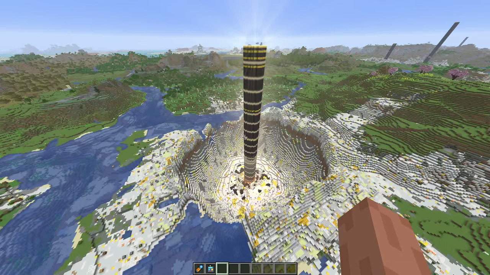
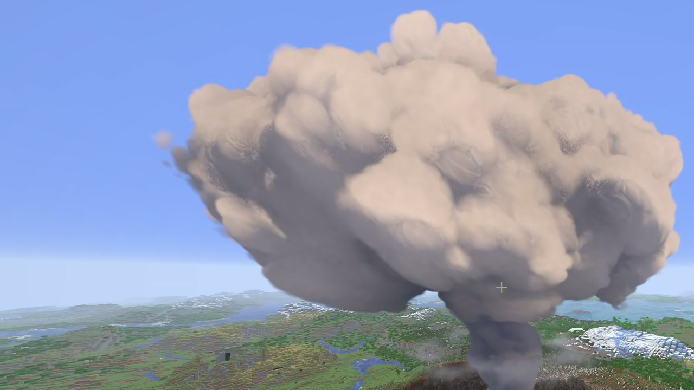
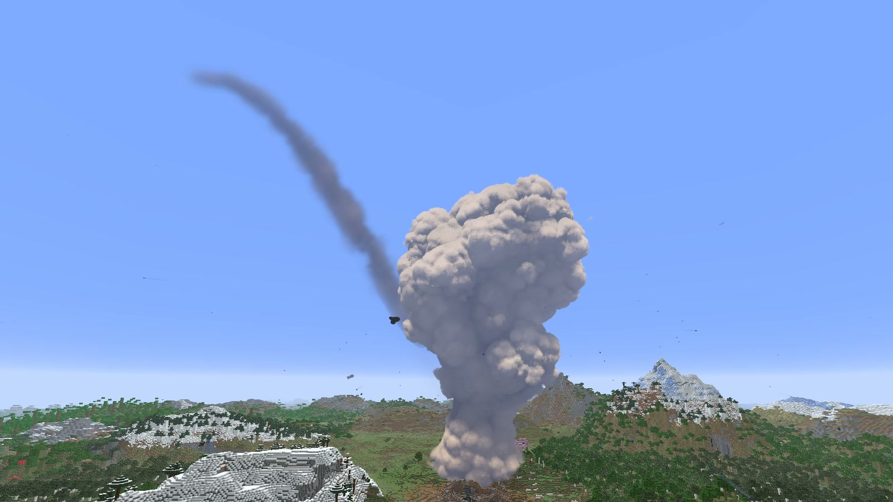
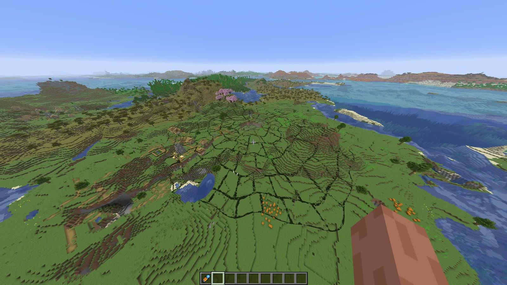
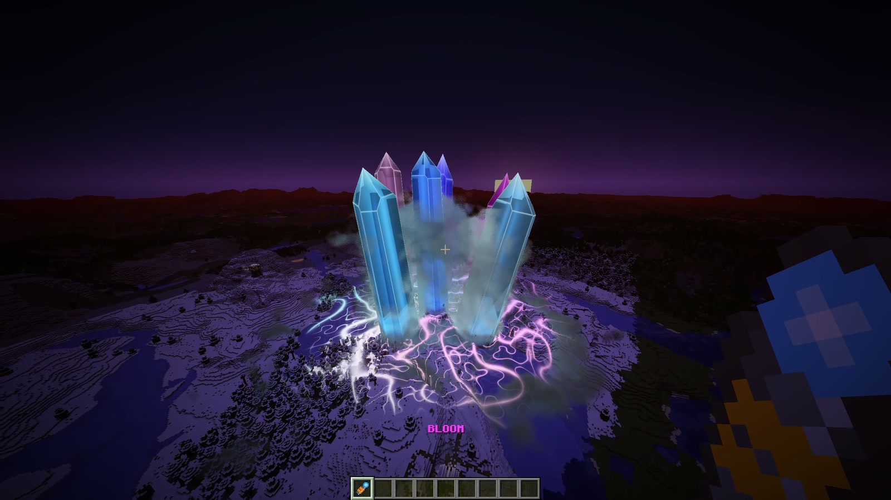
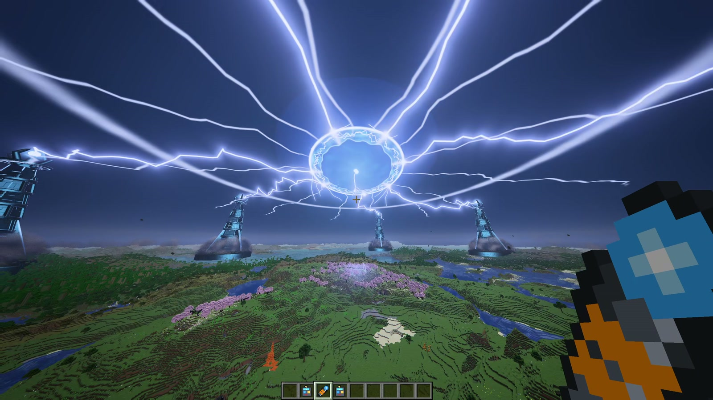
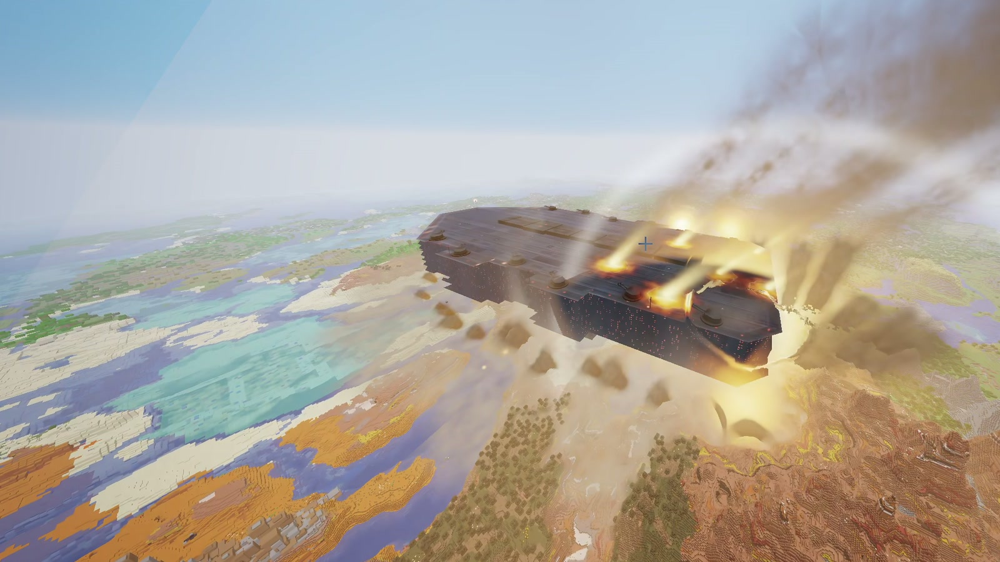

# Changes

What each release of Orbital Laser added, newest first. The current release is in the [README](../README.md#new-in-0512); each release's notes are in [docs/releases](releases).

## 0.5.12

- **Supervolcano**, the seventeenth laser, on the wheel's fourth page and `/orbital supervolcano`. A small laser satellite
  comes down on its jets, melts a hole through the crust and lifts away; the land swells round the hole for ten seconds,
  then opens in a ring 560 across and a column climbs to some 1,800 blocks, blotting out the sun, its umbrella across the
  whole sky with lightning in it. The column falls back, the ground inside the ring drops and a wall of ash rolls out over
  the land and over you, near black, the ground shaking. It ends on a blood-red sun over a caldera about 560 across and 90
  deep, a floor of cracked black crust and lava, its ten biggest thrown plates lodged in the land as real blocks. Its vent
  is at least 1,000 blocks in front of you and it lasts 88 seconds. QUALITY FAST draws its ash cloud at half size (FULL costs
  about 50 ms a frame at 1080p, FAST about 17). **Photosensitivity:** a white-out of under a second at 18 seconds, and lightning in the
  cloud and over the land from about 26 to 80 seconds.
- The fork's release `orbital-mod-api-12` is needed: `render.set-hand-tint` (a mod may tint the hand; the Supervolcano's
  tint is off for now, it went far too dark), and the chat now knows a mod's commands, so `/orbital` is no longer marked
  unknown and its words fill in as you type.
- **No more freeze and crash mid-strike on NVIDIA while the screen is captured** (the fork, Linux): during a heavy strike
  such as the Supervolcano, with OBS or another program capturing the screen, the game could freeze for a few seconds
  and crash (`Xid 109 CTX SWITCH TIMEOUT`). It made the graphics card wait for the screen to hand back its image; it now
  waits for the image without holding up the card. That's in `orbital-mod-api-12`.
- **The effects build on OpenGL and DirectX 12, not only Vulkan** ([#12](https://github.com/Stink-O/orbital-laser/issues/12)).
  The passes no longer read the depth in a way OpenGL refuses, or write vectors at a run-time index, which DirectX 12's
  compiler can't unroll. On the native version they draw on DirectX 12, all but the Downfall's, which that compiler still
  can't build; on OpenGL the game's frame can't be copied yet, so the native version skips its effects there with a
  warning in the log instead of ending the game.
- **The native version catches up to 0.5.12**, on upstream Horizon `PIN_AFTER_STAMP`: the Fold plays on upstream's world warp and
  held world (horizon-rust/horizon#11955, #11956), and the Supervolcano. The native build greys
  out any laser it can't play.

## 0.5.11

- **The Fold**, the sixteenth laser, on the wheel's fourth page and `/orbital fold`. No beam: a drop of liquid metal falls from high in the sky, brakes
  over the target and goes into the land, and the land folds along twelve creases and five rings into a tube round you. The hole boils shut, one drop falls
  to the target, and it all comes back, ring by ring, each bang showing its ring's real damage as the old land crumbles inward. Then the crater falls in and fire runs out over the land.
  Three crease patterns: the wheel's FOLD row or `/orbital foldpattern a|b|c`.
- The fork's release `orbital-mod-api-11` is needed: `render.set-warp` and `world_fragment`, `render.hold-world`, and `render.hold-world-within`.
- A Windows test build of the fork version, game and mod in one zip, so far only run under Wine.
- The native version stays at 0.5.10, without the Fold: regular Horizon doesn't have those renderer changes yet. The release carries the same 0.5.10 `orbital.hnmod`.

## 0.5.10

- **Tsunami**, the fifteenth laser, on the wheel's third page and `/orbital tsunami`. No beam: over three seconds the
  horizon stands up into a dark wall 320 blocks high and over five kilometres wide, and it comes in at about 100 blocks
  a second, losing height over the land, its lip tearing and its foot a brown boil of what it has swept up. It hits the
  target at 9 seconds and rolls on over you: a blow, seconds of foam, then green water with trees and pieces of houses
  going by. It hauls you to the surface and you ride the torrent down as it falls, to be set down about where it found
  you (hold **sneak** for half a second to break free; `/orbital knockback off` leaves you standing in it). It sweeps a
  swath 700 across for real: trees to stumps, buildings to footings, the soil scoured to mud and gravel in streaks along
  the flow, channels gouged, wreck strewn, a line of drift at its limit, boats stranded inland and ponds left in the
  hollows. Every mob and dropped item in the swath dies; chests and the like stay. It has its own sounds and lasts 42
  seconds. **Photosensitivity:** the blow is one white flash over the whole picture, about a fifth of a second.
- **Switching lasers is smoother.** A laser's effects have to be built when you pick it, which can stop the
  game for a moment, up to a few seconds the first time. On the wheel that now happens with the wheel still up, saying
  LOADING, and on the native version it happens in the background while the game keeps running, and going back to a laser is
  instant. On the Orbital Laser build the pause is still there behind the wheel, and `/orbital <laser>` still stops the
  game for it.
- **A long stall no longer ends a strike.** If the game stopped drawing for a while (the window hidden, the machine busy)
  the mod took the jump in the world's clock for another world and ended the strike. Leaving the world still ends it.
- **Native: world changes need operator level 4.** On a server or LAN host, a strike's world changes run at the console's
  level, so they are now taken only from a level 4 operator. Before, a level 2 operator with a modified client could run
  any command that way. Single player is unchanged.
- **Native: a guest's `/orbital` no longer changes the host's game,** and the command is listed for level 4 operators.
- **Native: built on a newer Horizon.** Land a strike changes out of your view now shows in far terrain, and the first
  person hand draws during the Hurricane.
- The `native/` folder holds the exact source of the native build. NOTICE no longer gives a count of the sounds, and
  names the scripts that make them.

## 0.5.9

- **The Orbital Remote is removed.** The Designator is the mod's one item now. `/orbital give` gives only the
  Designator, and the wheel opens with **R** while you hold it, or with `/orbital wheel`. A Remote left in an old
  world's inventory loads as an empty slot: it does nothing and breaks nothing.
- **R opens the wheel only with the Designator in hand.** With anything else in hand the mod ignores R.
- **Leaving the world mid-strike ends the strike.** Nothing of it carries into the next world: its plan, the land
  changes still waiting and its sounds still to come are dropped. The chunks it forceloaded are let go the next time
  that world is played (also after the game was closed mid-strike). The pause menu already held a strike still,
  sounds included; that is unchanged.
- Known gap: Horizon doesn't stop sounds that are playing when you Save and Quit to Title (its own too), so a
  strike's sounds can run on over the title screen. That needs an engine fix.

## 0.5.8

- **Hurricane**, the fourteenth laser, on the wheel's third page and `/orbital hurricane`. A hurricane some 3,500
  blocks across spins up over the target: storms gather into spiral rain bands round a dense core, the eye opens into
  a stadium of cloud and lightning bursts in the eyewall. The wind tears the land up round the eyewall, trees,
  buildings and the ground's top blocks, and whirls thousands of blocks round the eye in the game's own textures,
  whole trees tumbling among them. Mobs are carried round, and so are you (hold **sneak** for half a second to break
  free). At 46 seconds it flings everything out and it comes down as real blocks, then the cloud breaks up. It has its
  own sounds, rain and thunder, and lasts 64 seconds. **Photosensitivity:** its lightning is bright flashes in bursts.
- **No more pop-up messages.** The strikes' messages over the hotbar are gone, and so is the MESSAGES switch. Only two
  things still show there: the designator's countdown while you hold it on a target, and NO TARGET IN RANGE. Firing
  during a strike just clicks.
- **Needs the next Orbital Laser build of Horizon, `orbital-mod-api-10`** (it adds the game's block textures for the
  mod's effects and the Hurricane's carry). Older builds won't start the mod.

## 0.5.7

  

- **Rod from God**, the twelfth laser, on the wheel's third page and `/orbital rod`. A colossal rod of dark forged metal
  dropped from orbit, with no explosive. It comes straight down onto the target as a golden-white star with god rays
  streaming from it, puts on a last hard burst of speed and slams in. The picture holds on the hit for about a fifth of
  a second of impact frames, then lets go into a blinding burst, a jet of molten rock and a ring of dust racing out
  over the land. The crater is blasted out first and then lined in quartz, calcite and gold, and the rod stays
  standing in it, 171 blocks long with 130 of them over the crater floor, the floor round its foot heaved up in broken
  slabs. It has its own sounds and lasts 60 seconds.
- **Impact frames in three looks:** KANADA (the default), BLACK FLASH and CINEMATIC, or OFF, on the wheel's
  **IMPACT FX** row or with `/orbital impactframes`. **Photosensitivity:** they are a fifth of a second of hard
  full-screen cuts. `/orbital impactframes off` leaves them out.
- **For filming:** a follow camera that orbits the Nuke's or the Payload's bomb as it comes in (`/orbital follow`, the
  wheel's FOLLOW switch), a KNOCKBACK switch for the Nuke and the Rod, a seed you can type or lock for repeat takes of
  the same strike (`/orbital seed`), and `tools/world_snapshot.py` to put a world back between takes.
- **The wheel rearranged:** the strike options down the left (SEED and LOCK SEED, then KNOCKBACK and FOLLOW for the
  lasers they apply to), MESSAGES, PANEL and QUALITY down the right with a red STOP STRIKE under them during a strike,
  and the IMPACT FX and BLAST SOUND rows under the ring.
- **Supercell** (page three): a storm called down onto the target. Lightning strikes faster and faster, more at once,
  until every bolt draws in and merges into one colossal strike that leaves a crater veined with fused glass. Its
  fires are left burning. `/orbital supercell`.
- Still needs the Orbital Laser build of Horizon `orbital-mod-api-8` or newer, the same as 0.5.6.

## 0.5.6

  

- **Nuke**, the eleventh laser, on the wheel's third page and `/orbital nuke`. A white-hot streak across the sky, a
  dive, then a blinding flash, a fireball boiling up into a mushroom cloud and a shockwave in a wall of dust that
  knocks you off your feet. It leaves a terraced crater about 200 blocks across, the land flattened out to about 230
  and scorched out to about 480. It lasts 90 seconds.
- **The Payload** casts its cloud's shadow on the land, and its craters cut into water naturally.
- **No more "took too long".** Big strikes are split into small steps, so no laser stops the mod, and terrain goes in
  paced by the frame rate, with much less stutter.
- **Needs the next Orbital Laser build of Horizon**, `orbital-mod-api-8` (it adds `world.push-player`, the Nuke's
  knockback). Older builds won't start the mod.

## 0.5.5

  

- **Payload**, the tenth laser, on the wheel's second page and `/orbital payload`. A bomb, not a beam. A bright point
  drifts high across the sky trailing smoke, then dives as a fireball, shedding burning chunks and crackling as it
  tears through the air. It hits, a ragged column of smoke rises out of the crater and a wall of dust races out over
  the land. It leaves a crater about 42 blocks across, the land swept bare out to about 85 with the trees felled
  pointing away from it, and every mob within 90 killed. It lasts 70 seconds, its sounds arriving late with the
  distance. Two blasts to pick from: the wheel's **BLAST SOUND** row or `/orbital payloadsound main|alt`.
- **STOP STRIKE** on the wheel (top left while a strike runs) and `/orbital stop` end a strike there and then.
- **QUALITY FAST or FULL** on the wheel and `/orbital quality`: FAST (the default) draws the Payload's smoke at half
  size, about 4 ms a frame at 1080p instead of 11.
- **Best on the next Orbital Laser build of Horizon**, `orbital-mod-api-7` (it adds a half-size stage for a mod's
  post pass, which QUALITY FAST uses). `orbital-mod-api-6` still runs it, drawing the smoke at full size.

## 0.5.4

  

- **Sinkhole**, the ninth laser, on the wheel's second page and `/orbital sinkhole`. Nothing comes from the sky. A
  seismic warning, a deep rumble and birds scattering, then cracks race out over the land in spurts. The middle gives,
  and the land caves in from there outward in slabs that carry the real ground (its blocks, biome colours and trees) as
  they tip into a dark pit. Dust boils up, then an echoing silence. It leaves a sheer pit about 225 blocks across down
  to bedrock, its banded walls darkening downward, with ledges, roots and waterfalls where it cut a river or a lake. It
  lasts 40 seconds, with its own sounds.
- **Needs the next Orbital Laser build of Horizon**, `orbital-mod-api-6` (it adds `world.read-columns`, which reads the
  real blocks and biome colours of the land). Older builds won't start the mod.

## 0.5.3

  

- **Crystal Bloom**, the eighth laser, on the wheel's second page and `/orbital crystalbloom`. Crystals heave up out
  of cracked ground and 46 spires bloom over the land. They resonate with prism beams under an aurora, then shatter
  into about 200 pieces, each landing as blocks of its own shape on the ground where it falls. It leaves a glowing
  geode crater with a crystal-lined well to bedrock, broken pillars and shards. It lasts 60 seconds, with its own sounds.
- **Strikes tidy up after themselves:** loose plants, leaves and cut trees are cleared at the blast's edge, the Planet
  Killer's too.
- **Faster.** The Crystal Bloom's pass reads a table the mod works out once a strike (the fork's new
  `render.set-data`), about halving its GPU time at the heaviest moments.
- **Needs the next Orbital Laser build of Horizon**, `orbital-mod-api-5` (it adds `world.surface-height` and
  `render.set-data`). Older builds won't start the mod.

## 0.5.2

  

- **Planet Killer**, the seventh laser, on the wheel's second page and `/orbital planetkiller`. Seven towers grind up
  out of the land on the horizon and strike a ring of light in the sky with lightning. The ring fuses and fires a beam
  down, and the land domes up and bursts. It leaves a crater about 480 blocks across with a shaft to bedrock, a broken
  rim of thrown rock, chasms and charred land. Then the ring, crushed to a point, falls into the crater and bursts
  again. Its sounds are its own, and its explosion is modelled on measurements of a real one.
- **Faster terrain.** The Planet Killer writes its crater straight into the world's chunks through the fork's new
  `world.edit-blocks`, instead of thousands of commands, so there is far less stutter. Its land is done about 25
  seconds into the strike.
- **The wheel fits any window**, down to the smallest GUI (320 × 240), with short blurbs and tidier spacing.
- **Needs the next Orbital Laser build of Horizon**, `orbital-mod-api-4` (it adds `world.edit-blocks`). Older builds
  won't start the mod.

## 0.5.1

  

- **Downfall**, the sixth laser, on the wheel's second page and `/orbital downfall`: the Mothership brought down by a
  meteor. Its roof turrets fire on the meteor and break it up, the pieces hit it anyway, it falls and crashes into the
  land, crushing what it lands on and burying itself half its height, then the black hole engine in its stern ruptures
  and swallows the wreck. See [the README](../README.md#the-lasers).
- **A second page on the wheel** (its arrows, its tabs or a right-click turn it).
- **A colour for each ship**: the Mothership green, the Downfall red, or amber, blue, violet or white, from the swatches
  beside the arrival row or `/orbital colour …`.
- **Faster flying** for getting round the craters: the FLY SPEED bar over the wheel's title (1x to 40x) and the box
  beside it (type any speed up to 1000x), or `/orbital flyspeed N`. Kept between sessions.
- **Switches for the clutter:** MESSAGES turns the strikes' messages over the hotbar off, PANEL hides the status panel
  (or `/orbital messages off`, `/orbital hud off`).
- **`/orbital skip SECONDS`** starts the next strike part way in, with terrain damage off, to look at one moment of it.
- **Every blast now clears to the sky:** a strike under a hill or a mountain no longer leaves a tunnel or floating
  hilltops.
- **No more "it took too long":** a strike's heavier world changes are worked out a little each tick, so a big one can't
  overrun the mod's per-tick limit.
- **On Horizon's new renderer.** Horizon replaced its shader-pack support; the fork now gives a mod its own post pass
  on the new renderer and the integrated server, and the effects look as they did.
- **A new logo.**
- **Needs the newest Orbital Laser build of Horizon** (`orbital-mod-api-3`: the new renderer, flying speed and typing
  on the mod's screen are new in it).

## 0.5.0

- **Mothership**, the fifth laser, on the wheel and `/orbital mothership`. A kilometre-long ship of dark metal and
  green light drops out of nowhere over the target, charges, drills a shaft to bedrock and sweeps its beam away from
  you, cutting a molten trench 100 blocks long, then leaves in a streak.
- **Approach and arrival on the wheel.** Two rows under the ring when the Mothership is loaded: where it comes in from
  (ahead, behind, left, right, above) and how (snap, unfold, warp). Also `/orbital approach …` and `/orbital arrival …`.
- **Range out to 1000 blocks** for the Mothership. Past your render distance it aims across Horizon's distant terrain,
  so turn on **LOD Distance** in Video Settings to use it all.
- **Real camera shake on every laser.** The old screen jitter is gone: the game turns the camera itself, so the world,
  your hand and the effects move together, and each jolt lands when the sound does.
- **Quieter from afar.** The ground breaking is heard from the impact, not in your ears wherever you are.
- **Needs the newer Orbital Laser build of Horizon** (camera shake and the longer raycast are new in its mod API).

## 0.4.0

- **Meteor Storm**, the fourth laser, on the wheel and `/orbital meteor`. It does the most terrain damage of them all.
- **The storm:** 72 meteors, from tiny to big, enter from high in the atmosphere along real curved paths, burning, with
  trails of fire and smoke that hang in the sky. They land scattered and in clusters across 120 blocks round the target,
  each with a flash, a ground shockwave and a dust skirt, and each blows out a real round crater with a meteorite at the
  bottom, a lip of rubble and fires.
- **The extinction impact:** after the storm, one the size of a hill comes in on the target. A white-out, then a
  fireball that tears open in a different shape every time and throws glowing ejecta out every way. Everything above the
  ground goes out to 100 blocks, a crater about 125 blocks across is blown out with a raised rim, a shaft to bedrock and
  pools of lava on its floor, the land is charred out to 135, real blocks land as far as 250 blocks away and ash comes
  down over everything.
- **Its own sounds**, made to sound like real footage: whooshes as each meteor comes in, hits sized to the meteor,
  heard later and muffled the further away they land (sound travels at its real speed), and a deep blast for the big
  one followed by rumbling debris.
- **Faster.** Strikes spread their block changes over the ticks (up to 20,000 blocks a tick) instead of all at once, the
  big stages are worked out only when they're due, the post pass is warmed up when the mod loads (no hitch on the first
  strike), and the Black Hole's shader costs less to draw.

## 0.3.0

- **Black Hole**, the third laser, on the wheel and `/orbital blackhole`. The sky goes dark and starry and the picture
  is sucked in towards one point, then a black hole snaps open over the target. Its light bending is traced for real,
  so the land and sky behind it warp round it, and its accretion disk shows its far side over the top and under the
  bottom. A jet out of both poles bores to bedrock.
- **Terrain ripped into orbit.** 160 blocks and chunks are torn out of the ground round the crater (the real ones are
  removed as they go) and tumble up round the hole: most stretch, glow red-hot and are swallowed at the horizon, some
  are slingshotted away, and real blocks spat out of the disk come down as rubble across the land.
- **What it leaves:** the land dragged into spiral arms of sculk and black concrete, streams of rock reaching up
  towards where it hung, a crater lined with obsidian and crying obsidian, and a ring of rock left hanging where the
  disk was when it evaporated in a blinding flash.
- **Its own sounds**, synthesized like the others: an inhale that cuts dead, a vast low blast, the hole's drone, the
  evaporation.

## 0.2.0

Orbital Laser is now a mod that runs inside the game, on a Horizon fork that adds the mod capabilities it needed. 0.1
was a shader pack, a sound pack and a Python script driving the game from outside.

- **A real mod.** The Orbital Laser Designator and the Orbital Remote are real items with their own textures. Their
  right-clicks belong to the mod (no spyglass zoom), and the strike, the crater and the sounds all run in the game, with
  no script and no command spam.
- **The laser wheel**, a screen the mod draws itself, on the remote or **R**. The key is listed in **Options → Controls →
  Key Binds** under *Orbital Laser*, where you can rebind it.
- **Two lasers:** Plasma, now with a 3D fireball, a fused crater, fires and rubble; and the new **Godly**.
- **No packs to select.** The effects are the mod's own post-processing pass and the sounds ship inside the mod, so it
  needs no shader pack or resource pack.
- **A status panel** in the top right while you hold either item, and **`/orbital`** commands.

