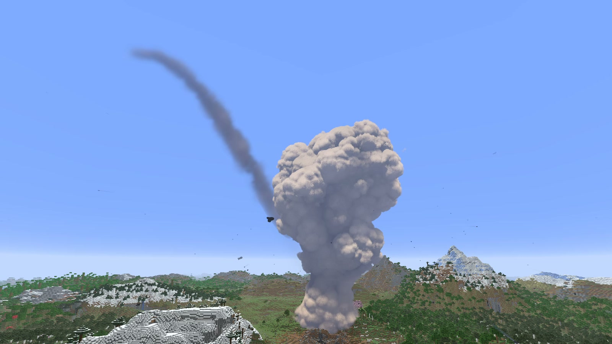
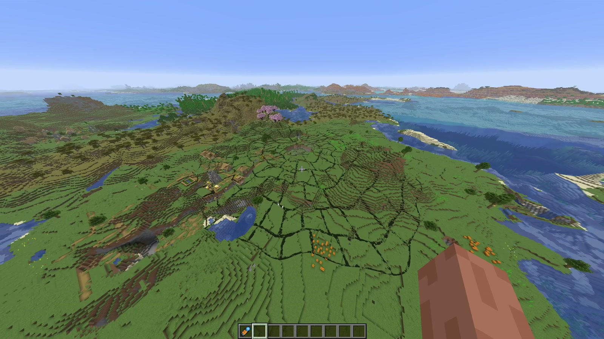

# Changes

What each release of Orbital Laser added, newest first. The current release is in the [README](../README.md#new-in-056); each release's notes are in [docs/releases](releases).

## 0.5.5

  

- **Payload**, the tenth laser, on the wheel's second page and `/orbital payload`. A bomb, not a beam. A bright point
  drifts high across the sky trailing smoke, then dives as a fireball, shedding burning chunks and crackling as it
  tears through the air. It hits, a ragged column of smoke rises out of the crater and a wall of dust races out over
  the land. It leaves a crater about 42 blocks across, the land swept bare out to about 85 with the trees felled
  pointing away from it, and every mob within 90 killed. It lasts 70 seconds, its sounds arriving late with the
  distance. Two blasts to pick from: the wheel's **BLAST SOUND** row or `/orbital payloadsound main|alt`.
- **STOP STRIKE** on the wheel (top left while a strike runs) and `/orbital stop` end a strike there and then.
- **QUALITY FAST or FULL** on the wheel and `/orbital quality`: FAST (the default) draws the Payload's smoke at half
  size, about 4 ms a frame at 1080p instead of 11.
- **Best on the next Orbital Laser build of Horizon**, `orbital-mod-api-7` (it adds a half-size stage for a mod's
  post pass, which QUALITY FAST uses). `orbital-mod-api-6` still runs it, drawing the smoke at full size.

## 0.5.4

  

- **Sinkhole**, the ninth laser, on the wheel's second page and `/orbital sinkhole`. Nothing comes from the sky. A
  seismic warning, a deep rumble and birds scattering, then cracks race out over the land in spurts. The middle gives,
  and the land caves in from there outward in slabs that carry the real ground (its blocks, biome colours and trees) as
  they tip into a dark pit. Dust boils up, then an echoing silence. It leaves a sheer pit about 225 blocks across down
  to bedrock, its banded walls darkening downward, with ledges, roots and waterfalls where it cut a river or a lake. It
  lasts 40 seconds, with its own sounds.
- **Needs the next Orbital Laser build of Horizon**, `orbital-mod-api-6` (it adds `world.read-columns`, which reads the
  real blocks and biome colours of the land). Older builds won't start the mod.

## 0.5.3

  

- **Crystal Bloom**, the eighth laser, on the wheel's second page and `/orbital crystalbloom`. Crystals heave up out
  of cracked ground and 46 spires bloom over the land. They resonate with prism beams under an aurora, then shatter
  into about 200 pieces, each landing as blocks of its own shape on the ground where it falls. It leaves a glowing
  geode crater with a crystal-lined well to bedrock, broken pillars and shards. It lasts 60 seconds, with its own sounds.
- **Strikes tidy up after themselves:** loose plants, leaves and cut trees are cleared at the blast's edge, the Planet
  Killer's too.
- **Faster.** The Crystal Bloom's pass reads a table the mod works out once a strike (the fork's new
  `render.set-data`), about halving its GPU time at the heaviest moments.
- **Needs the next Orbital Laser build of Horizon**, `orbital-mod-api-5` (it adds `world.surface-height` and
  `render.set-data`). Older builds won't start the mod.

## 0.5.2

  

- **Planet Killer**, the seventh laser, on the wheel's second page and `/orbital planetkiller`. Seven towers grind up
  out of the land on the horizon and strike a ring of light in the sky with lightning. The ring fuses and fires a beam
  down, and the land domes up and bursts. It leaves a crater about 480 blocks across with a shaft to bedrock, a broken
  rim of thrown rock, chasms and charred land. Then the ring, crushed to a point, falls into the crater and bursts
  again. Its sounds are its own, and its explosion is modelled on measurements of a real one.
- **Faster terrain.** The Planet Killer writes its crater straight into the world's chunks through the fork's new
  `world.edit-blocks`, instead of thousands of commands, so there is far less stutter. Its land is done about 25
  seconds into the strike.
- **The wheel fits any window**, down to the smallest GUI (320 × 240), with short blurbs and tidier spacing.
- **Needs the next Orbital Laser build of Horizon**, `orbital-mod-api-4` (it adds `world.edit-blocks`). Older builds
  won't start the mod.

## 0.5.1

  

- **Downfall**, the sixth laser, on the wheel's second page and `/orbital downfall`: the Mothership brought down by a
  meteor. Its roof turrets fire on the meteor and break it up, the pieces hit it anyway, it falls and crashes into the
  land, crushing what it lands on and burying itself half its height, then the black hole engine in its stern ruptures
  and swallows the wreck. See [the README](../README.md#the-lasers).
- **A second page on the wheel** (its arrows, its tabs or a right-click turn it).
- **A colour for each ship**: the Mothership green, the Downfall red, or amber, blue, violet or white, from the swatches
  beside the arrival row or `/orbital colour …`.
- **Faster flying** for getting round the craters: the FLY SPEED bar over the wheel's title (1x to 40x) and the box
  beside it (type any speed up to 1000x), or `/orbital flyspeed N`. Kept between sessions.
- **Switches for the clutter:** MESSAGES turns the strikes' messages over the hotbar off, PANEL hides the status panel
  (or `/orbital messages off`, `/orbital hud off`).
- **`/orbital skip SECONDS`** starts the next strike part way in, with terrain damage off, to look at one moment of it.
- **Every blast now clears to the sky:** a strike under a hill or a mountain no longer leaves a tunnel or floating
  hilltops.
- **No more "it took too long":** a strike's heavier world changes are worked out a little each tick, so a big one can't
  overrun the mod's per-tick limit.
- **On Horizon's new renderer.** Horizon replaced its shader-pack support; the fork now gives a mod its own post pass
  on the new renderer and the integrated server, and the effects look as they did.
- **A new logo.**
- **Needs the newest Orbital Laser build of Horizon** (`orbital-mod-api-3`: the new renderer, flying speed and typing
  on the mod's screen are new in it).

## 0.5.0

- **Mothership**, the fifth laser, on the wheel and `/orbital mothership`. A kilometre-long ship of dark metal and
  green light drops out of nowhere over the target, charges, drills a shaft to bedrock and sweeps its beam away from
  you, cutting a molten trench 100 blocks long, then leaves in a streak.
- **Approach and arrival on the wheel.** Two rows under the ring when the Mothership is loaded: where it comes in from
  (ahead, behind, left, right, above) and how (snap, unfold, warp). Also `/orbital approach …` and `/orbital arrival …`.
- **Range out to 1000 blocks** for the Mothership. Past your render distance it aims across Horizon's distant terrain,
  so turn on **LOD Distance** in Video Settings to use it all.
- **Real camera shake on every laser.** The old screen jitter is gone: the game turns the camera itself, so the world,
  your hand and the effects move together, and each jolt lands when the sound does.
- **Quieter from afar.** The ground breaking is heard from the impact, not in your ears wherever you are.
- **Needs the newer Orbital Laser build of Horizon** (camera shake and the longer raycast are new in its mod API).

## 0.4.0

- **Meteor Storm**, the fourth laser, on the wheel and `/orbital meteor`. It does the most terrain damage of them all.
- **The storm:** 72 meteors, from tiny to big, enter from high in the atmosphere along real curved paths, burning, with
  trails of fire and smoke that hang in the sky. They land scattered and in clusters across 120 blocks round the target,
  each with a flash, a ground shockwave and a dust skirt, and each blows out a real round crater with a meteorite at the
  bottom, a lip of rubble and fires.
- **The extinction impact:** after the storm, one the size of a hill comes in on the target. A white-out, then a
  fireball that tears open in a different shape every time and throws glowing ejecta out every way. Everything above the
  ground goes out to 100 blocks, a crater about 125 blocks across is blown out with a raised rim, a shaft to bedrock and
  pools of lava on its floor, the land is charred out to 135, real blocks land as far as 250 blocks away and ash comes
  down over everything.
- **Its own sounds**, made to sound like real footage: whooshes as each meteor comes in, hits sized to the meteor,
  heard later and muffled the further away they land (sound travels at its real speed), and a deep blast for the big
  one followed by rumbling debris.
- **Faster.** Strikes spread their block changes over the ticks (up to 20,000 blocks a tick) instead of all at once, the
  big stages are worked out only when they're due, the post pass is warmed up when the mod loads (no hitch on the first
  strike), and the Black Hole's shader costs less to draw.

## 0.3.0

- **Black Hole**, the third laser, on the wheel and `/orbital blackhole`. The sky goes dark and starry and the picture
  is sucked in towards one point, then a black hole snaps open over the target. Its light bending is traced for real,
  so the land and sky behind it warp round it, and its accretion disk shows its far side over the top and under the
  bottom. A jet out of both poles bores to bedrock.
- **Terrain ripped into orbit.** 160 blocks and chunks are torn out of the ground round the crater (the real ones are
  removed as they go) and tumble up round the hole: most stretch, glow red-hot and are swallowed at the horizon, some
  are slingshotted away, and real blocks spat out of the disk come down as rubble across the land.
- **What it leaves:** the land dragged into spiral arms of sculk and black concrete, streams of rock reaching up
  towards where it hung, a crater lined with obsidian and crying obsidian, and a ring of rock left hanging where the
  disk was when it evaporated in a blinding flash.
- **Its own sounds**, synthesized like the others: an inhale that cuts dead, a vast low blast, the hole's drone, the
  evaporation.

## 0.2.0

Orbital Laser is now a mod that runs inside the game, on a Horizon fork that adds the mod capabilities it needed. 0.1
was a shader pack, a sound pack and a Python script driving the game from outside.

- **A real mod.** The Orbital Laser Designator and the Orbital Remote are real items with their own textures. Their
  right-clicks belong to the mod (no spyglass zoom), and the strike, the crater and the sounds all run in the game, with
  no script and no command spam.
- **The laser wheel**, a screen the mod draws itself, on the remote or **R**. The key is listed in **Options → Controls →
  Key Binds** under *Orbital Laser*, where you can rebind it.
- **Two lasers:** Plasma, now with a 3D fireball, a fused crater, fires and rubble; and the new **Godly**.
- **No packs to select.** The effects are the mod's own post-processing pass and the sounds ship inside the mod, so it
  needs no shader pack or resource pack.
- **A status panel** in the top right while you hold either item, and **`/orbital`** commands.

