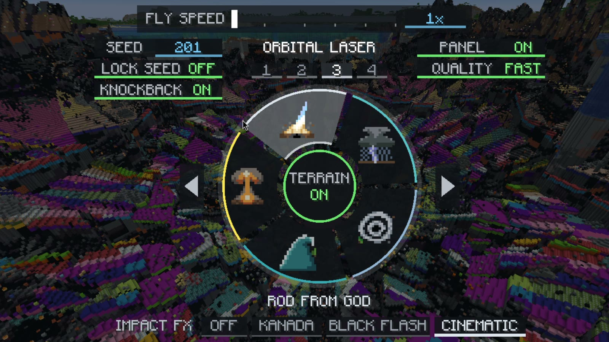

# Playing Orbital Laser

The [README](../README.md#how-to-play) has the first steps. This page has the rest: the wheel's switches and rows,
how long each strike takes, being caught in one, and every command. [The lasers](LASERS.md) describes each laser.

| The laser wheel |
|---|
|  |

## Firing a strike

1. Type **`/orbital give`** for the **Orbital Laser Designator**.
2. **Pick a laser.** Press **R** with the designator in hand (or type `/orbital wheel`) and the laser wheel opens. Point
   at a laser to read what it does and click to load it. The arrows either side of the ring, the tabs over it or a
   right-click turn the page. The middle switches terrain damage on or off, and Escape closes the wheel. Your choices
   are remembered.
3. **Fire.** Hold the designator, aim at a target and **hold right-click** for under a second. The action bar counts
   down (`ACQUIRING TARGET…`, `SEISMIC SCAN…` for the Sinkhole, `DESIGNATING…` for the Payload, the Nuke and the Rod,
   `TRACKING STORM…` for the Hurricane, `READING THE SEA…` for the Tsunami, `ATTUNING…` for the Fold, `BREACHING CRUST…` for the
   Supervolcano, `STRAINING THE SKY…` for the Sky Breaks, `CLEARING THE RUN…` for the Carpet Bomb, `STIRRING THE DEEP…` for the World Eater, `WORLDS STIRRING…` for the Convergence), then the strike lands where your crosshair is. Nothing else pops up over the
   hotbar but `NO TARGET IN RANGE`.
4. **Caught in the Tsunami?** The water takes you once it is over your head, tumbles you along with it, hauls you to the
   surface after about six seconds, and carries you back as it falls, to be set down near where it took you, facing the
   way it went. Hold **sneak** for half a second to break free. `/orbital knockback off` leaves you standing in it, the picture still drowned.
5. **Caught in the Hurricane?** Its wind picks you up and carries you round the eye. Hold **sneak** for half a second
   to break free; while you fly it leaves you alone, but stop flying for a second while it still blows where you are
   and it grabs you again. If it still has you at 46 seconds it throws you clear (a survival player gets a few seconds
   of Resistance V so the landing doesn't kill them).
6. **Swallowed by the World Eater?** It carries you inside along its tunnel and spits you out where it breaks out
   next, some seconds later; a survival player gets Resistance V so nothing hurts them. Stopping the strike while
   you're inside puts you on the land beside the hole. Holding **sneak** for half a second lets you go where you are,
   underground too. With KNOCKBACK or terrain damage off it can't swallow you.

Only one strike runs at a time. Plasma, Godly and the Black Hole take about 26 seconds, the Planet Killer 30.5, the
Mothership 34, the Carpet Bomb 37.5, the Meteor Storm 38, the Sinkhole 40, the Supercell and the Tsunami 42, the Sky Breaks 49.5, the Crystal Bloom, the Rod from God and the Convergence 60,
the Downfall, the Hurricane and the Fold 64, the Payload 70, the Supervolcano 88 and the Nuke 90; the World Eater's
scripted show takes 46 and its hunt up to 90.

## The wheel

The wheel also has:

- **FLY SPEED** over the title, for getting round the craters: click along the bar for 1x to 40x vanilla's creative
  flight, or type any speed up to 1000x in the box beside it and press Enter.
- Down the right, a **PANEL** switch, which hides the status panel shown at the top right while you hold the Designator,
  and a **QUALITY** switch under it: **FAST** (the default) draws the Payload's, the Nuke's and the Rod's smoke, dust and trail, the Supercell's, the Hurricane's and the Tsunami's weather and water, the Supervolcano's ash cloud, the Sky Breaks' dust, the Carpet Bomb's smoke, dust and shockwaves, the World Eater's
  body and dust and the Convergence's glows and rift at half the width and height and lays them over the full-size picture, keeping their edges against
  blocks and the sky; **FULL** draws every pixel (about two to three times the GPU time); **PERF** (PERFORMANCE) is FAST
  with the World Eater drawn at its lightest (less detail in its body, its dust and the pieces it throws, fewer falling
  blocks, its land's dressing left out). A click moves it on: FULL, FAST, PERF.
- **STOP STRIKE**, a red button under QUALITY while a strike is under way: it ends the strike there and then (what it
  has already done to the world stays), the same as `/orbital stop`.
- Down the left, the strike options. **SEED** shows the last strike's seed, or takes one you type (1 to 997), and
  **LOCK SEED** keeps it, so a strike plays out the same way take after take (`/orbital seed`). Under them, for the
  lasers they apply to: **KNOCKBACK** (the Nuke, the Rod, the Hurricane, the Tsunami, the Fold, the Supervolcano, the Carpet Bomb, the World
  Eater and the Convergence), whether the blast pushes you, the ash wall shoves you, the wind or the water carries you or the worm can
  swallow you,
  and **FOLLOW** (the Nuke and the Payload), the follow camera.
- An **IMPACT FX** row under the ring while the Rod from God or the Convergence is pointed at or loaded: **OFF**,
  **KANADA** (the default), **BLACK FLASH** or **CINEMATIC**, as `/orbital impactframes`. The Convergence's impact frames
  have one look of their own: any of the three looks turns them on, and OFF leaves out both lasers' frames.
- A **TAKE** row while the World Eater is pointed at or loaded: **HUNT** (the default: it comes after you) or
  **SCRIPTED** (the one-arch show, the same every time), as `/orbital worldeater hunt|scripted`.
- A **FOLD** row while the Fold is pointed at or loaded: its crease pattern, **UMBRELLA** (the default), **WATERBOMB** or **DIAGONAL**, as `/orbital foldpattern`.
- For the Mothership and the Downfall, rows for where the ship comes in from, how it arrives, and its colour.
- For the Payload, a **BLAST SOUND** row: **MAIN** (deep and rolling) or **ALT** (a sharp crack and a wide roar), the
  same choice as `/orbital payloadsound`. The Nuke has one too: **MAIN** (a hard crack, an overdriven boom) or **ALT**
  (a rounder, bassier boom and a longer thunder roll), as `/orbital nukesound`.

## Commands

| Command | What it does |
|---|---|
| `/orbital give` | gives you the Designator |
| `/orbital wheel` | opens the laser wheel |
| `/orbital plasma`, `godly`, `blackhole`, `meteor`, `mothership`, `downfall`, `planetkiller`, `crystalbloom`, `sinkhole`, `payload`, `nuke`, `rod`, `supercell`, `hurricane`, `tsunami`, `fold`, `supervolcano`, `skybreak`, `carpetbomb`, `worldeater`, `convergence` | loads that laser |
| `/orbital terrain on\|off` | terrain damage on, or off (light and sound only) |
| `/orbital approach ahead\|behind\|left\|right\|overhead` | where the ship comes in from |
| `/orbital arrival snap\|unfold\|warp` | how the ship arrives |
| `/orbital colour green\|red\|amber\|blue\|violet\|white` | the loaded ship's colour |
| `/orbital flyspeed N\|reset` | creative flying speed, N times vanilla's (up to 1000) |
| `/orbital hud on\|off` | the status panel |
| `/orbital payloadsound main\|alt`, `/orbital nukesound main\|alt` | the Payload's or the Nuke's blast: the main one or the alternative; also the wheel's BLAST SOUND row |
| `/orbital quality full\|fast\|performance` | the Payload's, the Nuke's and the Rod's smoke, the Supercell's, the Hurricane's and the Tsunami's weather and water, the Supervolcano's ash cloud, the Sky Breaks' dust, the Carpet Bomb's smoke, dust and shockwaves, the World Eater's body and dust and the Convergence's glows and rift at full size, or at half size (faster); `performance` is `fast` with the World Eater at its lightest; kept; also the wheel's QUALITY switch |
| `/orbital impactframes kanada\|blackflash\|cinematic\|off` | the Rod from God's impact frames (a fifth of a second of hard cuts as it strikes) in one of three looks (Kanada is the default), or off; the same switch turns the Convergence's own impact frames on or off; kept; also the wheel's IMPACT FX row |
| `/orbital foldpattern a\|b\|c` | the Fold's crease pattern for its next strike: umbrella (the default), waterbomb or diagonal; kept, also the wheel's FOLD row |
| `/orbital knockback on\|off` | the Nuke's, the Rod's, the Fold's, the Carpet Bomb's last blast's, the World Eater's and the Convergence's push on you as the blast reaches you, the Supervolcano's ash wall's shove (the camera's jolt stays), and whether the Hurricane's wind or the Tsunami's water carries you off or the World Eater can swallow you; also the wheel's KNOCKBACK switch |
| `/orbital worldeater hunt\|scripted` | the World Eater's take: the hunt (the default: it surfaces near you, hop by hop, then comes for you; up to 90 s) or the scripted one-arch show (46 s, the same every time, for filming); kept; also the wheel's TAKE row |
| `/orbital wormground a\|b\|c\|old\|off` | the World Eater's sound as it moves under the ground: three takes (`a`, the default; `b`; `c`), the older loop (`old`) or none (`off`); for this session only |
| `/orbital carryview turn\|still` | while the Hurricane carries you, your view turns a little with you round the storm and sways with the gusts (`turn`, the default), or stays your own (`still`); kept |
| `/orbital follow on\|off` | the follow camera: an orbit round the Nuke's or the Payload's bomb as it comes in. Your mouse sets the angle (the camera sits 70 blocks back along your view), it backs off as the burst nears and orbits the fireball and the cloud, then puts you back where you stood; also the wheel's FOLLOW switch. Pairs well with the Cinematic Camera key (Options > Controls > Key Binds > Miscellaneous) |
| `/orbital follow distance N` | the follow camera's distance from the bomb, 10 to 400 blocks (70 by default) |
| `/orbital seed N\|lock\|random` | hold every strike's look at seed N (1 to 997), lock it at the last strike's, or go back to a fresh one each time; also the wheel's SEED field and LOCK SEED switch |
| `/orbital stop` | ends the strike under way (also the wheel's STOP STRIKE button) |
| `/orbital skip SECONDS` | starts the next strike that far in, to look at one moment (terrain damage off only) |

[How it works](HOW-IT-WORKS.md#commands) has the full details of each command. To rebind **R**: **Options →
Controls → Key Binds**, the *Orbital Laser* section at the bottom (on a native build of Horizon: **Options → Mods →
Orbital Laser → Settings**).
