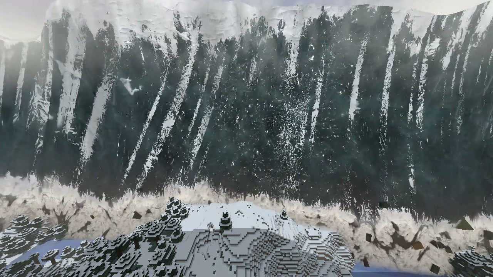
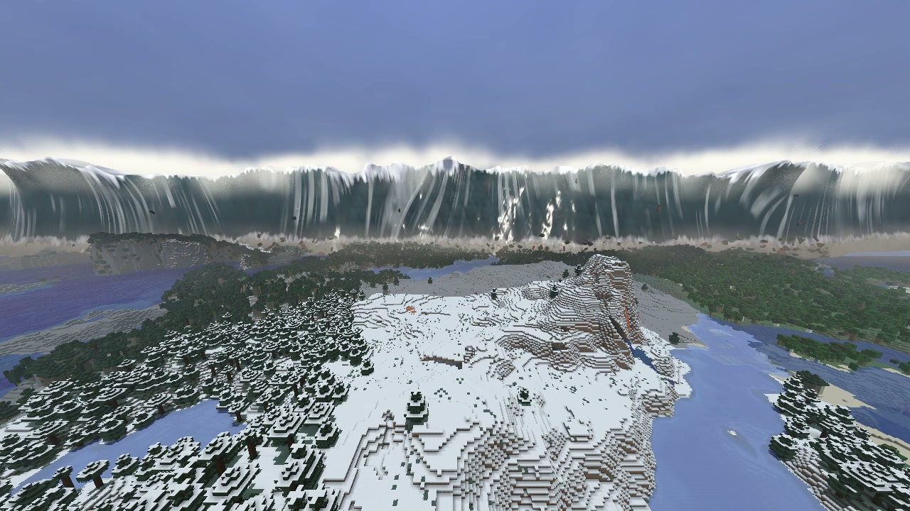
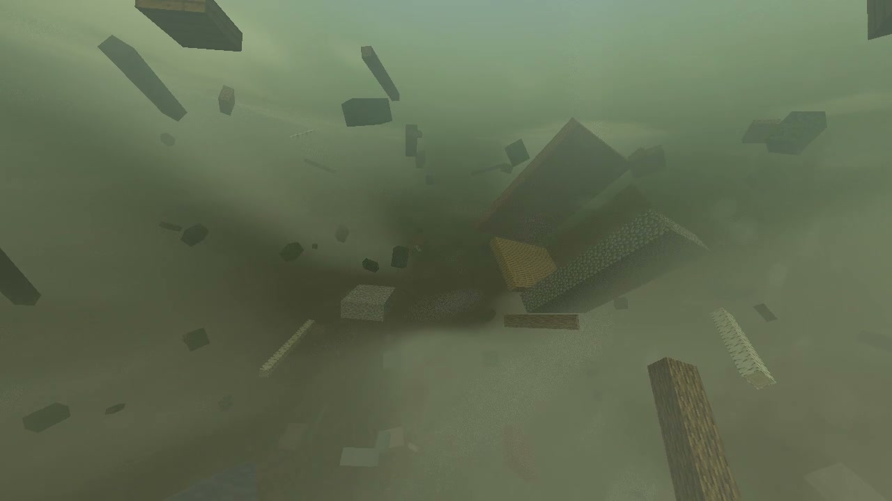
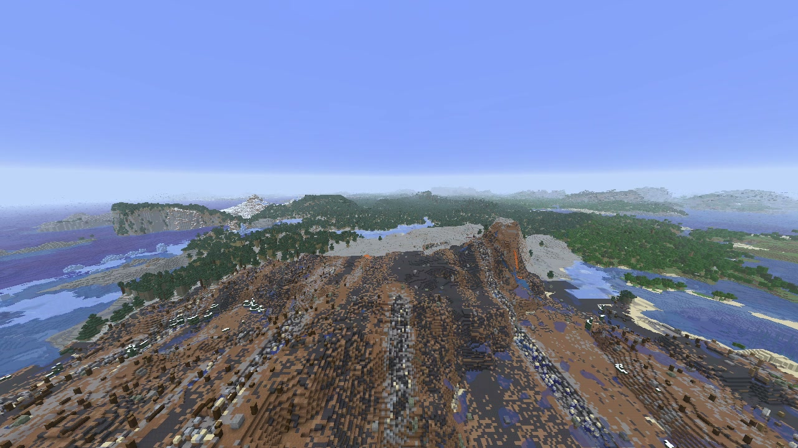

  <picture>
    <source media="(prefers-color-scheme: dark)" srcset="https://github.com/Stink-O/orbital-laser/raw/main/docs/branding/orbital-laser-logo-dark.svg">
    
  </picture>

A new laser, the **Tsunami**, smoother laser switching, and for the native version a server safety fix and a newer Horizon.

The **Tsunami** has no beam. Over three seconds the horizon stands up: a line, a swell, then a dark wall 320 blocks high and over five kilometres wide lying across the whole of it, spray blowing off its top, and the sky goes grey. It comes in at about 100 blocks a second, losing height over the land, a grey-green mass with its lip tearing and foam drawn up its face, a brown foot boiling over the ground with what it has swept up in it, in the game's own textures. It reaches the target at 9 seconds and you a few seconds later. Then it takes you with it, and it leaves the land changed for good.

> [!CAUTION]
> **Photosensitivity:** the Tsunami's blow, as the water takes you, is one white flash over the whole picture, about a fifth of a second. The Hurricane's eyewall lightning is bright flashes over much of the picture, in bursts. The Rod from God's impact frames are a fifth of a second of hard full-screen cuts, on by default (`/orbital impactframes off`). The Supercell's finale and other strikes' lightning and blasts are bright flashes too.

  

  
  

  

## New

- **Tsunami**, on the wheel's third page and `/orbital tsunami`:
  - **the wave:** it stands up over the first three seconds beyond the target, about 1,200 blocks from you, and comes in with stretches of its crest pitching forward, mist pushed along the ground ahead of it and its shadow taking the land. Close by, spray is thrown up where it hits trees, buildings and rises. High ground holds its foot back and it runs on up the low, so it wraps the hills and tongues up the valleys;
  - **in the water:** the blow is a white flash, the picture thrown round and a second or two of foam going past at a violent speed. Then you're in green water with the light coming down through it and wreckage going by, a whole tree and pieces of houses. The water hauls you to the surface after about six seconds, you ride the brown torrent down as it falls, and it sets you down about where it found you, looking at what it left. Hold **sneak** for half a second to break free. `/orbital knockback off` (or KNOCKBACK on the wheel) leaves you standing in it, the picture still drowned;
  - **the land:** a swath 700 blocks across, from 300 upstream of the target to 160 past you. Trees are snapped to stumps and houses to their footings, the soil is scoured to mud and gravel in streaks along the flow, channels are gouged up to 5 deep, wreck is strewn along the flow, a line of drift marks its limit, up to 36 boats are left stranded inland and ponds stand in the hollows. The land is left soaked, with pools on the level ground that dry off as it ends. Every mob and dropped item there dies (not players). Chests and the like stay where they are, with what's in them. It works on far-off targets, up to 1000 blocks;
  - **the sound:** its own, 23 sounds, a rising roar in layers, the crash at the target, trunks cracking and water slapping round you, then the muffled churn underwater, the torrent and the drain. All of it is synthesised;
  - the strike lasts 42 seconds.

## Fixes

- **Switching lasers is smoother.** A laser's effects have to be built when you pick it, which can stop the game for a moment, up to a few seconds the first time. On the wheel that now happens with the wheel still up, saying LOADING. On the native version it happens in the background while the game keeps running, and going back to a laser is instant. On the Orbital Laser build the pause is still there behind the wheel, and `/orbital <laser>` still stops the game for it.
- **A long stall no longer ends a strike.** If the game stopped drawing for a while (the window hidden, the machine busy), the mod took the jump in the world's clock for another world and ended the strike. Leaving the world still ends it.

## Native: the server fix and a newer Horizon

- **World changes need operator level 4.** On a server or LAN host, a strike's world changes run at the console's level, so they are now taken only from a level 4 operator. Before, a level 2 operator with a modified client could run any command that way. If you run the native mod on a server, update. A level 2 or 3 operator can no longer fire strikes that change the world there.
- **A guest's `/orbital` no longer changes the host's game,** and the command is listed for level 4 operators.
- **Far terrain shows what strikes did.** Land a strike changes beyond your render distance now shows in far terrain, usually within a few seconds of you looking at it, with the fix in Horizon ([horizon-rust/horizon#8665](https://github.com/horizon-rust/horizon/pull/8665)).
- **Your hand draws during the Hurricane.**
- **The native source is in this repository,** in `native/`, on this release's tag.

Single player plays as before, and the changes in this section don't touch the fork version.

## Install

1. **Get the Orbital Laser build of Horizon, `orbital-mod-api-10` or newer** (the same as 0.5.8), from [Stink-O/horizon releases](https://github.com/Stink-O/horizon/releases).
2. Download **orbital-laser-v0.5.10.zip** below, unzip it, and with the game closed run `python3 install.py`.
3. Run `./play.sh` (a creative test world) or `./play.sh MyWorld`.
4. In the game, type `/orbital give`. Hold the Designator and press **R** for the laser wheel, and hold right-click with it on a target to fire.

### On regular Horizon (native)

0.5.10 also comes as a native mod for regular Horizon: no fork build and no `play.sh`. The [Horizon launcher](https://playhorizon.dev) (0.2.37 or newer) compiles it into the game.

1. Close the game. Put **orbital.hnmod** (the code and the content, one file) in your instance's `horizon-native-mods/` folder (make them if they aren't there; the Instances page's **Open folder** opens the instance). Give the native mod an instance of its own, not the Orbital Laser build's game folder.
   Coming from an earlier native test build? Delete its `orbital_laser.hnmod` from `horizon-native-mods/`, and `orbital-*.hmod` and `orbital-laser-native-*.hmod` from `horizon-mods/`, first.
2. On the launcher's Mods page, check Orbital Laser is on, and on the **Native build** row pick **Release build** (or run `horizon-launcher settings native-profile release`). It takes longer to build, but the game runs noticeably faster than with the default.
3. On the **Native build** row press **Build**, read the warning and choose **I trust these mods: build**. A native mod's code runs with full access to your computer, so only build it if you trust it.
4. Wait for the build (20 to 30 minutes the first time), play the instance, and type `/orbital give`.

It is built on upstream Horizon `e57b1d34b`, and the launcher builds it there whatever Nightly the instance has. What each system needs first: on **Linux** (tested) a C compiler, `pkg-config` and the ALSA and libudev development files (Debian/Ubuntu: `sudo apt install build-essential pkg-config libasound2-dev libudev-dev`; the launcher names what is missing); on **Windows** (x64) nothing, the launcher brings its own Rust and MinGW-w64; on **macOS** (Apple Silicon) Apple's Command Line Tools (`xcode-select --install`). Windows and macOS are build-checked (the code type-checks and every pass translates for DX12 and Metal) but not yet played. Intel Macs can't build native mods: the launcher has no Rust for them.

Known issues on the native build:

- **On Macs the Downfall's effects don't draw** (Apple's Metal compiler fails on its pass, as on the fork: [#3](https://github.com/Stink-O/orbital-laser/issues/3)); its land and sound still happen.
- **Multiplayer and LAN aren't tested** on the native build; it's made for single player.
- **Each new version rebuilds the game**: 20 to 30 minutes the first time, quicker after.

**Want an AI agent to do it?** Paste the prompt from the [README](https://github.com/Stink-O/orbital-laser#set-it-up-with-an-ai-agent) into your coding agent.

> [!WARNING]
> **Strikes with terrain damage on are permanent.** Only fire them in a throwaway world, or switch terrain damage off on the wheel.

## Assets

| file | what |
|---|---|
| `orbital-laser-v0.5.10.zip` | **the mod (`orbital/`), `install.py` and `play.sh`**: unzip and run `python3 install.py`; needs the Orbital Laser build of Horizon, `orbital-mod-api-10` or newer |
| `orbital.hnmod` | **the native mod for regular Horizon**: its code and its content in one file; goes in the instance's `horizon-native-mods/` |
| `INSTALL.md` | the native install guide: what each system needs, known issues, how to remove it |
| `SHA256SUMS` | the files' checksums |
| Source code (zip / tar.gz) | the whole repository: the mod's source, the 0.1 setup for stock Horizon, and the tools |

> [!IMPORTANT]
> **Nothing from Minecraft is included.** This is an independent fan project, not affiliated with Mojang, Microsoft or Horizon's author. It runs on top of Horizon and needs your own copy of the game.
