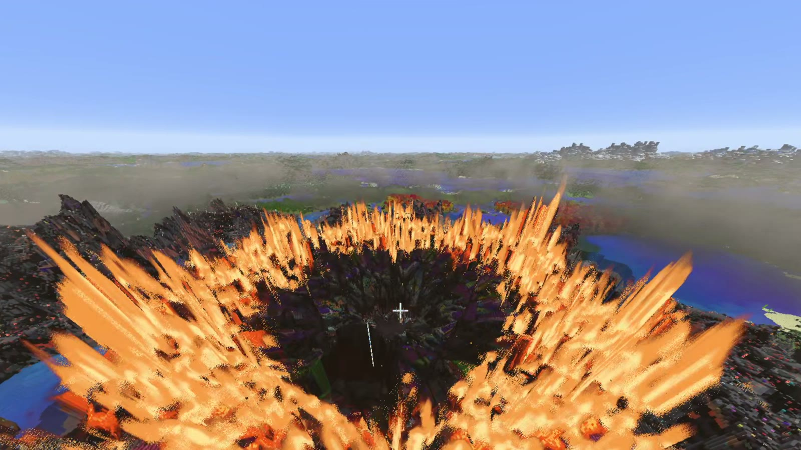
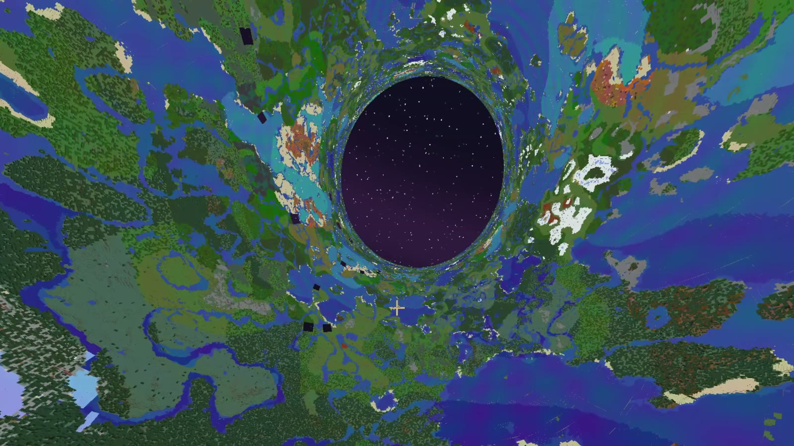
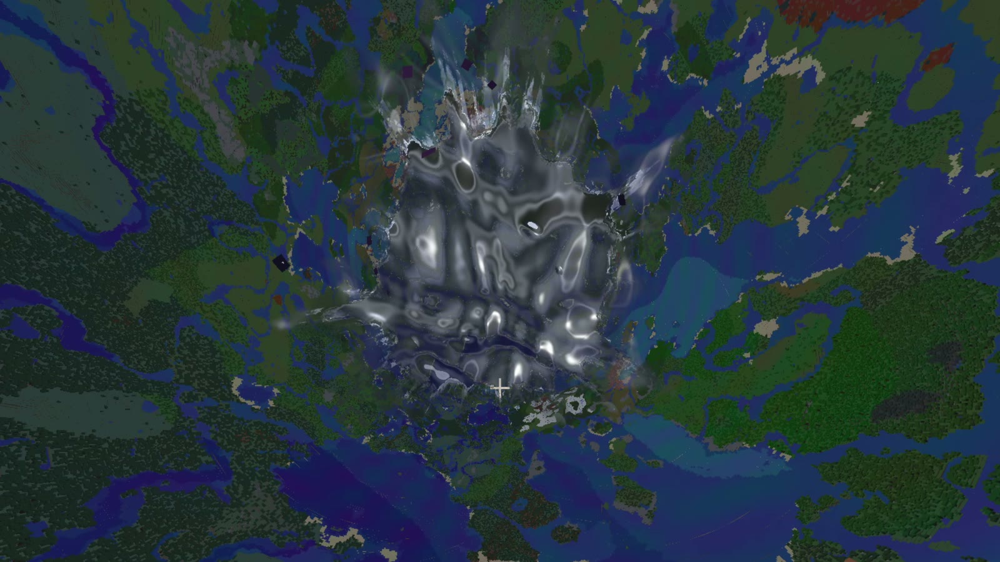
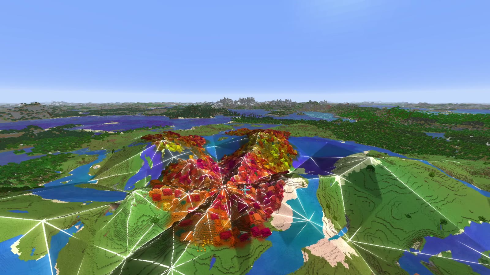
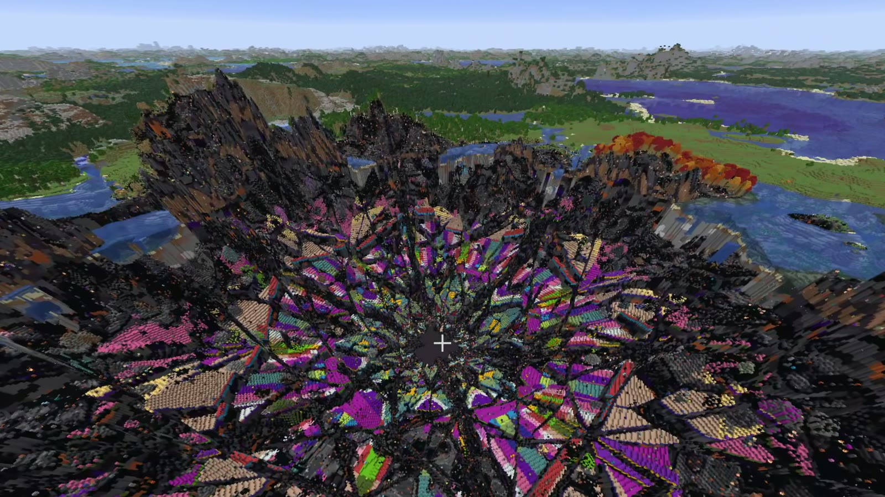

  <picture>
    <source media="(prefers-color-scheme: dark)" srcset="https://github.com/Stink-O/orbital-laser/raw/main/docs/branding/orbital-laser-logo-dark.svg">
    
  </picture>

A new laser, **The Fold**.

**The Fold** has no beam. A drop of liquid metal falls out of the top of the sky, brakes over the target and goes into the land like a stone into water. Ripples run out and sharpen into creases, and the land folds along them: it lifts ring by ring, the horizon curls up over you and you are inside a tube with the whole world on its walls. The hole overhead boils shut in metal, one drop falls the length of the tube to the target, and everything goes back. The rings slam down one by one, outermost first, each bang showing that ring's real damage as the old land crumbles inward. Then the crater falls in, panel by panel, and fire runs out over the land from the middle to the edges. It is on the wheel's fourth page and `/orbital fold`, with three crease patterns on the wheel's FOLD row.

> [!CAUTION]
> **Photosensitivity:** the Fold bends the whole world round you for half a minute, then there is one bright flash and hard jolts at the end. It is strongly distorting: skip it if you are sensitive to those.

  

  
  

  
  

## Native version

**The Fold isn't in the native version.** It bends the world's real geometry, which takes changes to the game's renderer that regular Horizon doesn't have yet. So nothing changes for native this time: the `orbital.hnmod` in this release is the same 0.5.10 file as before, with fifteen lasers.

## Install

The Fold needs the fork version, on the fork's build from the release `orbital-mod-api-11` or newer: older builds won't start the mod. See [Getting started](https://github.com/Stink-O/orbital-laser#getting-started).

**Windows, new and untested:** `orbital-laser-windows-test.zip` has the fork's game and the mod together, with its own setup notes. It has only been run under Wine on Linux, never on real Windows, so expect rough edges and please report how it goes.
