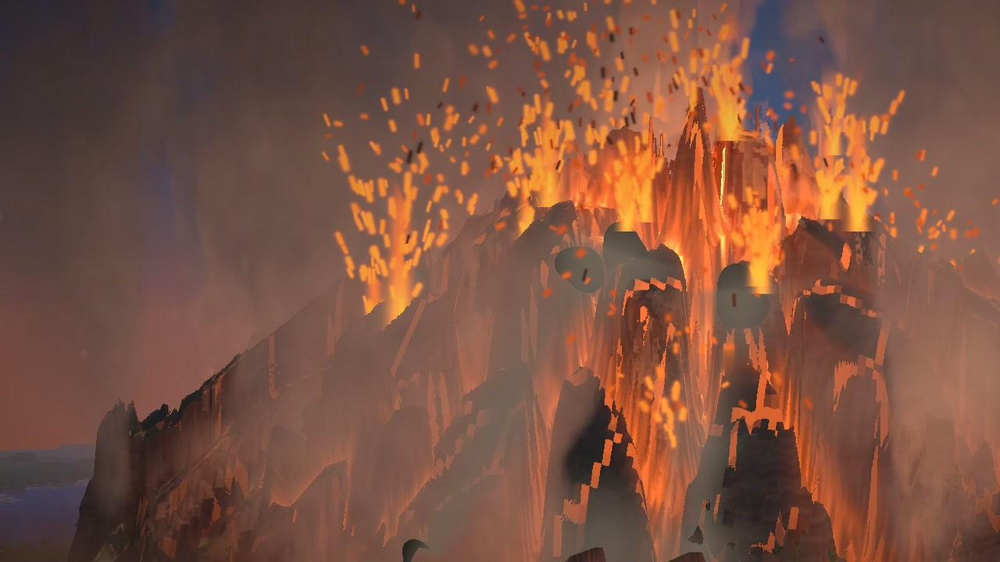
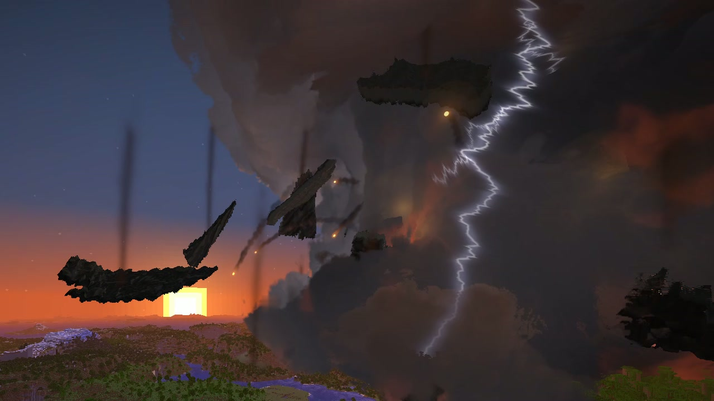
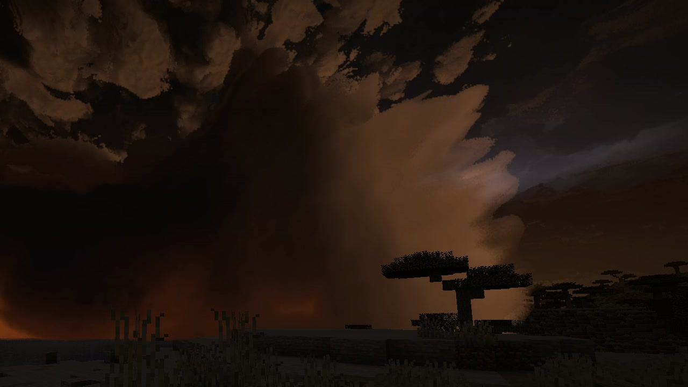
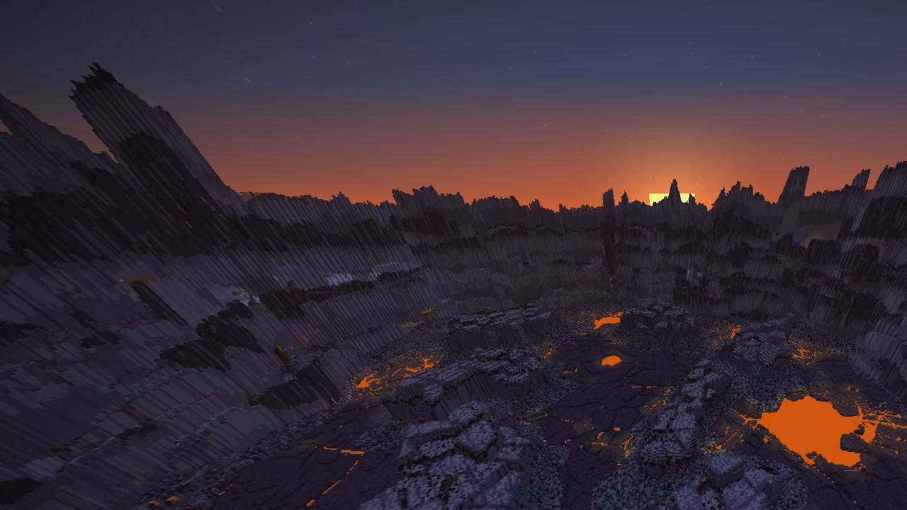

  <picture>
    <source media="(prefers-color-scheme: dark)" srcset="https://github.com/Stink-O/orbital-laser/raw/main/docs/branding/orbital-laser-logo-dark.svg">
    
  </picture>

A new laser, the **Supervolcano**, the effects drawing on DirectX 12, and the native version catching up.

The **Supervolcano** is the crust breached. A small laser satellite comes down out of the sky on its jets, righting itself as it brakes, rolls out its solar arrays and fires a white-hot beam that melts a glowing hole through the land, then lifts away. For ten seconds steam rises off the hole, a tremor builds and the land swells round it. Then it opens in a ring 560 blocks across and a column climbs to some 1,800 blocks, blotting out the sun, lava bombs arcing off it and its umbrella spreading across the whole sky with lightning running through it. The column falls back on itself, the ground inside the ring drops and a wall of ash rolls out over the land and over you, near black, embers going past, the ground shaking under you. It ends on a blood-red sun as the ash thins, over a caldera where the land was.

> [!CAUTION]
> **Photosensitivity:** the Supervolcano's eruption whites out the picture for under a second at 18 seconds, and its lightning flashes in the cloud and over the land from about 26 to 80 seconds. The Tsunami's blow is one white flash over the whole picture. The Hurricane's eyewall lightning is bright flashes over much of the picture, in bursts. The Rod from God's impact frames are a fifth of a second of hard full-screen cuts, on by default (`/orbital impactframes off`). The Fold bends the whole world round you for half a minute.

  

  
  

  

## New

- **Supervolcano**, on the wheel's fourth page and `/orbital supervolcano`:
  - **the satellite:** it comes down a steep slant to its station 7,000 blocks up over the vent, braking on four jets, aims a red targeting beam and fires at 4.5 seconds. The beam melts a hole in the crust and is cut at about 7 seconds, and the satellite rolls its arrays in and lifts away;
  - **the eruption:** the ring cracks through with steam, the land swells round the hole, everything stops dead for a held breath at 17 seconds, and at 18 it bursts: a white-out, the column climbing, lava bombs arcing out from 19 seconds, lightning from 26, the umbrella across the sky from 28 and the sky dark by about 44;
  - **the collapse:** at 50 seconds the column falls back and a wall of ash rolls out from the ring, 500 blocks from the vent by about 54 seconds and 1,000 by about 66, new clouds rising off it. The camera shakes harder and harder as it comes and on and on inside it, and with KNOCKBACK on it shoves you. From 80 seconds the ash thins to a blood-red sun;
  - **the land:** a caldera about 560 across and 90 deep, a lake of dark crust in plates with veins of lava and a few open pools, huge blocks of the land standing in it and a jagged rim of tilted slabs. Round it one sheet of ash out to about 440, the land dusted out to about 1,050, trees charred and felled pointing away, then bare and black, then scorched further out. The ten biggest plates it throws lodge in the land as real blocks, and each lava bomb leaves a small crater. Every mob within 520 dies (not players);
  - **the sound:** its own, 76 sounds, all synthesised: the satellite coming down and firing, the steam and the tremor, the rock grinding, the eruption's report arriving late with the distance, the column's roar, the bombs whistling in and thudding down, thunder from the cloud, and the wall of ash coming in over you;
  - it reaches 1000 blocks, its vent is at least 1,000 blocks in front of you, and the strike lasts 88 seconds. QUALITY FAST (the default) draws its ash cloud at half size, about 17 ms a frame at 1080p; FULL costs about 50 ms a frame during it.

## Fixes

- **The effects draw on DirectX 12, not only Vulkan** ([#12](https://github.com/Stink-O/orbital-laser/issues/12), thanks to everyone who reported and tested it). On the native version on Windows the strikes' effects only drew on Vulkan: DirectX 12's shader compiler couldn't build the passes that write into a vector at a run-time index, and OpenGL refused the way they read the depth. Both are fixed, and every pass now builds for Vulkan, DirectX 12 and OpenGL, all but the Downfall's, which DirectX 12's compiler still can't build. The first time you pick a laser on DirectX 12 its effects can take a while to build.
- **OpenGL no longer risks ending the game.** The native version can't copy the game's picture on OpenGL yet, so it now skips its effects there with one warning in the log instead of a graphics error. Use Vulkan or DirectX 12 for the effects (Options → Graphics → Advanced → Graphics API).
- **The item icons script** no longer recolours the other icons when it is run.
- **The fork's chat knows `/orbital`.** It's no longer marked as an unknown command, and its words fill in as you type, as on the native version. That's in the fork's `orbital-mod-api-12`.
- **No more freeze and crash mid-strike on NVIDIA while the screen is captured.** On the fork version on Linux with an NVIDIA card, the game could freeze for a few seconds and then crash (the kernel logs `Xid 109 CTX SWITCH TIMEOUT`) in the middle of a heavy strike such as the Supervolcano, while OBS or another program was capturing the screen. The game made the graphics card wait for the screen to hand back its image, and the driver gave up on it. It now waits for the image without holding up the graphics card. That's in the fork's `orbital-mod-api-12`.

## Known issues

- **QUALITY FULL is heavy during the Supervolcano**: about 50 ms a frame at 1080p, against about 17 ms on FAST, the default. Keep FAST for it unless your card has room.
- **Picking a laser on the fork version can still stop the game for a moment** while its effects are built (up to a few seconds the first time; the wheel stays up saying LOADING). Building them in the background is to come in a later fork release.

## Native: 0.5.12, on a newer Horizon

- **The native version catches up to 0.5.12**: the Supervolcano plays there, and the DirectX 12 and OpenGL fixes above are in it. It is built on upstream Horizon `fdc87ae`, the Nightly of 2026-11-08.
- **The Fold shows greyed out** in the native wheel, saying "Not on the native build yet". Regular Horizon has merged the two renderer changes it needs (the world warp and the held world), but hasn't numbered their hook points yet, and a native mod can't use them until it has. It comes to the native version in an update once they are.

## Install

1. **Get the Orbital Laser build of Horizon, `orbital-mod-api-12` or newer** (new with this release: the chat knows a mod's commands, and `render.set-hand-tint`), from [Stink-O/horizon releases](https://github.com/Stink-O/horizon/releases). This release won't start on `orbital-mod-api-11` or older.
2. Download **orbital-laser-v0.5.12.zip** below, unzip it, and with the game closed run `python3 install.py`.
3. Run `./play.sh` (a creative test world) or `./play.sh MyWorld`.
4. In the game, type `/orbital give`. Hold the Designator and press **R** for the laser wheel, and hold right-click with it on a target to fire.

**Windows, untested:** `orbital-laser-windows-test.zip` has the fork's game and the mod together, with its own setup notes. It has only been run under Wine on Linux, never on real Windows, so expect rough edges and please report how it goes.

### On regular Horizon (native)

0.5.12 also comes as a native mod for regular Horizon: no fork build and no `play.sh`. The [Horizon launcher](https://playhorizon.dev) (0.2.37 or newer) compiles it into the game.

1. Close the game. On the launcher's **Mods** page, install or update **Orbital Laser**, or put **orbital.hnmod** in your instance's `horizon-native-mods/` folder yourself. Give the native mod an instance of its own, not the Orbital Laser build's game folder.
2. On the **Native build** row pick **Release build** (or run `horizon-launcher settings native-profile release`). It takes longer to build, but the game runs noticeably faster than with the default.
3. Press **Build**, read the warning and choose **I trust these mods: build**. A native mod's code runs with full access to your computer, so only build it if you trust it.
4. Wait for the build (20 to 30 minutes the first time), play the instance, and type `/orbital give`.

What each system needs first: on **Linux** (tested) a C compiler, `pkg-config` and the ALSA and libudev development files (the launcher names what is missing); on **Windows** (x64) nothing, the launcher brings its own Rust and MinGW-w64; on **macOS** (Apple Silicon) Apple's Command Line Tools (`xcode-select --install`). Windows and macOS are build-checked but not yet played. Intel Macs can't build native mods. `INSTALL.md` below has the known issues and how to remove it.

**Want an AI agent to do it?** Paste the prompt from the [README](https://github.com/Stink-O/orbital-laser#set-it-up-with-an-ai-agent) into your coding agent.

> [!WARNING]
> **Strikes with terrain damage on are permanent.** The Supervolcano's caldera is about 560 blocks across and its ash covers the land for a kilometre round it. Only fire them in a throwaway world, or switch terrain damage off on the wheel.

## Assets

| file | what |
|---|---|
| `orbital-laser-v0.5.12.zip` | **the mod (`orbital/`), `install.py` and `play.sh`**: unzip and run `python3 install.py`; needs the Orbital Laser build of Horizon, `orbital-mod-api-12` or newer |
| `orbital.hnmod` | **the native mod for regular Horizon**: its code and its content in one file; goes in the instance's `horizon-native-mods/` |
| `INSTALL.md` | the native install guide: what each system needs, known issues, how to remove it |
| `orbital-laser-windows-test.zip` | the fork's game (`orbital-mod-api-12`) and the mod together for Windows, untested on real Windows |
| `SHA256SUMS` | the files' checksums |
| Source code (zip / tar.gz) | the whole repository: the mod's source, the native build's source in `native/`, and the tools |

> [!IMPORTANT]
> **Nothing from Minecraft is included.** This is an independent fan project, not affiliated with Mojang, Microsoft or Horizon's author. It runs on top of Horizon and needs your own copy of the game.
