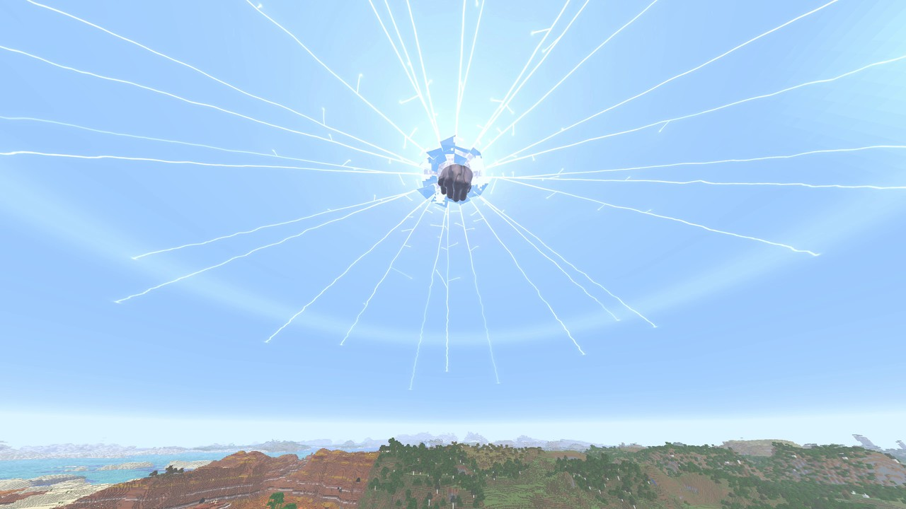
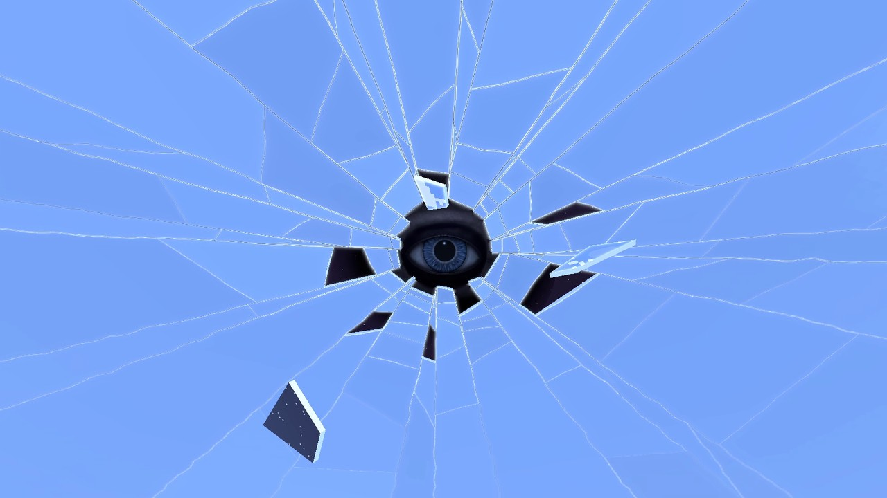
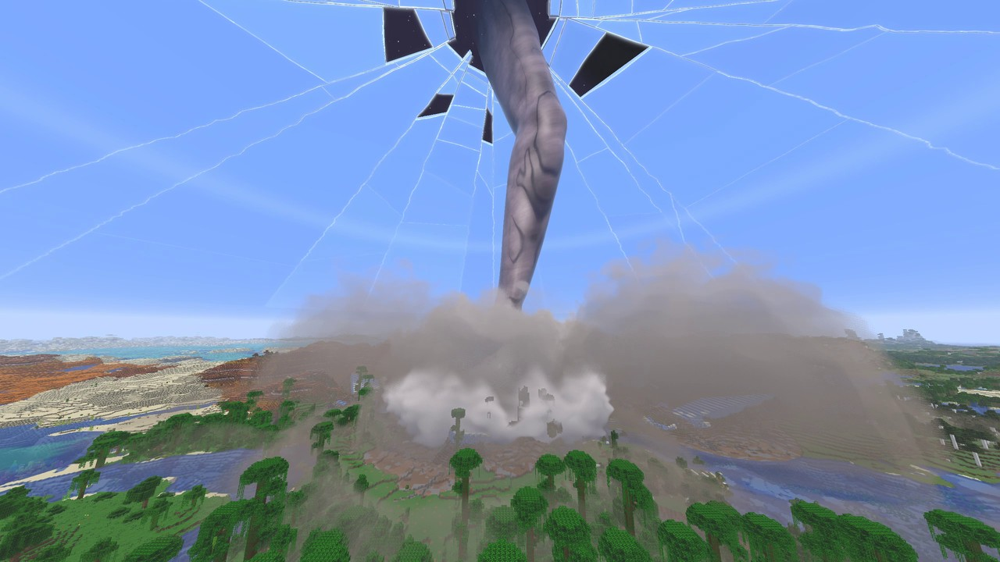
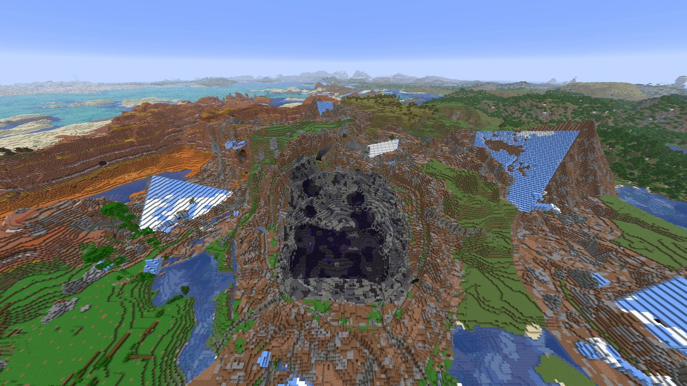

  <picture>
    <source media="(prefers-color-scheme: dark)" srcset="https://github.com/Stink-O/orbital-laser/raw/main/docs/branding/orbital-laser-logo-dark.svg">
    
  </picture>

A new laser, **the Sky Breaks**.

**The Sky Breaks** has no beam. A disc of land tears free round the target, rises into the sky and sinks into it, and the sky rings like a struck pane. Something vast presses on it from behind and bows it down, and at 9 seconds a fist punches through: a blinding flash, cracks racing out across the whole sky, the shattered middle falling. An eye slides into the hole, opens and finds you. Huge panes of sky break free one by one, still showing the sky and its clouds, fall and wedge into the land round the target as real blocks. Then the eye flares and turns away, the fist is thrown back down through the hole and slams the land on the target, a shockwave and a wall of dust run out over the land, and the sky heals over. It is on the wheel's fourth page and `/orbital skybreak`.

> [!CAUTION]
> **Photosensitivity:** the Sky Breaks' punch at 9 seconds is a blinding flash, with the whole picture's light jumping for a fraction of a second. Each pane's impact brightens the picture a moment, the eye's flare at about 35 seconds is a glare through the hole, and as the slam's shockwave passes you the picture greys over with dust for under a second. The Supervolcano's eruption whites out the picture for under a second, and its lightning flashes from about 26 to 80 seconds. The Tsunami's blow is one white flash over the whole picture. The Hurricane's eyewall lightning is bright flashes over much of the picture, in bursts. The Rod from God's impact frames are a fifth of a second of hard full-screen cuts, on by default (`/orbital impactframes off`). The Fold bends the whole world round you for half a minute.

  

  
  

  

## New

- **The Sky Breaks**, on the wheel's fourth page and `/orbital skybreak`:
  - **the opening:** a disc of land some 14 blocks across cracks round its rim and tears free, its real blocks taken out of the world and drawn rising into the sky, dirt falling off its underside and a ring of dust rolling out where it tore out. It sinks into the sky by about 5 seconds, the sky rings, and a hand presses on it from behind, the sky bowing and whitening under it;
  - **the punch:** at 9 seconds the fist punches through. Cracks race out across the whole sky in a tenth of a second, forking, short breaks joining them, and the shattered middle falls in a glittering rain;
  - **the eye:** from 12 seconds an eye some 150 blocks across slides into the hole, opens and looks round until it finds you. It blinks at about 30 seconds, flares at 35, turns away and shuts;
  - **the panes:** from about 17 seconds up to seven huge panes of sky break free one by one, fall for five seconds and smash into the land round the target. They stay as real blocks: their sky on top in blue ice, packed ice and snow, dark obsidian under, lying low and a third buried, the earth they ploughed up heaped against them, the trees round them felled and every mob near them killed. A pane is never brought down on you;
  - **the slam:** at 36 seconds the fist is thrown back down through the hole and at 37.5 it slams the land on the target: a crater about 140 across and 20 deep falling in broken steps to the fist's print, its knuckles' dents deepest, dark obsidian and blackstone pressed into it, the earth heaped round it and the trees laid flat out past that, every mob within 125 killed. A shockwave and a wall of dust run out over the land, and as they reach you the camera jolts as the Payload's does and muck lands on the lens. The last of the shattered middle shakes loose, the arm lifts away, and the sky heals over from 40 to 46.5 seconds;
  - **the sound:** its own, 26 sounds: the ground tearing free, the sky ringing and straining, the glass of the crack built from how real glass breaks, the eye's two deep notes, the panes' falls and impacts, the eye's flare and the fist's descent. The slam plays the Payload's ALT blast. All of it is synthesised but for the glass of the shudder after the slam, which is slices of four CC0 recordings of glass breaking from Freesound (credited in `NOTICE`);
  - it reaches 1000 blocks and the strike lasts 49.5 seconds. QUALITY FAST (the default) draws its dust at half size.

## Native version

**The Sky Breaks isn't in the native version yet.** The native version stays at 0.5.12 this time, with seventeen lasers (the Fold greyed out), and the `orbital.hnmod` in this release is the same 0.5.12 file as before.

## Install

1. **Get the Orbital Laser build of Horizon, `orbital-mod-api-12` or newer**, from [Stink-O/horizon releases](https://github.com/Stink-O/horizon/releases). It's the same fork release as 0.5.12 needed: there is no new one this time.
2. Download **orbital-laser-v0.5.13.zip** below, unzip it, and with the game closed run `python3 install.py`.
3. Run `./play.sh` (a creative test world) or `./play.sh MyWorld`.
4. In the game, type `/orbital give`. Hold the Designator and press **R** for the laser wheel, and hold right-click with it on a target to fire.

**Windows, untested:** `orbital-laser-windows-test.zip` has the fork's game and the mod together, with its own setup notes. It has only been run under Wine on Linux, never on real Windows, so expect rough edges and please report how it goes.

**Want an AI agent to do it?** Paste the prompt from the [README](https://github.com/Stink-O/orbital-laser#set-it-up-with-an-ai-agent) into your coding agent.

> [!WARNING]
> **Strikes with terrain damage on are permanent.** The Sky Breaks' panes stay wedged in the land round the target and its fist leaves a crater about 140 blocks across. Only fire them in a throwaway world, or switch terrain damage off on the wheel.

## Assets

| file | what |
|---|---|
| `orbital-laser-v0.5.13.zip` | **the mod (`orbital/`), `install.py` and `play.sh`**: unzip and run `python3 install.py`; needs the Orbital Laser build of Horizon, `orbital-mod-api-12` or newer |
| `orbital.hnmod` | **the native mod for regular Horizon**, still 0.5.12: its code and its content in one file; goes in the instance's `horizon-native-mods/` |
| `INSTALL.md` | the native install guide: what each system needs, known issues, how to remove it |
| `orbital-laser-windows-test.zip` | the fork's game (`orbital-mod-api-12`) and the mod together for Windows, untested on real Windows |
| `SHA256SUMS` | the files' checksums |
| Source code (zip / tar.gz) | the whole repository: the mod's source, the native build's source in `native/`, and the tools |

> [!IMPORTANT]
> **Nothing from Minecraft is included.** This is an independent fan project, not affiliated with Mojang, Microsoft or Horizon's author. It runs on top of Horizon and needs your own copy of the game.
