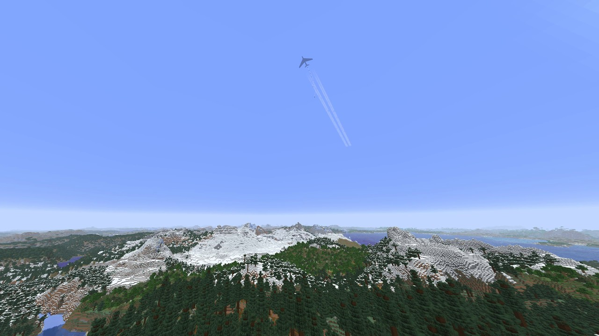
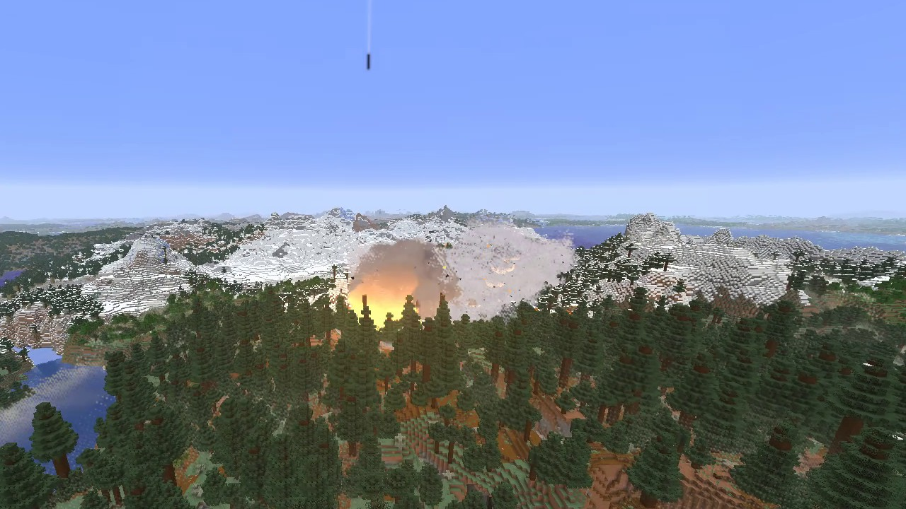
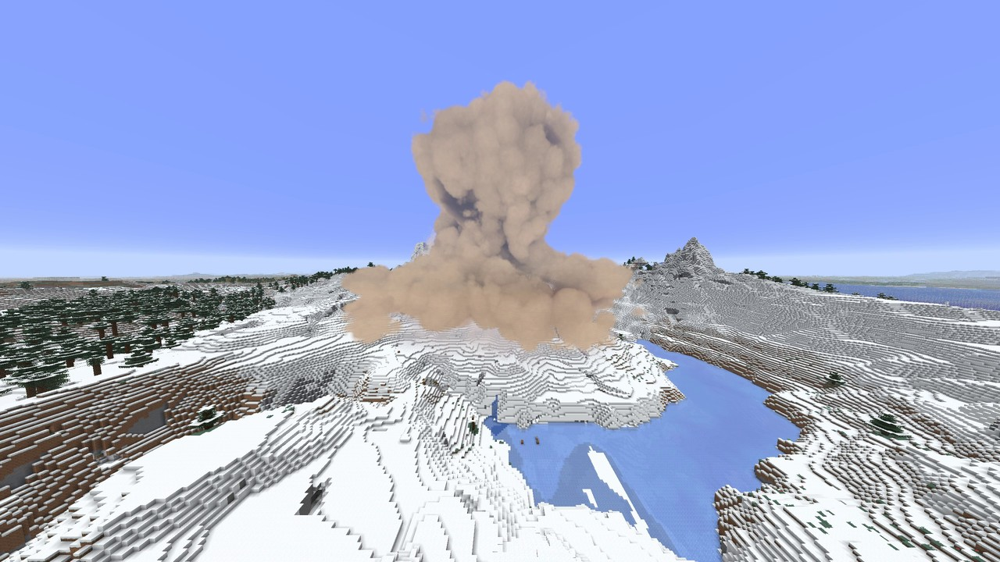
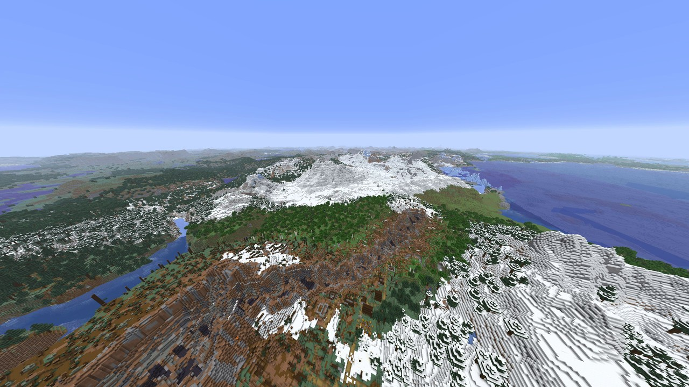

  <picture>
    <source media="(prefers-color-scheme: dark)" srcset="https://github.com/Stink-O/orbital-laser/raw/main/docs/branding/orbital-laser-logo-dark.svg">
    
  </picture>

A new laser, **the Carpet Bomb**.

**The Carpet Bomb** has no beam. A heavy bomber comes in high out of the haze beyond the target, its four contrails trailing it, and lets its stick of thirteen bombs go as it passes over. From 7 seconds they walk a line of blasts across the land towards you, about half a second apart, each a flash, a low boiling cloud and a front of dust racing out over the land, the rumble rolling into one wall of sound, while the bomber flies on overhead and away. The last bomb, at about 15 seconds, is the biggest: its cloud boils up out of the crater, a pale flash races across the land with its shockwave, and as the front reaches you the camera jolts and you're thrown back. It leaves a ragged trench of craters along the line, the land flattened, charred and burning. It is on the wheel's fourth page and `/orbital carpetbomb`.

> [!CAUTION]
> **Photosensitivity:** each of the Carpet Bomb's blasts is a quick flash with an orange glow through the smoke and dust for about a second, thirteen of them half a second apart; the last one's flash is brighter and lights the land round it, and a pale flash races across the land with its shockwave. The Sky Breaks' punch at 9 seconds is a blinding flash, with the whole picture's light jumping for a fraction of a second. The Supervolcano's eruption whites out the picture for under a second, and its lightning flashes from about 26 to 80 seconds. The Tsunami's blow is one white flash over the whole picture. The Hurricane's eyewall lightning is bright flashes over much of the picture, in bursts. The Rod from God's impact frames are a fifth of a second of hard full-screen cuts, on by default (`/orbital impactframes off`). The Fold bends the whole world round you for half a minute.

  

  
  

  

## New

- **The Carpet Bomb**, on the wheel's fourth page and `/orbital carpetbomb`:
  - **the bomber:** a heavy swept-wing bomber comes out of the haze far beyond the target from the first second, high and steady, its four engines' contrails trailing it and its drone growing. At about 4.4 seconds it lets its stick go, thirteen bombs one after another over under two seconds, as it passes over the start of the line. It flies on over and past you (well to one side) and is gone into the haze soon after the last blast;
  - **the run:** the bombs come down on a line about 265 blocks long walking towards you, coming in at an angle so the blasts sweep across the picture, from 7 seconds about half a second and 22 blocks apart. Each is a flash, a low boiling cloud lit orange from inside as it goes off, a front of dust racing out over the land at the speed of sound, earth thrown up and falling back, fires left burning in its crater and round it, and a jolt of the camera. The dust rolls along the line into one wall;
  - **the last bomb:** at about 15 seconds, at least 100 blocks in front of you, the biggest: a brighter flash lighting the land, its cloud pushed up out of the crater billow by billow, boiling into a broad dome over a skirt of dust, its head leaning downwind into a plume; a pale condensation flash racing across the land with its shockwave, burning debris thrown far, and as the front reaches you the camera jolts hard, it throws you back and muck lands on the lens. KNOCKBACK decides whether it throws you;
  - **what it leaves:** a ragged trench of craters along the line, each about 25 across and 8 deep, the land flattened to about 35 round each, the trees felled to about 50 and the grass charred to about 55; the last crater about 65 across and 16 deep, its walls stepped and scorched, its rim heaped with a few fires left burning on it, the land flattened out to about 110 round it, the trees felled to about 150 and the grass charred to about 170. Rubble is strewn and real blocks are thrown out of every crater, and every mob within about 40 of each blast (about 125 of the last) is killed;
  - **the sound:** its own, synthesised: the bombers' drone following the bomber over, and each bomb a low, rolling blast, duller and later from the far end of the line, rolling into one wall of sound as the stick walks in. There is no falling sound. The last blast plays the Payload's ALT blast with the Nuke's ALT under it;
  - it reaches 1000 blocks and the strike lasts 37.5 seconds. QUALITY FAST (the default) draws its smoke, dust and shockwaves at half size.

## Native version

**The Carpet Bomb isn't in the native version yet.** The native version stays at 0.5.12 this time, with seventeen lasers (the Fold greyed out, no Sky Breaks or Carpet Bomb yet), and the `orbital.hnmod` in this release is the same 0.5.12 file as before.

## Install

1. **Get the Orbital Laser build of Horizon, `orbital-mod-api-12` or newer**, from [Stink-O/horizon releases](https://github.com/Stink-O/horizon/releases). It's the same fork release as 0.5.13 needed: there is no new one this time.
2. Download **orbital-laser-v0.5.14.zip** below, unzip it, and with the game closed run `python3 install.py`.
3. Run `./play.sh` (a creative test world) or `./play.sh MyWorld`.
4. In the game, type `/orbital give`. Hold the Designator and press **R** for the laser wheel, and hold right-click with it on a target to fire.

**Windows, untested:** `orbital-laser-windows-test.zip` has the fork's game and the mod together, with its own setup notes. It has only been run under Wine on Linux, never on real Windows, so expect rough edges and please report how it goes.

**Want an AI agent to do it?** Paste the prompt from the [README](https://github.com/Stink-O/orbital-laser#set-it-up-with-an-ai-agent) into your coding agent.

> [!WARNING]
> **Strikes with terrain damage on are permanent.** The Carpet Bomb leaves a trench of craters some 265 blocks long, its last crater about 65 across with the land flattened out to about 110 round it, and fires left burning on its rim. Only fire it in a throwaway world, or switch terrain damage off on the wheel.

## Assets

| file | what |
|---|---|
| `orbital-laser-v0.5.14.zip` | **the mod (`orbital/`), `install.py` and `play.sh`**: unzip and run `python3 install.py`; needs the Orbital Laser build of Horizon, `orbital-mod-api-12` or newer |
| `orbital.hnmod` | **the native mod for regular Horizon**, still 0.5.12: its code and its content in one file; goes in the instance's `horizon-native-mods/` |
| `INSTALL.md` | the native install guide: what each system needs, known issues, how to remove it |
| `orbital-laser-windows-test.zip` | the fork's game (`orbital-mod-api-12`) and the mod together for Windows, untested on real Windows |
| `SHA256SUMS` | the files' checksums |
| Source code (zip / tar.gz) | the whole repository: the mod's source, the native build's source in `native/`, and the tools |

> [!IMPORTANT]
> **Nothing from Minecraft is included.** This is an independent fan project, not affiliated with Mojang, Microsoft or Horizon's author. It runs on top of Horizon and needs your own copy of the game.
