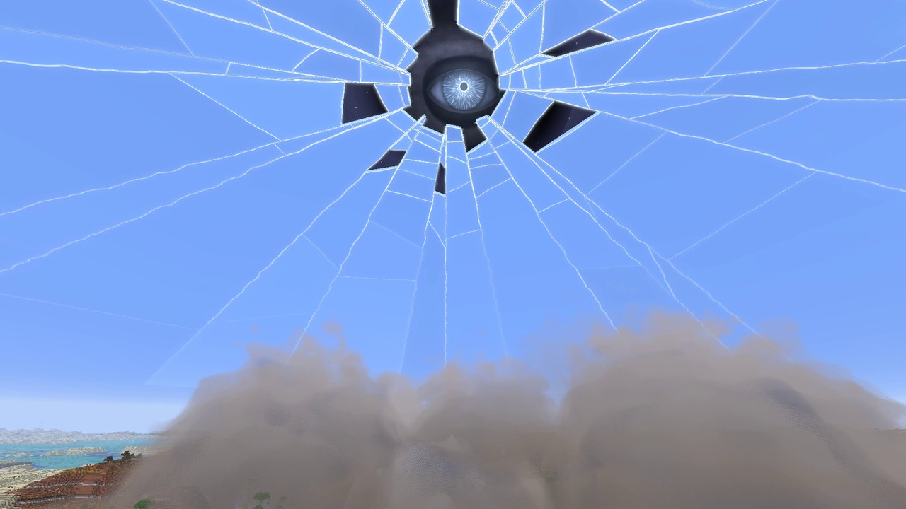

  <picture>
    <source media="(prefers-color-scheme: dark)" srcset="https://github.com/Stink-O/orbital-laser/raw/main/docs/branding/orbital-laser-logo-dark.svg">
    
  </picture>

**The native version catches up: every laser now plays on regular Horizon.** The Fold and the Sky Breaks join the other
sixteen on the native version, installed from the launcher's Mods page. The fork version is the same mod as 0.5.13.

  

## New

- **The Fold plays natively.** Regular Horizon now has the world warp and the held world it needs
  (horizon-rust/horizon#11955 and #11956, numbered in #12794), so it is no longer greyed out in the wheel.
- **The Sky Breaks plays natively**, as on the fork since 0.5.13: see the
  [0.5.13 notes](https://github.com/Stink-O/orbital-laser/releases/tag/v0.5.13) for what it does, and its
  photosensitivity note.
- The native build is pinned to upstream Horizon `89f236e3e`, the commit that numbers those two hook points. The launcher
  builds it on that revision, whatever Nightly you have.

## Install

**Native (regular Horizon):** on the launcher's **Mods** page, search **orbital** and install or update Orbital Laser,
then on the **Native build** row pick **Release build** and press **Build**. Or put `orbital.hnmod` below into the
instance's `horizon-native-mods/` folder. `INSTALL.md` has what each system needs and the known issues.

**Fork version:** nothing new; `orbital-laser-v0.5.14.zip` is 0.5.13's mod with its version number moved on. It needs the
Orbital Laser build of Horizon, `orbital-mod-api-12` or newer.

> [!WARNING]
> **Strikes with terrain damage on are permanent.** Only fire them in a throwaway world, or switch terrain damage off on
> the wheel.

## Assets

| file | what |
|---|---|
| `orbital.hnmod` | **the native mod for regular Horizon**, 0.5.14: its code and its content in one file; goes in the instance's `horizon-native-mods/` |
| `INSTALL.md` | the native install guide: what each system needs, known issues, how to remove it |
| `orbital-laser-v0.5.14.zip` | the fork version's mod, `install.py` and `play.sh`; needs `orbital-mod-api-12` or newer |
| `SHA256SUMS` | the files' checksums |
| Source code (zip / tar.gz) | the whole repository: the mod's source, the native build's source in `native/`, and the tools |

> [!IMPORTANT]
> **Nothing from Minecraft is included.** This is an independent fan project, not affiliated with Mojang, Microsoft or Horizon's author. It runs on top of Horizon and needs your own copy of the game.
