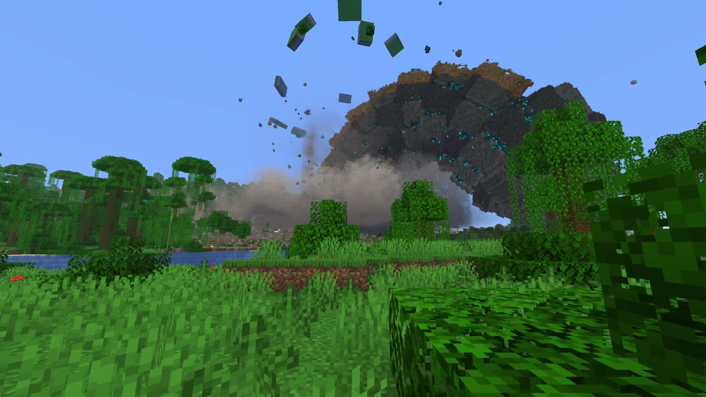
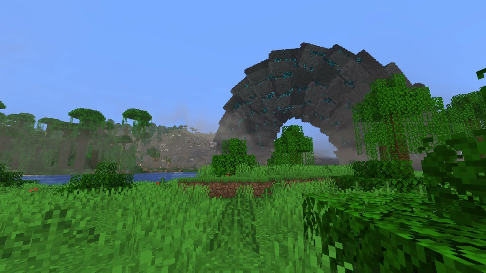
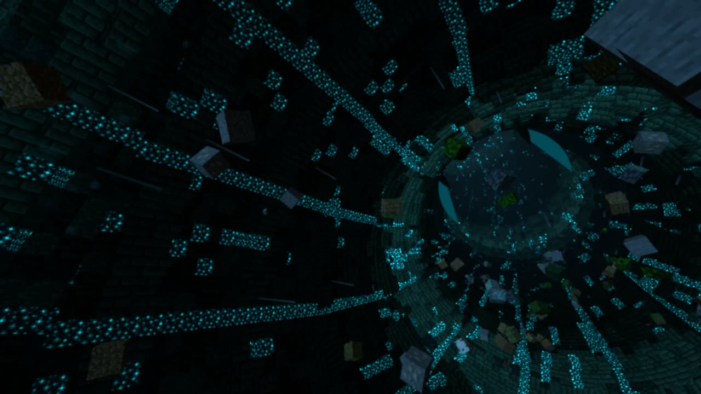
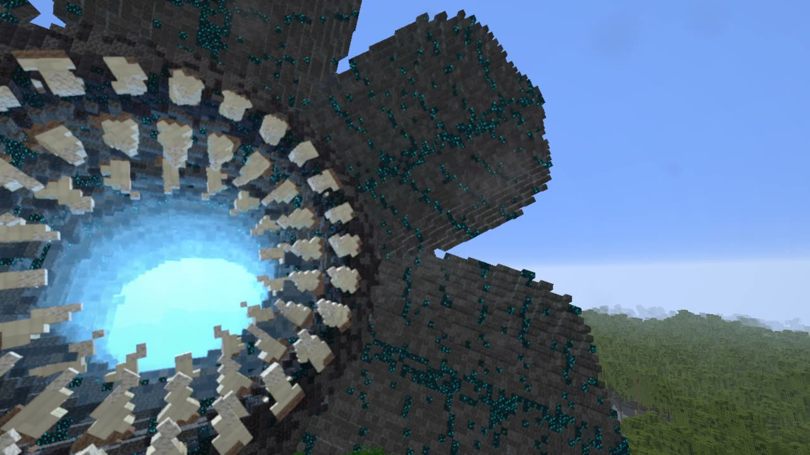
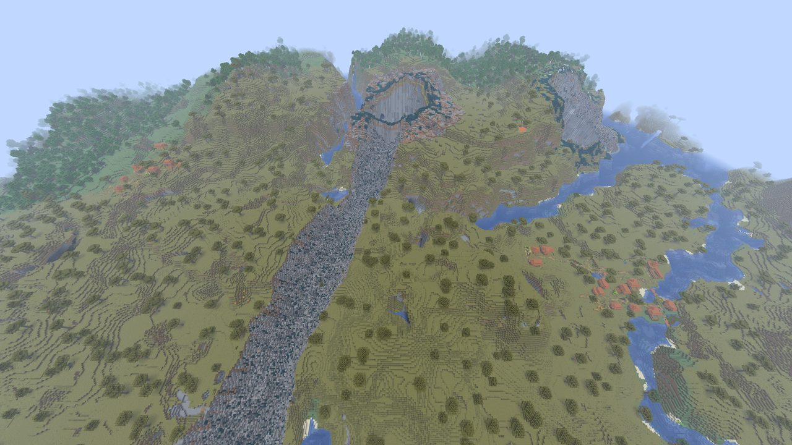

  <picture>
    <source media="(prefers-color-scheme: dark)" srcset="https://github.com/Stink-O/orbital-laser/raw/main/docs/branding/orbital-laser-logo-dark.svg">
    
  </picture>

A new laser, **the World Eater**, and the first one that comes after you.

**The World Eater** has no beam. A rumble grows under your feet as something ploughs through the ground towards the target, the land bucking over it. At 9 seconds the land domes up, cracks open glowing teal, and a worm the size of a mountain bursts out, built of real blocks: plated in deepslate and blackstone, sculk glowing in its seams, a round mouth of jaw petals and rings of teeth. Then it hunts you. It dives back in and breaks out again nearer you, two or three low hops, then rears up over the land, spreads its jaws, bellows and comes down on you. If its mouth closes over you, it swallows you: you're carried down its glowing throat with the land it ate, along its tunnel under the ground, and spat out over the land where it breaks out next. It leaves a hole to bedrock everywhere it broke out or bit in, and the land over its tunnels caves into trenches. It's on the wheel's fourth page and `/orbital worldeater`.

> [!CAUTION]
> **Photosensitivity and motion:** the camera jolts hard each time the World Eater breaks out and bites in. Being swallowed turns the picture black for under a second, then carries your view fast down a glowing tunnel for several seconds and throws it out over the land. The Carpet Bomb's blasts are quick flashes, thirteen of them half a second apart. The Sky Breaks' punch at 9 seconds is a blinding flash. The Supervolcano's eruption whites out the picture for under a second, and its lightning flashes from about 26 to 80 seconds. The Tsunami's blow is one white flash over the whole picture. The Hurricane's eyewall lightning is bright flashes over much of the picture, in bursts. The Rod from God's impact frames are a fifth of a second of hard full-screen cuts, on by default (`/orbital impactframes off`). The Fold bends the whole world round you for half a minute.

  

  
  

  
  

## New

- **The World Eater**, on the wheel's fourth page and `/orbital worldeater`:
  - **the wormsign:** a deep rumble under the land, only growing, as something ploughs through the ground towards the target from some 420 blocks off. The land over it bucks in real blocks, trees topple away from its line and short bursts of dust kick up along its track with a teal glow at their foot;
  - **the breach:** at 9 seconds the land over the target domes up and cracks open, glowing teal, and the worm punches out, throwing a crown of real blocks and whole trees, a sheet of dust blasting out over the land and the camera jolting. It is 68 blocks thick and over 1,800 long, built of real blocks in the game's own textures: rings of deepslate and blackstone plates, tuff in the joints, sculk growing in the seams with a slow teal pulse, a round mouth of six jaw petals round three rings of turning teeth, its throat glowing soul-blue. Its head turns on its neck to look at you;
  - **the hunt (HUNT, the default):** it arcs over and dives back into the land, runs on under it, and breaks out again nearer you. Two or three low hops, each one planned while the last is still in the air and aimed at where you are then (it leads you a little if you move), then the big arch: it rears up some 250 blocks over the land, holds there with its jaws spread and bellows, and comes down mouth first on you. No two hunts play the same. It lasts up to 90 seconds;
  - **swallowed:** if its jaws come down over you, or it comes up under you, the petals close round the view and it goes dark. Then you're carried inside: down its throat, dark ribbed walls glowing with sculk veins, the land it ate streaming past you, wind rushing by, along its tunnel under the ground and up, until the teeth come at you from far down the throat and you're pushed out through its mouth and thrown clear over the land where it breaks out next. If that was its last bite, it comes up once more, small, just to spit you out. Creative players keep flying; a survival player gets Resistance V so nothing hurts. Stopping the strike while you're inside puts you on the land beside the hole;
  - **SCRIPTED:** the wheel's TAKE row (or `/orbital worldeater scripted`) gives the one-arch show instead, the same every time, 46 seconds, made for filming: the wormsign across your view, the breach on the target, the rise and the bellow, the bite 260 blocks off at 19 seconds, the body pouring over in an arch across the sky until its tail goes in at 31, and its tunnel caving in;
  - **keeping it a show:** with KNOCKBACK off or terrain damage off it can't swallow you (it still comes after you, and the camera still jolts). KNOCKBACK off also leaves out its push as it breaks out and bites in. The scripted take can still swallow you if you stand where it breaks out, on the target, unless one of them is off;
  - **what it leaves (terrain on):** a hole open to bedrock about 80 across wherever it broke out, its walls darkening downward to blackstone, a rim of thrown earth round it and the trees felled out to about 120 lying pointing away; a hole about 90 across wherever it bit in, caving to a funnel; sculk creeping out round them; and once its tail has passed, the land over every stretch it tunnelled sinks into a trench about 50 wide and 25 deep, its floor rubble, lakes and rivers left standing. Every mob within about 110 of its holes and its way is killed;
  - **the sound:** its own. A croaking voice as it breaks out, the burst out of the ground (a whump with the weight of an explosion but no bang), the ground grinding as it moves under you, the bellow, the bite as the jaws drive into the land, the tunnel slumping, and inside, the gulp, the throat's roar and the wind of the ride. The burst and the ground are built from CC0 recordings (every one is listed in NOTICE) over synthesised layers; `/orbital wormground a|b|c|old|off` picks the take for the sound under the ground, for the session;
  - it reaches 1000 blocks. QUALITY FAST (the default) draws its body and dust at half size.
- **QUALITY has a third setting, PERFORMANCE** (`/orbital quality performance`, or click the wheel's QUALITY switch on to PERF): as FAST, with the World Eater drawn at its lightest (less detail, fewer pieces and falling blocks, its land's dressing left out). The other lasers draw as on FAST.
- The README's steps for putting the native file in by hand are back.

## Known issues

- **The first time you pick the World Eater, the game freezes while its effects are built**: about half a minute to a minute and a half on the fork build `orbital-mod-api-12`. Nothing after that, until a driver update or a new version of the mod. Give it the time: it comes back.
- **It's the heaviest laser.** At 2560x1440 on QUALITY FAST (an RTX 4070 SUPER), the game's frame takes about 5 ms of GPU time for most of a hunt, 17 to 26 ms through the breach and the hops and 9 to 19 ms while you ride inside, with whole frames spiking to 20 to 60 ms round the breach, the swallow and the spit (the slowest half second about 41 fps); the scripted show seen from 250 blocks off tops out at about 13 ms of GPU time. If it's too slow, `/orbital quality performance`.
- **Its neck shows stacked discs** as its head turns to look at you: the rings behind the head fan out into a stack of discs instead of bending smoothly.

## Native version

**The native version stays at 0.5.14** (the same `orbital.hnmod` as last time). The World Eater isn't in it yet, and the Fold, the Sky Breaks and the Carpet Bomb show greyed out there ("On the fork now, native soon"); to play them now, use the fork version below.

**A reliable native version is waiting on upstream Horizon.** I can't release a native build I'd call reliable until Horizon merges the fixes I've sent it. Two are still open: the game's sound stopping during a heavy strike ([horizon-rust/horizon#15875](https://github.com/horizon-rust/horizon/pull/15875)) and frames hanging on NVIDIA cards on Linux ([horizon-rust/horizon#13885](https://github.com/horizon-rust/horizon/pull/13885)); mod messages being dropped when the server runs behind is reported and not fixed yet ([horizon-rust/horizon#15879](https://github.com/horizon-rust/horizon/issues/15879)). Until those are in, new lasers come to the fork first, and the native file follows.

## Install

1. **Get the Orbital Laser build of Horizon, `orbital-mod-api-12` or newer**, from [Stink-O/horizon releases](https://github.com/Stink-O/horizon/releases). It's the same fork release as 0.5.13 and 0.5.14 needed: there is no new one this time.
2. Download **orbital-laser-v0.5.15.zip** below, unzip it, and with the game closed run `python3 install.py`.
3. Run `./play.sh` (a creative test world) or `./play.sh MyWorld`.
4. In the game, type `/orbital give`. Hold the Designator and press **R** for the laser wheel, and hold right-click with it on a target to fire.

**Windows, untested:** `orbital-laser-windows-test.zip` has the fork's game and the mod together, with its own setup notes. It has only been run under Wine on Linux, never on real Windows, so expect rough edges and please report how it goes.

**Want an AI agent to do it?** Paste the prompt from the [README](https://github.com/Stink-O/orbital-laser#set-it-up-with-an-ai-agent) into your coding agent.

> [!WARNING]
> **Strikes with terrain damage on are permanent.** The World Eater leaves a hole to bedrock about 80 to 90 across everywhere it broke out or bit in, and a trench about 50 wide over every stretch it tunnelled, wherever it chased you. Only fire it in a throwaway world, or switch terrain damage off on the wheel.

## Assets

| file | what |
|---|---|
| `orbital-laser-v0.5.15.zip` | **the mod (`orbital/`), `install.py` and `play.sh`**: unzip and run `python3 install.py`; needs the Orbital Laser build of Horizon, `orbital-mod-api-12` or newer |
| `orbital.hnmod` | **the native mod for regular Horizon**, still 0.5.14 (no World Eater; the Fold, the Sky Breaks and the Carpet Bomb greyed out for now): its code and its content in one file; goes in the instance's `horizon-native-mods/` |
| `INSTALL.md` | the native install guide: what each system needs, known issues, how to remove it |
| `orbital-laser-windows-test.zip` | the fork's game (`orbital-mod-api-12`) and the mod together for Windows, untested on real Windows |
| `SHA256SUMS` | the files' checksums |
| Source code (zip / tar.gz) | the whole repository: the mod's source, the native build's source in `native/`, and the tools |

> [!IMPORTANT]
> **Nothing from Minecraft is included.** This is an independent fan project, not affiliated with Mojang, Microsoft or Horizon's author. It runs on top of Horizon and needs your own copy of the game.
