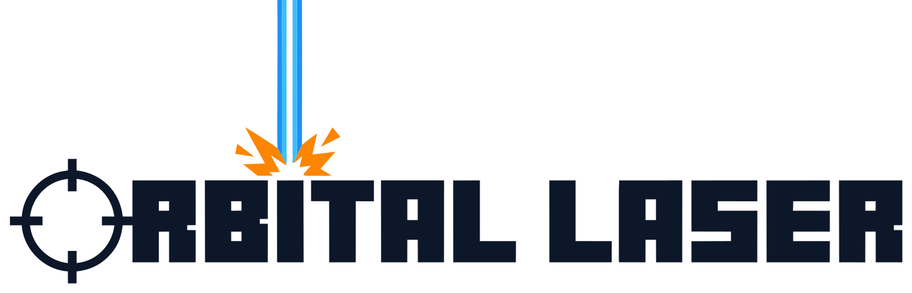
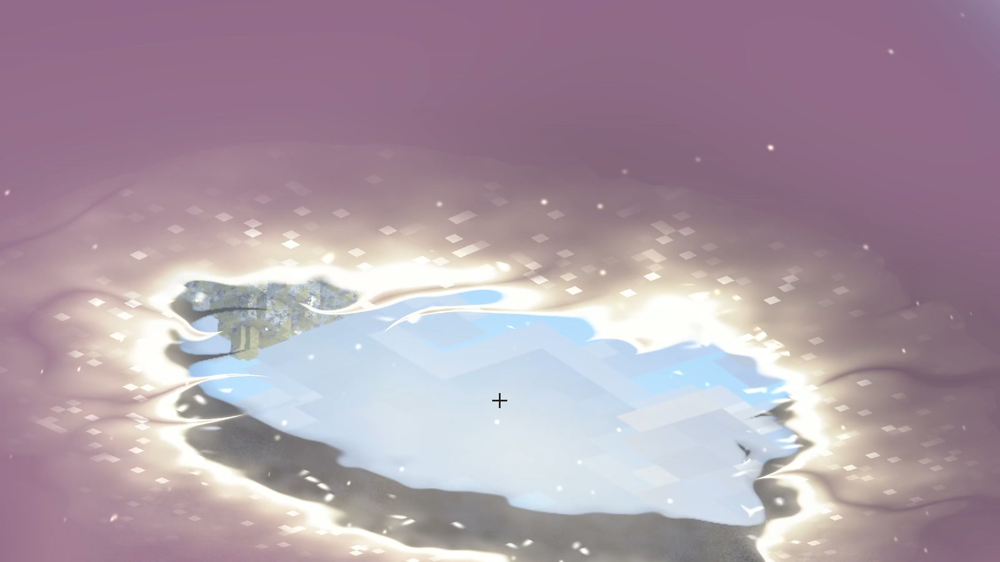
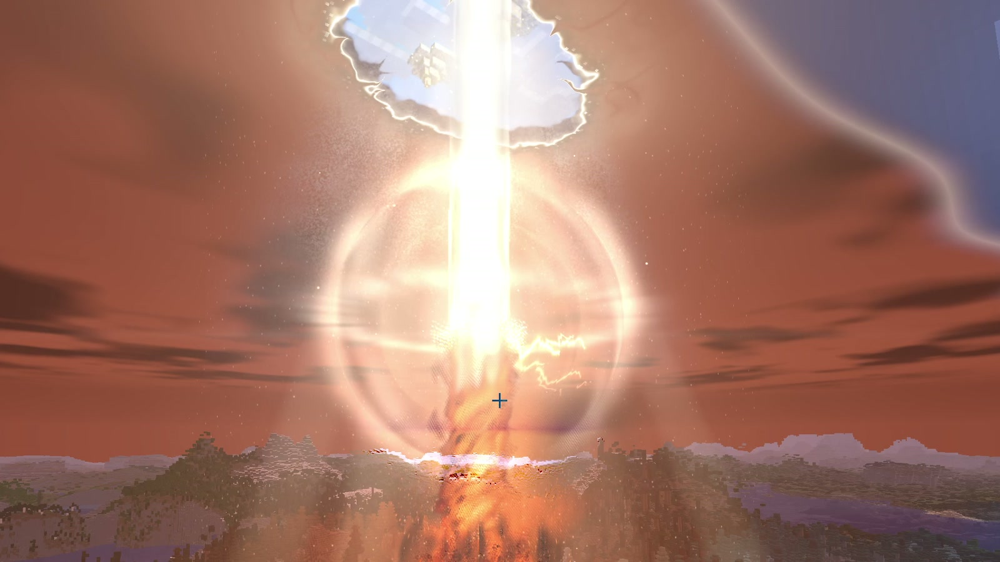
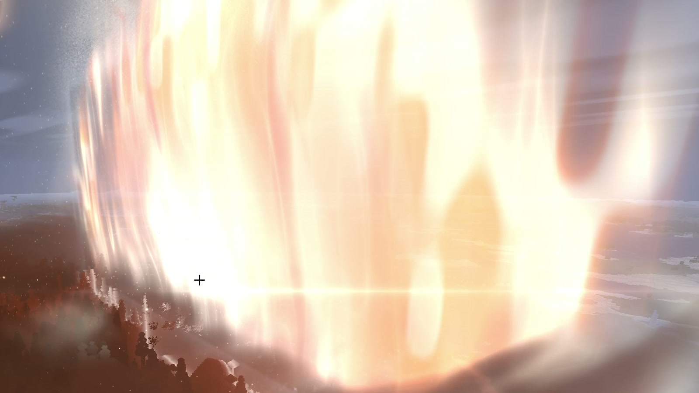
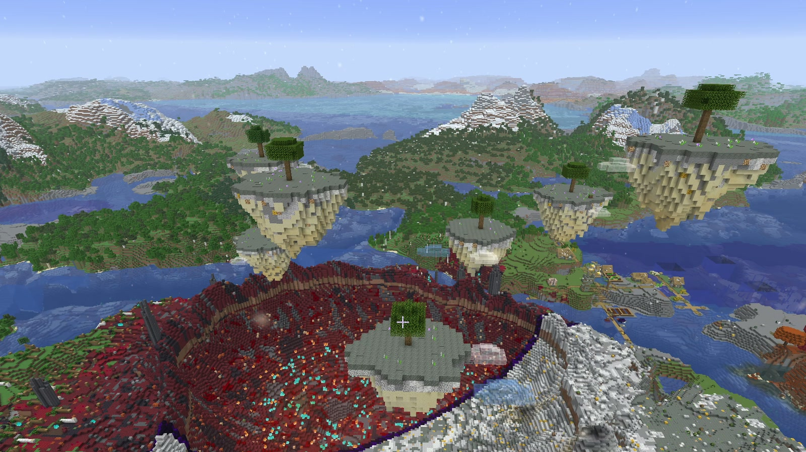

  <picture>
    <source media="(prefers-color-scheme: dark)" srcset="https://github.com/Stink-O/orbital-laser/raw/main/docs/branding/orbital-laser-logo-dark.svg">
    
  </picture>

A new laser, **the Convergence**: the Nether and the Aether break into the world over the target and fight.

**The Convergence** has no beam. The ground trembles and cracks of fire run out from the target, and at 5 seconds they open into real fissures with fire and ash rushing out of them while a rift tears open in the sky 260 blocks up, a brighter sky with floating islands showing through it. The daylight goes out and the sky splits in two, red over one half of the land and deep blue over the other. A column of fire rises out of the ground and a column of light comes down out of the rift; at 13 seconds they strike each other in the air 130 blocks over the land and fight for ten seconds, six surges each sending a ring out. Then the light drives the meeting point down into the ground, and at 26 seconds the blast tears the land in two: a crater about 170 across, half Nether and half pale stone and moss, a seam of obsidian between them, and small islands of the Aether left hanging in the sky over it. It's on the wheel's fifth page and `/orbital convergence`.

> [!CAUTION]
> **Photosensitivity and motion:** the Convergence's blast at 26 seconds opens with impact frames: a fifth of a second of hard full-screen cuts in black, white and the two sides' colours, then a white flash. They are on by default; `/orbital impactframes off` (or OFF on the wheel's IMPACT FX row) leaves them out, for the Rod from God too. The columns meeting at 13 seconds is a short bright flash, and the camera jolts at each of the six surges and hard at the blast. The World Eater jolts the camera hard each time it breaks out and bites in, and being swallowed turns the picture black for under a second, then carries your view fast down a glowing tunnel. The Carpet Bomb's blasts are quick flashes, thirteen of them half a second apart. The Sky Breaks' punch at 9 seconds is a blinding flash. The Supervolcano's eruption whites out the picture for under a second, and its lightning flashes from about 26 to 80 seconds. The Tsunami's blow is one white flash over the whole picture. The Hurricane's eyewall lightning is bright flashes over much of the picture, in bursts. The Rod from God's impact frames are a fifth of a second of hard full-screen cuts, on by default. The Fold bends the whole world round you for half a minute.

  

  
  

  

## New

- **The Convergence**, on the wheel's fifth page and `/orbital convergence`, 60 seconds:
  - **the omen:** for five seconds the ground trembles, seven cracks glow out from the target and a seam of light opens high over it;
  - **the break:** at 5 seconds the cracks open into real fissures, fire and ash rushing out of them, netherrack creeps out along veins round them and basalt shoulders up out of the ground. The seam tears into a rift 260 blocks over the land, and through it a brighter, bluer sky, blocky clouds and floating islands textured with the game's blocks, mist spilling from its rim and light slanting down. The daylight goes out and the sky splits along the seam, dark red over one half and deep blue over the other. A fountain of fire 30 high stands out of the ground at 6 seconds, and a stub of light hangs out of the rift from 7.5;
  - **the impact:** at 12.45 seconds both fire, two columns racing at each other, and at 13 seconds they strike in the air 130 blocks over the land: a hard white flash and a shell racing out, the camera jolting as it reaches you;
  - **the clash:** for ten seconds they fight, six surges each sending a ring out and jolting the camera, the fire driving the meeting point up. Under them the land takes sides out to 100 blocks, turning Nether on one half (netherrack, crimson nylium, soul soil, blackstone) and pale on the other (pale moss, calcite, diorite), with a seam of obsidian and crying obsidian between them, and loose ground lifts toward the rift;
  - **the blast:** from 23 seconds the light drives the meeting point down, and at 26 seconds it is driven into the ground: the impact frames, the picture cut in two along the seam, then a sheet of light standing on the seam, fire and ash surging out over the Nether's half and light and mist over the other. The front throws you back as it reaches you (KNOCKBACK);
  - **what it leaves (terrain on):** a crater about 170 across and 42 deep, split down the middle, one half lined in netherrack, blackstone, basalt, soul soil and magma with fires burning on its floor, the other in calcite, diorite and pale moss with gold and glowstone, a seam of obsidian between them; a rim heaped up to about 17 high out to about 125; the land flattened and the trees felled pointing away out to about 190, crowns stripped for 40 past that; the grass turned Nether or pale in rays out to about 220; rubble out to 250 and 240 blocks thrown out of the crater; basalt pillars rising round the Nether half of the crater; seven small islands of the Aether growing in the sky over it, each with an oak and a cloud beside it. Every mob and item within 200 is killed. The seam runs along your line of sight from where you fired, so the two halves lie left and right of the target;
  - **the sound:** its own. The ground's voice and the sky's before the launch, the cracks giving and the fire erupting, the launch and the hit in the air, the two columns grinding against each other with a blow at each surge, the drive down, the blast and the land tearing, with hell's voice and furnace and heaven's choir and thunder over it all. The beds and hell's voice are built from CC0 recordings (every one is listed in NOTICE) over synthesized layers; the explosions are synthesized;
  - it reaches 1000 blocks. QUALITY FAST (the default) draws its glows, smoke and rift at half size.

## Fixes

- **Snow no longer hangs in the air** where a strike clears the leaves and plants it lay on: the Crystal Bloom, the Sinkhole, the Payload, the Nuke, the Rod from God, the Fold, the Carpet Bomb and the Convergence now take it with them. The World Eater doesn't yet.
- **Lava in the Convergence's crater is dug like the rest of the land**: in the crater and its rim it is dug out or cooled to basalt under a crust of magma where the crater cuts a pool, a pool past the rim is left, held back by it, and the lava in the ground the crater bares is sealed.

## Native version

**The native version stays at 0.5.14** (the same `orbital.hnmod` as last time). The World Eater and the Convergence aren't in it yet, and the Fold, the Sky Breaks and the Carpet Bomb show greyed out there ("On the fork now, native soon"); to play them now, use the fork version below.

**A reliable native version is waiting on upstream Horizon.** I can't release a native build I'd call reliable until Horizon merges the fixes I've sent it. Two are still open: the game's sound stopping during a heavy strike ([horizon-rust/horizon#15875](https://github.com/horizon-rust/horizon/pull/15875)) and frames hanging on NVIDIA cards on Linux ([horizon-rust/horizon#13885](https://github.com/horizon-rust/horizon/pull/13885)); mod messages being dropped when the server runs behind is reported and not fixed yet ([horizon-rust/horizon#15879](https://github.com/horizon-rust/horizon/issues/15879)). Until those are in, new lasers come to the fork first, and the native file follows.

## Install

1. **Get the Orbital Laser build of Horizon, `orbital-mod-api-12` or newer**, from [Stink-O/horizon releases](https://github.com/Stink-O/horizon/releases). It's the same fork release as 0.5.13, 0.5.14 and 0.5.15 needed: there is no new one this time.
2. Download **orbital-laser-v0.5.16.zip** below, unzip it, and with the game closed run `python3 install.py`.
3. Run `./play.sh` (a creative test world) or `./play.sh MyWorld`.
4. In the game, type `/orbital give`. Hold the Designator and press **R** for the laser wheel, and hold right-click with it on a target to fire.

**Windows, untested:** `orbital-laser-windows-test.zip` has the fork's game and the mod together, with its own setup notes. It has only been run under Wine on Linux, never on real Windows, so expect rough edges and please report how it goes.

**Want an AI agent to do it?** Paste the prompt from the [README](https://github.com/Stink-O/orbital-laser#set-it-up-with-an-ai-agent) into your coding agent.

> [!WARNING]
> **Strikes with terrain damage on are permanent.** The Convergence leaves a crater about 170 across and 42 deep, flattens the land out to about 190, turns the grass out to about 220 and strews rubble out to 250. Only fire it in a throwaway world, or switch terrain damage off on the wheel.

## Assets

| file | what |
|---|---|
| `orbital-laser-v0.5.16.zip` | **the mod (`orbital/`), `install.py` and `play.sh`**: unzip and run `python3 install.py`; needs the Orbital Laser build of Horizon, `orbital-mod-api-12` or newer |
| `orbital.hnmod` | **the native mod for regular Horizon**, still 0.5.14 (no World Eater or Convergence; the Fold, the Sky Breaks and the Carpet Bomb greyed out for now): its code and its content in one file; goes in the instance's `horizon-native-mods/` |
| `INSTALL.md` | the native install guide: what each system needs, known issues, how to remove it |
| `orbital-laser-windows-test.zip` | the fork's game (`orbital-mod-api-12`) and the mod together for Windows, untested on real Windows |
| `SHA256SUMS` | the files' checksums |
| Source code (zip / tar.gz) | the whole repository: the mod's source, the native build's source in `native/`, and the tools |

> [!IMPORTANT]
> **Nothing from Minecraft is included.** This is an independent fan project, not affiliated with Mojang, Microsoft or Horizon's author. It runs on top of Horizon and needs your own copy of the game.
