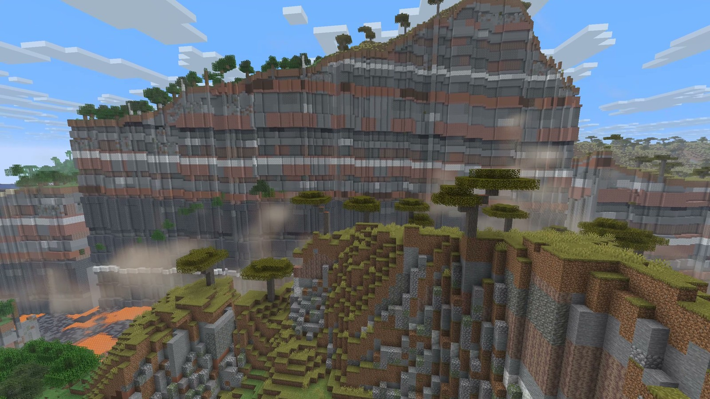
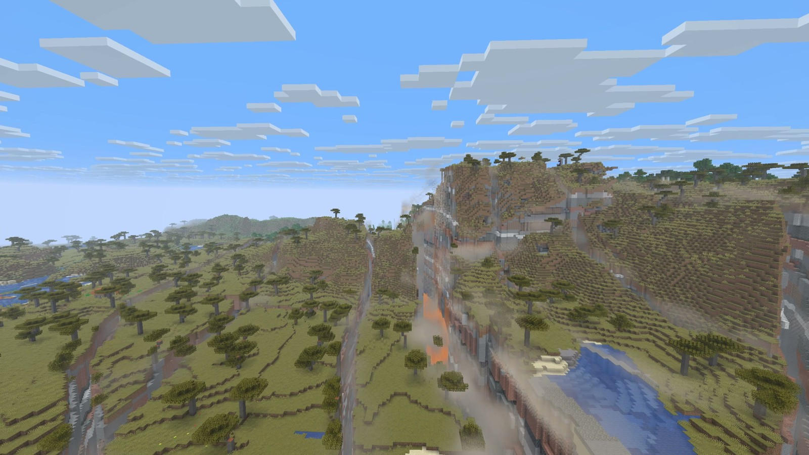
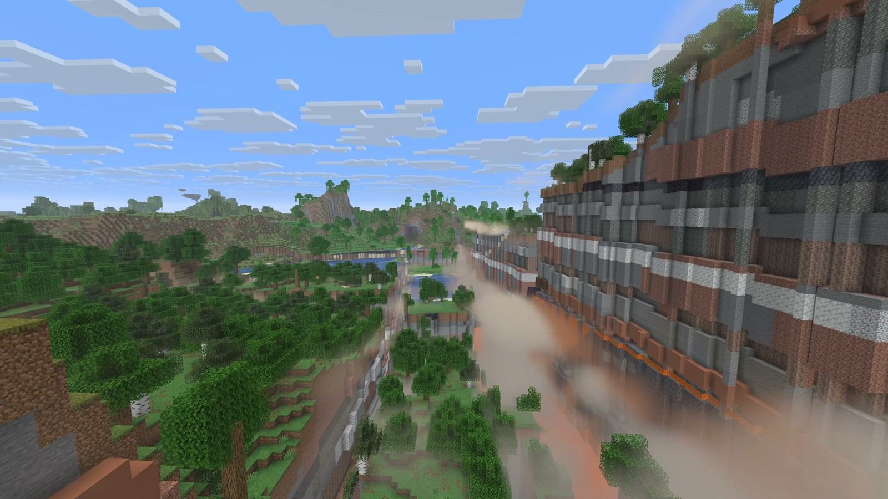
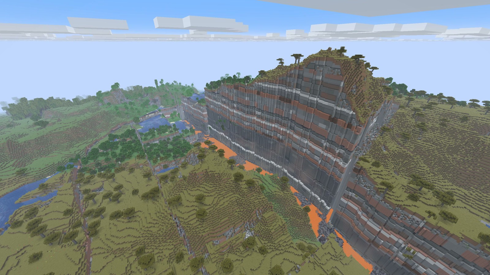
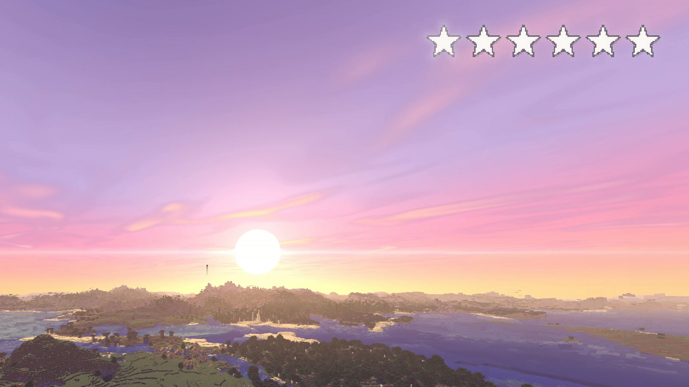
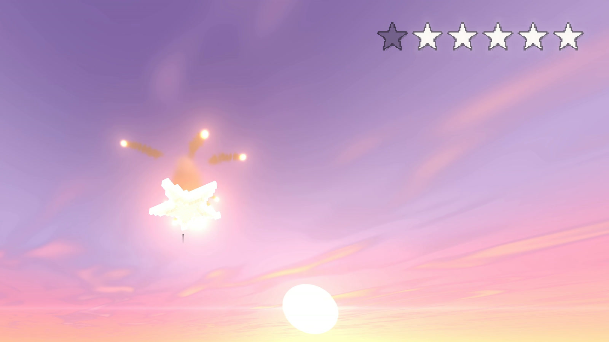
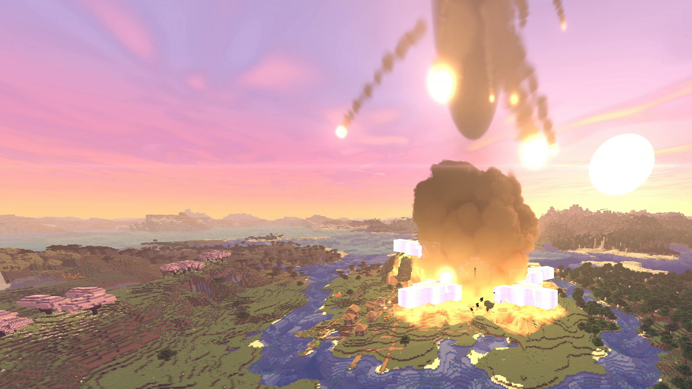
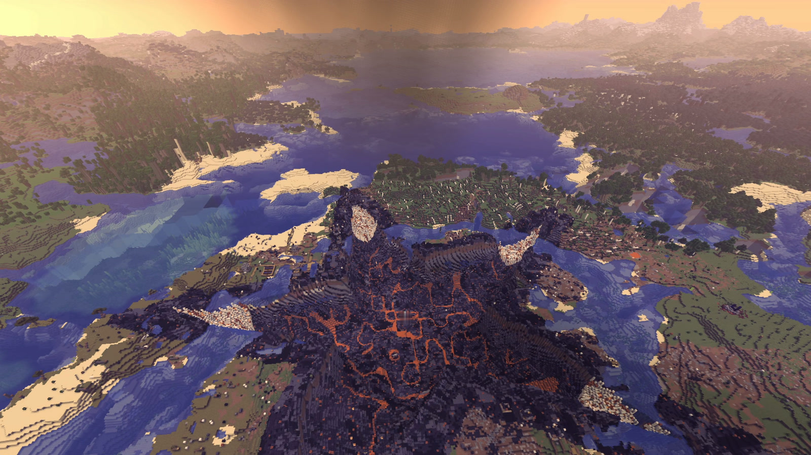

  <picture>
    <source media="(prefers-color-scheme: dark)" srcset="https://github.com/Stink-O/orbital-laser/raw/main/docs/branding/orbital-laser-logo-dark.svg">
    
  </picture>

Two new lasers: **the Earthquake**, where the land splits along a fault through the target and your side is thrust up into a cliff, and **the Six Stars**, where a wanted level climbs to six stars and the last one comes down on the target.

**The Earthquake** has no beam. A blow sounds underfoot and the ground splits open along a fault through the target, the crack racing out both ways and on toward you, a trench of lava opening down it and side cracks running out round the land. Then the land within about 250 blocks of the target lurches: your side of the fault heaves upward in jolts at 6, 8.5, 11 and 13.5 seconds while the far side drops away, trees near you go over, slabs of the low edge break off and topple into the lava, and at 18.5 seconds the climax thrusts your side up into a cliff in one last heave. At 31 seconds it comes to rest moved for real: cliffs of banded rock up to about 90 blocks high over a canyon of lava. Stand on your side as it fires and you ride the land up.

> [!CAUTION]
> **Motion:** the camera jolts at each heave and hard at the climax, and the land you stand on moves under you for about fifteen seconds.

  

  
  

  

**The Six Stars** starts on your screen. A row of six empty stars fades in at the top right and lights one by one, a deep swell for each and one more siren joining far off, while the whole sky turns to a hazy golden-hour sunset and the low sun swells with every star. When the sixth lights, the last star tears out of its slot, crosses the picture still the screen's flat star, and turns into a real one where it will hang: a star of cracked white blocks the size of a hill, high over the target. It falls burning, shedding blocks, its cracks widening, and strikes in a dirty fireball under a column of black smoke. Its five points break off and plough out across the land, and it leaves a five-pointed star burnt into the ground.

> [!CAUTION]
> **Photosensitivity and motion:** the sun flares on each star, the stars flash as they light and as they go, and the impact is a bright flash. They are on by default; `/orbital impactframes off` (or SOFT on the wheel's FLASHES row) softens them. The camera jolts at the impact and its front knocks you back as it reaches you.

  

  
  

  

## New

- **The Earthquake**, on the wheel's fifth page and `/orbital earthquake`, 50 seconds:
  - **the crack:** from under a second the faults are cut open for real as the crack reaches them, the main one a trench up to 20 blocks wide with a lake of lava far down in it, all of it open by 5.5 seconds;
  - **the heave and the lurches:** the land is broken into 21 plates; at 6 seconds your side of the fault heaves up and the far side drops, then lurches again at 8.5, 11 and 13.5 seconds, the plates grinding and shuddering harder from 14;
  - **the climax:** at 18.5 seconds your side is thrust up into a cliff in one heave; slabs of the trench's low edge lean over into the lava as the lurches and the climax hit, and trees near you fall over and stay down as logs;
  - **what it leaves (terrain on):** at 31 seconds the moved land is swapped in on one frame: cliffs of banded rock up to about 90 blocks high along the fault, a canyon at their foot with lava crusted over in rafts, smaller steps along the side faults, scree heaped at the foot of every step, and water that reaches a new edge pouring over it. Nothing is killed;
  - **riding it:** standing on your side of the fault as it fires, you ride your plate up and can walk, jump and fly on it while it moves; anyone else is knocked by the heaves (KNOCKBACK); a survival player on a moving plate gets Resistance V for the strike;
  - **terrain off:** the land moves the same way and settles back where it was by 43 seconds;
  - **the sound:** its own, synthesized: the blow, the crack tearing out and branching, the heaves, grinding rock, rockfalls, falling trees and slabs and water pouring, each heard from where it happens;
  - it reaches 1000 blocks. QUALITY FAST (the default) draws its dust at half size.
- **The Six Stars**, on the wheel's fifth page and `/orbital sixstars`, 58 seconds:
  - **the climb:** from 1.2 seconds the six stars light from the right, about a second apart, each with a deep swell and one more far siren, while the sky turns to a golden-hour sunset, the sun swelling a step with each star and the land shimmering in the heat;
  - **the star leaves the screen:** at 8.2 seconds the last star lit snaps out of its slot, crosses the picture as the screen's flat star and turns into a star of white blocks 150 across, hanging some 520 blocks over the target;
  - **the fall:** at 11.8 seconds it falls, tipping over to land flat, burning, shedding burning blocks, its cracks widening;
  - **the impact:** at 17 seconds it strikes: a dirty fireball and a column of black smoke, a wall of dust flattening the forest, blocks thrown, the camera jolting and the front knocking you back. Its five points break off and plough out over the land for two and a half seconds, each cutting a burning trench;
  - **what it leaves (terrain on):** a five-pointed crater about 340 blocks tip to tip, 40 deep in the middle and its trenches shallower toward their tips, scorched black with lava in its cracks and fires burning in the trenches, the white wreck of each point lying at its trench's end, a black band round the whole star, the trees felled pointing away out to about 225 and rubble strewn out to about 270. Mobs and items within 260 are killed;
  - **the sound:** its own, from the swells and sirens of the climb through the star tearing loose, the fall, the blast by distance and the points ploughing out;
  - it reaches 1000 blocks.

## Known issues

These are the Earthquake's.

- **Shaped blocks on land that moves lose their shape**: stairs, slabs, fences, glass panes and doors are written again in their plain shape, and chests and other blocks that hold items lose what they hold. Fire it away from your builds.
- **It's heavy on the graphics card while the land moves** (6 to 31 seconds): about 18 to 21 ms a frame at 2560x1440 on an RTX 4070 SUPER, because the game draws every loaded section while the land is bent.
- **Don't pause during it for long**: the game's hold on the picture runs on while paused, so a long pause between 10 and 31 seconds can show the half-moved land early.
- **One short stutter** as the moved land is swapped in at 31 seconds.

## Native version

- **Every laser but the Fold and the Earthquake plays natively now.** The Six Stars, the Sky Breaks, the Carpet Bomb, the World Eater (0.5.15) and the
  Convergence (0.5.16) are in the native file, no longer greyed out. Each was played end to end on regular Horizon for
  this release.
- **Built on a newer Horizon (`4626921`) with three fixes I sent upstream**, all merged on 15 November:
  - **The sound keeps going through a heavy strike**
    ([horizon-rust/horizon#15875](https://github.com/horizon-rust/horizon/pull/15875)). When a big strike stalls the
    game, the sound output used to die (until a restart, before 0.5.14's workaround) or cut out and drop what was
    playing. Now it's reopened without stopping the sounds, with a longer buffer so it happens far less.
  - **No more frames hanging on NVIDIA cards on Linux**
    ([horizon-rust/horizon#13885](https://github.com/horizon-rust/horizon/pull/13885)): a frame could get stuck waiting
    on the desktop's compositor and freeze the game.
  - **The Supervolcano no longer drags the world**
    ([horizon-rust/horizon#15878](https://github.com/horizon-rust/horizon/pull/15878)). It keeps about 5,800 chunks
    loaded, and past 4,096 regular Horizon slowed down for that whole minute and left the outer part of its land
    uncarved.
- **The Supervolcano no longer freezes the game.** Newer Horizon makes `/forceload` wait until its chunks are loaded,
  and the Supervolcano asks for a few hundred at once: the game froze for half a minute and the strike gave up. Strikes
  now keep their chunks loaded without the wait, as on the fork.
- **Big strikes no longer leave whole chunks standing.** The Planet Killer, the Supervolcano and other big strikes
  could leave square pillars of untouched land in their craters natively: when the game fell behind during a big
  strike, regular Horizon quietly threw away much of what the mod sent it to do, and land whose chunks weren't loaded
  yet was skipped. Nothing is lost now: when the game is behind, or a chunk is still loading, the land just goes in a
  little later.
- **Sounds sound as they do on the fork.** Regular Horizon plays a stereo sound file straight to your ears, as music
  is played, with no distance and no direction; the fork places every sound in the world. The native file now carries
  those sounds as the fork plays them, so they come from the strike and fade with distance. (It also keeps the file
  under the registry's 64 MiB.)
- **The file has a name that says what it is**: `orbital-laser-native-v0.5.17.hnmod`. The launcher installs it as
  before; a file put in `horizon-native-mods/` by hand can keep this name. Keep only one Orbital Laser file there.

**Still greyed out natively: the Fold and the Earthquake** ("On the fork now, native soon"). The Fold's
water can drop out through its bending of the world on regular Horizon. The Earthquake needs three calls that only the
fork has (the camera drawn from a moving plate, the player put where they are seen, and the warp's data for the falling
trees). Play them on the fork version for now.

**Known on the native version:**

- **It stays on Horizon `4626921` for now.** Newer Horizon (from 16 November) dropped the hooks its world bending and
  screen effects use, so it can't move to a newer Horizon until it's ported to the new mod API. The launcher builds it
  on that commit as usual. A port is coming.
- **A laser's first strike in a session can hitch** for a second or two (the Downfall about 8, the Sky Breaks about 12)
  if you fire it straight after picking it: its effects are still being prepared. Pick it, wait a few seconds, fire.
  The World Eater's are the biggest: the very first time on a computer the game can freeze for about half a minute as
  it fires; after that the graphics driver keeps them and it's a second or two.

To install it: on the launcher's **Mods** page install or update Orbital Laser (or put the `.hnmod` file below in the
instance's `horizon-native-mods/` folder), pick **Release build** on the Native build row, press **Build** and choose
**I trust these mods: build**. `INSTALL.md` has what each system needs and the known issues.

**No Windows test build this time:** it would need the new fork release built for Windows. 0.5.16's `orbital-laser-windows-test.zip` still works, without the two new lasers.

## Install

1. **Get the Orbital Laser build of Horizon, `orbital-mod-api-13` or newer**, from [Stink-O/horizon releases](https://github.com/Stink-O/horizon/releases). This release needs the new fork release: `orbital-mod-api-12` won't start the mod.
2. Download **orbital-laser-v0.5.17.zip** below, unzip it, and with the game closed run `python3 install.py`.
3. Run `./play.sh` (a creative test world) or `./play.sh MyWorld`.
4. In the game, type `/orbital give`. Hold the Designator and press **R** for the laser wheel, and hold right-click with it on a target to fire.

**Want an AI agent to do it?** Paste the prompt from the [README](https://github.com/Stink-O/orbital-laser#set-it-up-with-an-ai-agent) into your coding agent.

> [!WARNING]
> **Strikes with terrain damage on are permanent.** The Earthquake moves the land within about 250 blocks of the target for good, raising cliffs up to about 90 blocks high and opening a lava canyon. The Six Stars burns a star about 340 blocks tip to tip into the land, 40 deep in the middle, flattens the land and fells the trees out to about 225 and strews rubble out to about 270. Only fire them in a throwaway world, or switch terrain damage off with `/orbital terrain off` (or the wheel's centre).

## Assets

| file | what |
|---|---|
| `orbital-laser-v0.5.17.zip` | **the mod (`orbital/`), `install.py` and `play.sh`**: unzip and run `python3 install.py`; needs the Orbital Laser build of Horizon, `orbital-mod-api-13` or newer |
| `orbital-laser-native-v0.5.17.hnmod` | **the native mod for regular Horizon**, 0.5.17 (the Fold and the Earthquake greyed out for now): its code and its content in one file; goes in the instance's `horizon-native-mods/` |
| `INSTALL.md` | the native install guide: what each system needs, known issues, how to remove it |
| `SHA256SUMS` | the files' checksums |
| Source code (zip / tar.gz) | the whole repository: the mod's source, the native build's source in `native/`, and the tools |

> [!IMPORTANT]
> **Nothing from Minecraft is included.** This is an independent fan project, not affiliated with Mojang, Microsoft or Horizon's author. It runs on top of Horizon and needs your own copy of the game.
