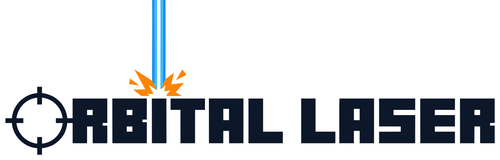
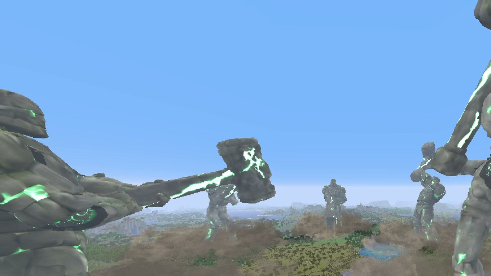
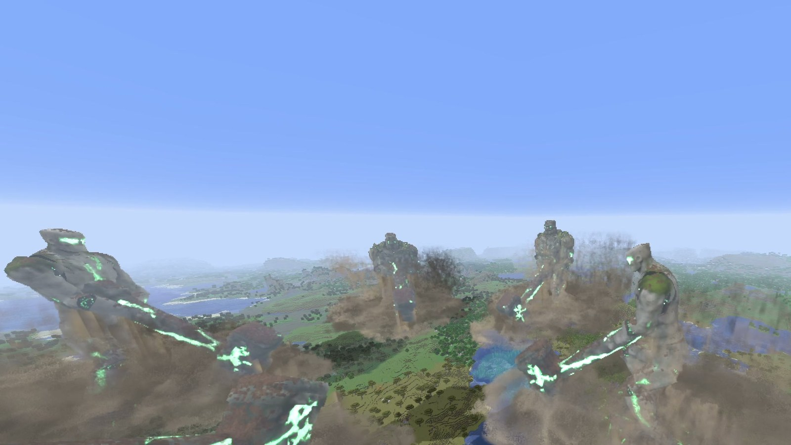
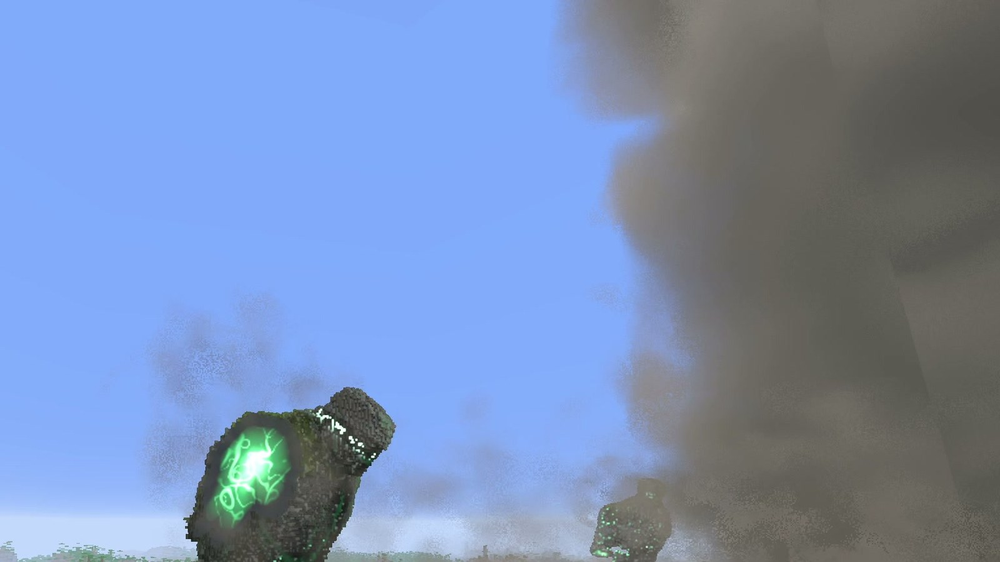
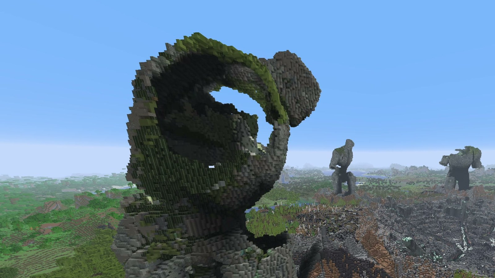

  <picture>
    <source media="(prefers-color-scheme: dark)" srcset="https://github.com/Stink-O/orbital-laser/raw/main/docs/branding/orbital-laser-logo-dark.svg">
    
  </picture>

A new laser, **the Colossi**, a fix for the Earthquake, and a note on the native version.

**The Colossi.** Five stone giants about 220 blocks tall heave themselves out of the earth in a ring 300 blocks round
the target, tearing the land up round their feet. Each stamps a foot down, hauls its hammer up over its shoulder and
slams it into the ground in front of it, one after another, then all five together. Green cracks run from the blows to
the middle and meet, and the land bursts in a crown of earth round a column of dark smoke some 500 blocks high while a
wall of dust races out past the giants. Light runs back up each hammer into the arms holding it and they burst into
flying rock; the giants sink onto one knee and a glowing line sweeps down each, turning it into real blocks. It leaves
five kneeling statues round a terraced crater about 317 blocks across, split by glowing green fissures, the hammers'
wrecks lying in it, the trees felled round it and every mob within 470 blocks killed. It's on the wheel's fifth page and
`/orbital colossi`. It isn't in the native version.

The giants and their hammer were made in [Tripo](https://www.tripo3d.ai) from four pictures each, and turned into
Minecraft blocks with [model2mc](https://github.com/Stink-O/model2mc), a free converter I wrote for it. This laser was
sponsored by Tripo.

  

  
  

  

> [!CAUTION]
> **Photosensitivity:** as the land bursts, the Colossi play half a second of hard cuts between black, white and pale
> green (impact frames), and a white flash. `/orbital impactframes off`, or SOFT on the wheel's FLASHES row, leaves out
> the impact frames and holds the flash down.

**The Earthquake over water.** Where its fault ran through water, the slabs breaking off the low edge took the water and the seabed with them as they tipped, drawn as stretched blue and black sheets. The slabs' land is checked as the strike fires now, and only slabs standing dry break away.

**The native version is off for now.** Horizon's launcher moved to a new mod format on 18 November and no longer installs `.hnmod` mods, so Orbital Laser isn't on its Mods page any more. This release has no native file. The last one, `orbital-laser-native-v0.5.17.hnmod`, stays on the [0.5.17 release](https://github.com/Stink-O/orbital-laser/releases/tag/v0.5.17) for Horizon builds from before the change. Play the fork version below.

## Install

1. **Get the Orbital Laser build of Horizon, `orbital-mod-api-13` or newer**, from [Stink-O/horizon releases](https://github.com/Stink-O/horizon/releases). Already on it for 0.5.17? Nothing to change.
2. Download **orbital-laser-v0.5.18.zip** below, unzip it, and with the game closed run `python3 install.py`.
3. Run `./play.sh` (a creative test world) or `./play.sh MyWorld`.
4. In the game, type `/orbital give`. Hold the Designator and press **R** for the laser wheel, and hold right-click with it on a target to fire.

**Want an AI agent to do it?** Paste the prompt from the [README](https://github.com/Stink-O/orbital-laser#set-it-up-with-an-ai-agent) into your coding agent.

> [!WARNING]
> **Strikes with terrain damage on are permanent.** Only fire them in a throwaway world, or switch terrain damage off with `/orbital terrain off` (or the wheel's centre).

## Assets

| file | what |
|---|---|
| `orbital-laser-v0.5.18.zip` | **the mod (`orbital/`), `install.py` and `play.sh`**: unzip and run `python3 install.py`; needs the Orbital Laser build of Horizon, `orbital-mod-api-13` or newer |
| `SHA256SUMS` | the file's checksum |
| Source code (zip / tar.gz) | the whole repository: the mod's source, the native build's source in `native/`, and the tools |

> [!IMPORTANT]
> **Nothing from Minecraft is included.** This is an independent fan project, not affiliated with Mojang, Microsoft or Horizon's author. It runs on top of Horizon and needs your own copy of the game.
