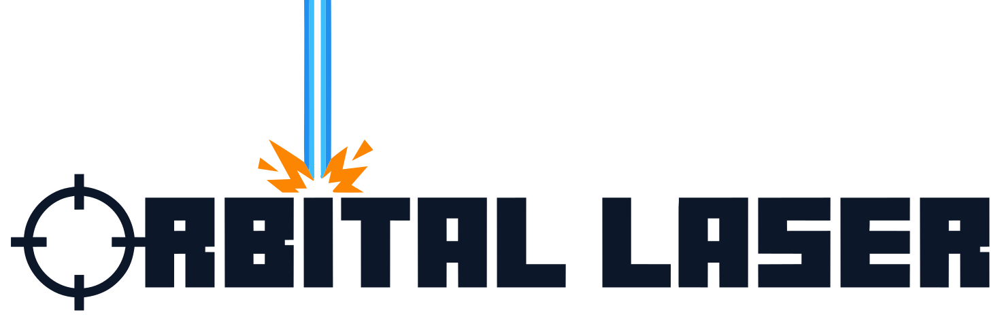
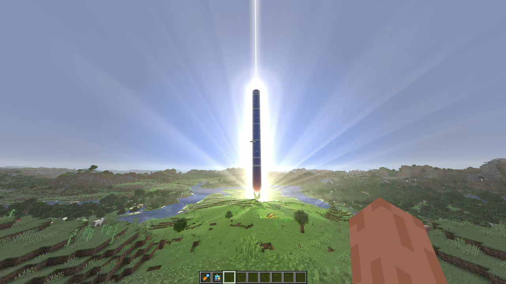
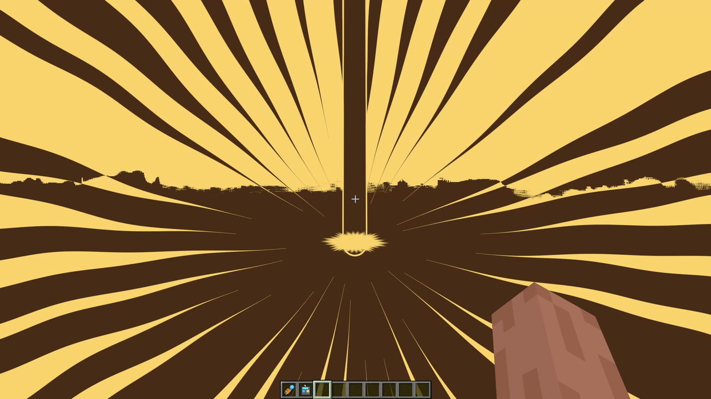
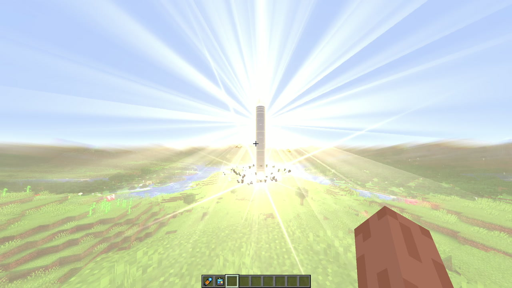
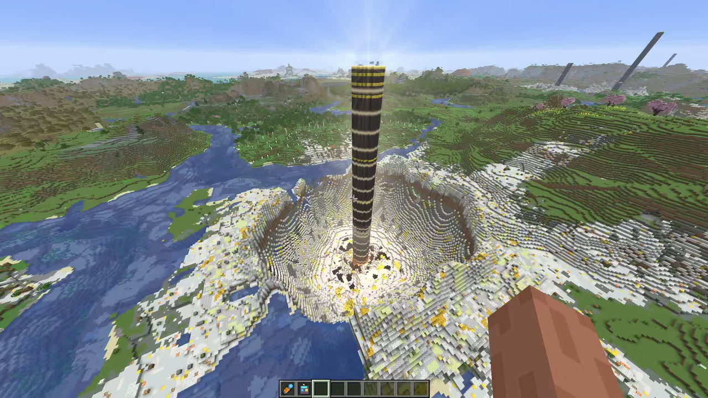

  <picture>
    <source media="(prefers-color-scheme: dark)" srcset="https://github.com/Stink-O/orbital-laser/raw/main/docs/branding/orbital-laser-logo-dark.svg">
    
  </picture>

A twelfth laser: the **Rod from God**. A rod of dark forged metal dropped from orbit, with no explosive. It comes straight down onto the target as a golden-white star, makes a last hard burst of speed and slams in. The picture holds on the hit for a moment of impact frames, then lets go into the burst. When the dust clears the rod is still there, standing 130 blocks over the floor of a crater lined with quartz, calcite and gold.

> [!CAUTION]
> **Photosensitivity:** the Rod's impact frames are about a fifth of a second of hard full-screen cuts between light and dark, and they are on by default. Turn them off with `/orbital impactframes off` or OFF on the wheel's IMPACT FX row (shown while the Rod is loaded or pointed at). The Supercell's finale is a rapid run of lightning flashes, and other strikes have bright flashes of their own (lightning, blasts).

  

  
  

  

## New

- **Rod from God**, on the wheel's third page and `/orbital rod`:
  - **the fall:** a golden-white star high over the target with god rays streaming from it and a column of light down its path. It comes straight down, faster and faster, and over its last half second it puts on a hard burst of speed. For its last moments you see the rod itself, its nose white-hot;
  - **the impact frames:** the picture holds on the hit while a few hard cuts play over it, then lets go with a blur. There are three looks: **KANADA** (the default: black silhouettes and thick lines rushing into the point, a close-up in negative, gold and umber), **BLACK FLASH** (black lightning in a red glow) and **CINEMATIC** (a white-out with the rod burned into it and a shockwave ring tearing across the frame). Pick one on the wheel's **IMPACT FX** row or with `/orbital impactframes kanada|blackflash|cinematic|off`;
  - **the burst:** a white-gold flash with rays fanning out, the land rippling in rings, a jet of molten rock up its path, a fountain of rock thrown up round it and a ring of dust racing out over the land;
  - **the sound:** a sung chord out of the sky as it falls, cut dead on the impact, then the ground's thump, a hard crack and a deep boom with a metal clang in it, arriving late with the distance. Afterwards the rod hums as it cools;
  - **the feel:** the shockwave knocks you back and the camera and picture jolt hard;
  - **the land:** the crater is dug out first and then lined in quartz, calcite and gold, about 120 blocks across and 50 deep. The rod stays standing in the middle: 13 blocks thick and 171 long, 130 of it over the crater floor and its top 80 over the land, with the floor round its foot heaved up in broken slabs. Trees are felled out to about 200 and rubble lies in rays out to about 250. It works on far-off targets in the distant terrain, as the Nuke does;
  - the strike lasts 60 seconds.
- **Tools for filming:**
  - **a follow camera** that orbits the Nuke's or the Payload's bomb as it comes in, your mouse setting the angle, then backs off, circles the fireball and the cloud, and puts you back where you stood. `/orbital follow on|off`, `/orbital follow distance N` (10 to 400 blocks), or the wheel's FOLLOW switch;
  - **a knockback switch** for the Nuke and the Rod (`/orbital knockback on|off`, the wheel's KNOCKBACK). The camera still jolts with it off;
  - **a seed** for repeat takes: the wheel's SEED field shows the last strike's seed or takes one you type, and LOCK SEED holds it, so the next strike plays out the same way. `/orbital seed N|lock|random` does the same;
  - **`tools/world_snapshot.py`** saves a world and puts it back (`save`, `restore`, or `reset` to do it from the running game), so you can strike the same land again.
- **The wheel rearranged.** The strike options run down the left: SEED and LOCK SEED, then KNOCKBACK and FOLLOW for the lasers they apply to. MESSAGES, PANEL and QUALITY run down the right, with a red STOP STRIKE under them while a strike is under way. The IMPACT FX and BLAST SOUND rows sit under the ring.
- A thirteenth laser, the **Supercell**, is on the third page too (`/orbital supercell`).

## Fixes

- The follow camera never moves you faster than 24 blocks a tick, so the game's collision check can't run out of time and crash.
- `/orbital`'s list of commands names the impact frame looks and the new commands.
- **macOS: a saved laser can no longer crash the game every time it starts** ([#3](https://github.com/Stink-O/orbital-laser/issues/3)). On Apple Silicon, Metal's shader compiler can crash the game building the Downfall's effects (and the Nuke's, at startup). The mod no longer hands the game any laser's effects as it starts: it builds the loaded laser's a few seconds into play, and others only when you load them. If the game closes while it is building them, the next start loads the Plasma instead and says so in chat. The Downfall itself still crashes on those Macs until the fork's next release (`orbital-mod-api-9`), which skips a pass it can't build instead.
- **`play.sh` says what's wrong instead of stopping silently** ([#7](https://github.com/Stink-O/orbital-laser/issues/7)). When it can't find the Orbital Laser build of Horizon it used to exit without a word; now it says what's missing and where to download the build, and it checks that the build it found is the fork's (stock Horizon, or a build made without `--features mods`, can't run the mod). Started without a terminal, it shows the message in a dialog where it can and writes it to `play-error.txt`.
- **The README covers the setup snags people hit:** the *capability world is for server mods* message (that's stock Horizon: start the game with `play.sh`), building the fork from source with `--features mods` ([#2](https://github.com/Stink-O/orbital-laser/issues/2)), and copying upstream Horizon's `research-lock.json` when `horizon-prepare` rejects Mojang's republished 26.3 files.
- The Rod from God's blurb on the wheel describes the Rod as it is now.

## Install

1. **Get the Orbital Laser build of Horizon, `orbital-mod-api-8` or newer.** It is the same build 0.5.6 needed, so if you have it already, keep it. Otherwise download `horizon-orbital-linux-x86_64.tar.gz` from [Stink-O/horizon releases](https://github.com/Stink-O/horizon/releases) and unpack it to `~/horizon-orbital`. Prepare its resources once from your own Minecraft 26.3 (`./horizon-prepare --prepare --server-jar PATH/TO/server.jar`), or point `HORIZON_RESOURCES` at the prepared resources of a Horizon you already have. **The mod won't start on `orbital-mod-api-7` or older.**
2. Download **orbital-laser-v0.5.7.zip** below, unzip it, and with the game closed run `python3 install.py`.
3. Run `./play.sh` (a creative test world) or `./play.sh MyWorld`.
4. In the game, type `/orbital give`. Press **R** (or right-click the Orbital Remote) for the laser wheel, and hold right-click with the Designator on a target to fire. The Rod from God is on the wheel's third page.

**Want an AI agent to do it?** Paste the prompt from the [README](https://github.com/Stink-O/orbital-laser#set-it-up-with-an-ai-agent) into your coding agent.

> [!WARNING]
> **The Rod from God is permanent.** It digs a crater about 120 blocks across and 50 deep, leaves the rod standing in it, flattens everything standing out to about 200 and kills every mob within 200. Only fire it in a throwaway world, or switch terrain damage off on the wheel.

> [!WARNING]
> **Early and experimental.** Developed and tested on one Linux PC (Fedora, NVIDIA). Reported working on Windows 11 by a user (the fork built from source, with `--features mods`). On macOS (Apple Silicon) the Downfall crashes the game (see the README's Known gaps). The ready-built Horizon is Linux x86-64 only.

## Assets

| file | what |
|---|---|
| `orbital-laser-v0.5.7.zip` | **the mod (`orbital/`), `install.py` and `play.sh`**: unzip and run `python3 install.py`; needs the Orbital Laser build of Horizon, `orbital-mod-api-8` or newer |
| Source code (zip / tar.gz) | the whole repository: the mod's source, the 0.1 setup for stock Horizon, and the tools |

> [!IMPORTANT]
> **Nothing from Minecraft is included.** This is an independent fan project, not affiliated with Mojang, Microsoft or Horizon's author. It runs on top of Horizon and needs your own copy of the game.
