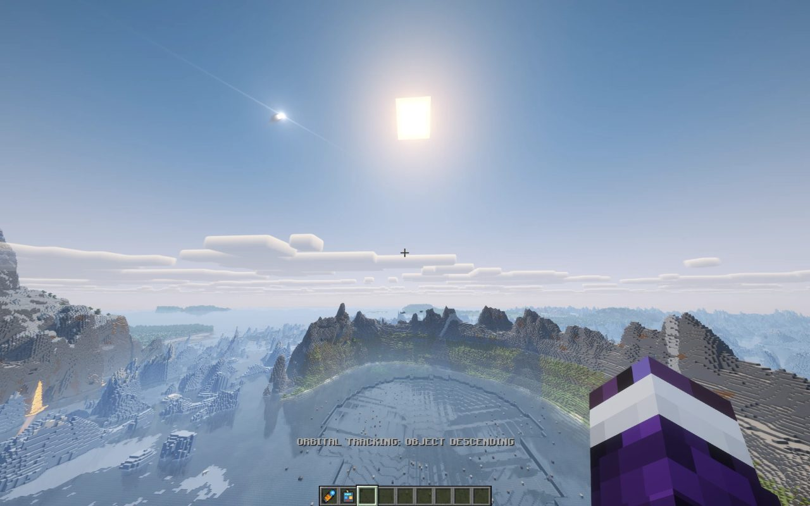
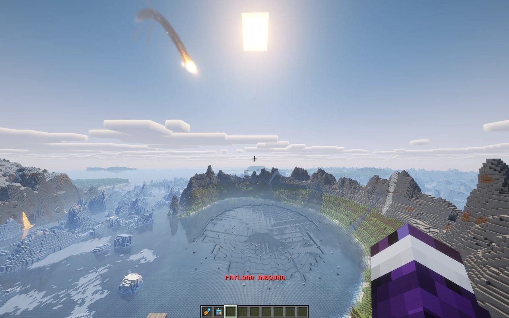
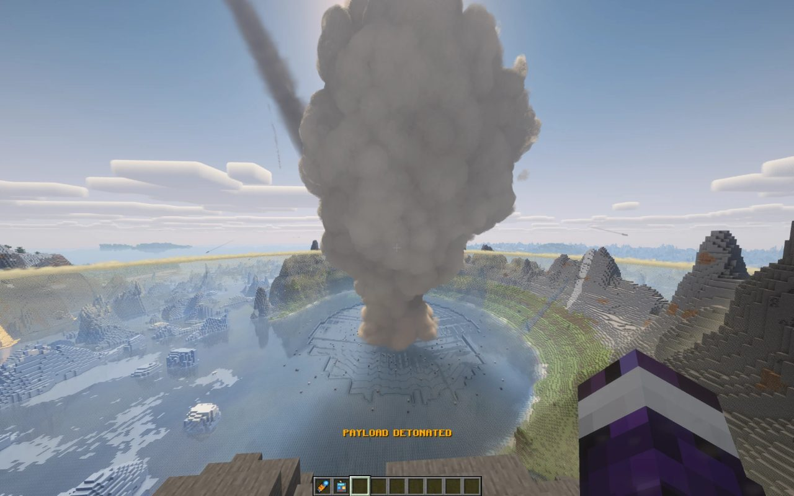
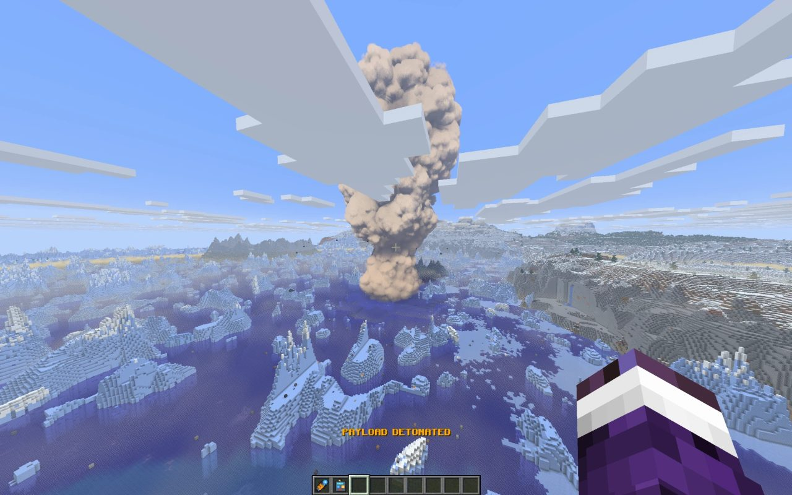

# Orbital Laser: Fabric version

Call down an **orbital laser strike** in Minecraft. Pick a laser from a menu, hold the Designator on a target, and a strike
comes down from orbit: a beam, a crater, a mushroom cloud, a shockwave. This is the **Fabric** version of
[Orbital Laser](https://github.com/Stink-O/orbital-laser) by Stink-O.

> **Strikes destroy the land for good.** Always try it in a brand new test world. Terrain damage starts **off**, so your
> first strikes are only light and sound.

## Screenshots

Minecraft 26.3 on Fabric, with the Tectonic terrain mod, Sodium, Voxy and the Complementary Reimagined shader pack (Iris).
Click a picture to see it full size.

| | |
|:---:|:---:|
| [](docs/1-tracking.jpg)<br>**1. Tracking:** the object appears | [](docs/2-inbound.jpg)<br>**2. Inbound:** the payload falls |
| [](docs/3-impact-shaders.jpg)<br>**3. Impact,** with a shader pack | [](docs/4-impact-vanilla.jpg)<br>**4. Impact,** without shaders |

## What you need

| | Version |
|---|---|
| **Minecraft: Java Edition** | **26.3** |
| **Mod loader: Fabric Loader** | **0.20.1** or newer (this is *Fabric* only, not Forge, NeoForge or Quilt) |
| **Required mod: Fabric API** | **0.165.0+26.3** (or a newer build made for Minecraft 26.3) |
| Java | 25. The Minecraft launcher installs it for you; you only need it yourself to build from source |

## Download and play

1. **Install Minecraft Java Edition 26.3** with the official launcher, and start it once so it downloads the game.
2. **Install Fabric.** Download the installer from <https://fabricmc.net/use/installer/>, open it, choose **Minecraft version
   26.3**, and click **Install**. It adds a **Fabric** profile to your launcher.
3. **Download Fabric API** from <https://modrinth.com/mod/fabric-api>. Choose the file for **Minecraft 26.3** (version
   `0.165.0+26.3`).
4. **Download Orbital Laser:** the file `orbital-laser-0.1.0.jar` from the
   [Releases page](https://github.com/Stink-O/orbital-laser/releases). If there is no release there yet, build the jar
   yourself with the short steps under **Build it yourself** below.
5. **Put both `.jar` files in your `mods` folder.** Press `Windows key + R`, type `%appdata%\.minecraft\mods`, and press Enter.
   (If there is no `mods` folder, make one.) On Mac or Linux it is `.minecraft/mods` in your home folder.
6. **Start the launcher, pick the Fabric profile, and play.** If you use another launcher (Prism, ATLauncher and so on),
   make a Fabric 26.3 instance and drop both jars in its `mods` folder.

Do not put the file ending in `-sources.jar` in `mods`: that one is only the source code.

## Your first strike (safe test)

1. Make a **new Creative world** and turn **Allow Cheats: ON**. Do not use a world you care about.
2. Press **T** and type `/orbital give`. You get the **Designator** and the **Remote**.
3. Press **R** (or right-click with the Remote) to open the laser menu, and click a laser, for example **Plasma**.
4. Hold the Designator, aim at the ground, and **hold right-click for about half a second**. A strike comes down.
5. When you want the real thing, type `/orbital terrain on`. It **permanently** digs craters and flattens land.
6. `/orbital stop` ends every strike at once and clears its smoke, sounds and effects.

You can fire as many strikes as you like, at once. You can also aim at far-away land (for example terrain drawn by a
distance mod such as Voxy); the strike's sounds then arrive late and quiet, from its direction.

## All the commands

`/orbital give`, `/orbital terrain on|off`, `/orbital stop`, `/orbital wheel` (opens the menu), one command per laser
(`plasma`, `godly`, `blackhole`, `meteor`, `mothership`, `payload`, `nuke`), `/orbital payloadsound main|alt` and
`/orbital nukesound main|alt` (the alternative blast sounds), `/orbital flyspeed N|reset`, `/orbital messages on|off`,
`/orbital skip SECONDS` (jump a strike ahead, terrain damage off only). Rebind **R** under *Options, Controls, Key Binds*.

## Works with

Tested together with Sodium, **Iris shader packs** (Complementary Reimagined), Voxy and the Tectonic terrain mod, on
Windows with an NVIDIA graphics card. The effects are drawn after the shader pack, so they show with shaders on.
**Not tried:** Distant Horizons, Linux, macOS, AMD or Intel graphics, and multiplayer.

## What is finished

| | Look (screen effects) | World changes and sounds |
|---|---|---|
| Plasma, Godly, Black Hole, Meteor Storm, Mothership | the original's shaders, working | closely follow the original |
| Payload, Nuke | the original's shaders, working | simplified |
| Downfall, Planet Killer, Crystal Bloom, Sinkhole | **not done yet** (simple stand-in effects) | simplified |

The menu lists only the lasers whose looks are finished. The other four still answer to their commands
(`/orbital downfall`, `planetkiller`, `crystalbloom`, `sinkhole`). Not done yet: the Nuke's knockback, `/orbital shadow`,
and the original's lower-quality "fast" mode for the Payload and Nuke.

## Something wrong?

- **The game says a mod is missing (fabric-api):** install Fabric API (step 3).
- **The game won't start:** check the table above. Everything must be for **Minecraft 26.3**.
- **`/orbital` does nothing:** cheats must be on in that world.
- **A strike doesn't fire:** hold right-click for about half a second, and aim at land, not the sky.
- **No effects with a shader pack:** this should work. If it doesn't, please report it and include `logs/latest.log`.

## Build it yourself

For developers. You need **Java 25**.

```sh
cd java
./gradlew build          # on Windows: gradlew.bat build
```

The mod is `java/build/libs/orbital-laser-0.1.0.jar` (put that one in `mods`). The first build downloads Minecraft's build
files, Fabric Loader and Fabric API by itself; none of them is in this repository.

The strike plans are in `src/main/java/dev/orbital`, and the client (menu, screen effects) in `src/client/java/dev/orbital/client`.
The `.fsh` shaders are **generated** from the original's WGSL shaders; see [tools/README.md](tools/README.md) to regenerate them.

## Licence and credit

Copyright (c) 2026 Ramingen, MIT License. This is a port of Orbital Laser by Stink-O (also MIT, Copyright (c) 2026 Stink-O),
and the licence requires the original's copyright notice to stay: see [LICENSE](LICENSE) and [NOTICE](NOTICE).
An independent fan project, not affiliated with Mojang or Microsoft. Nothing from Minecraft is included.
